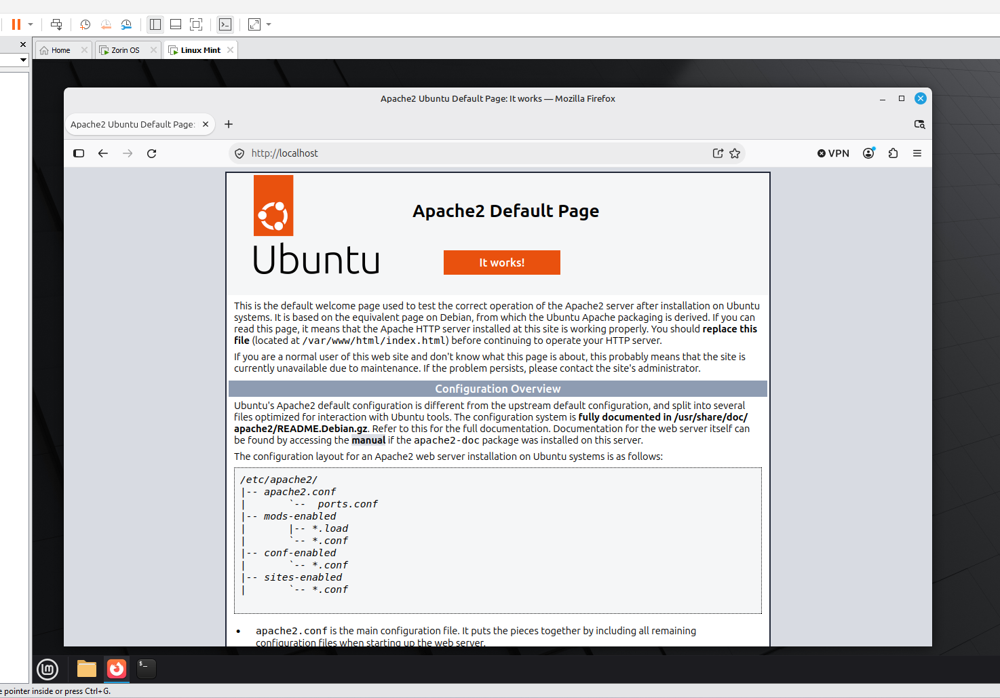
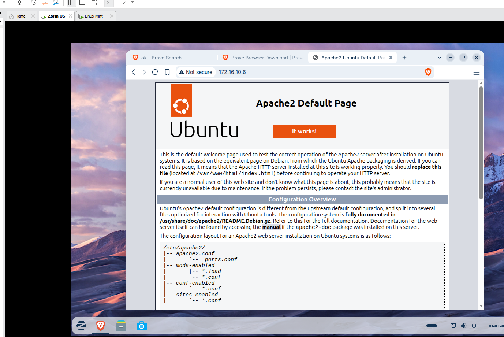
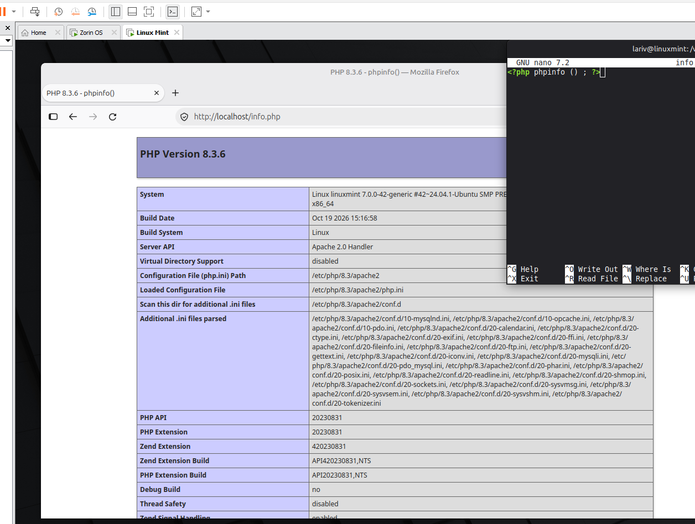
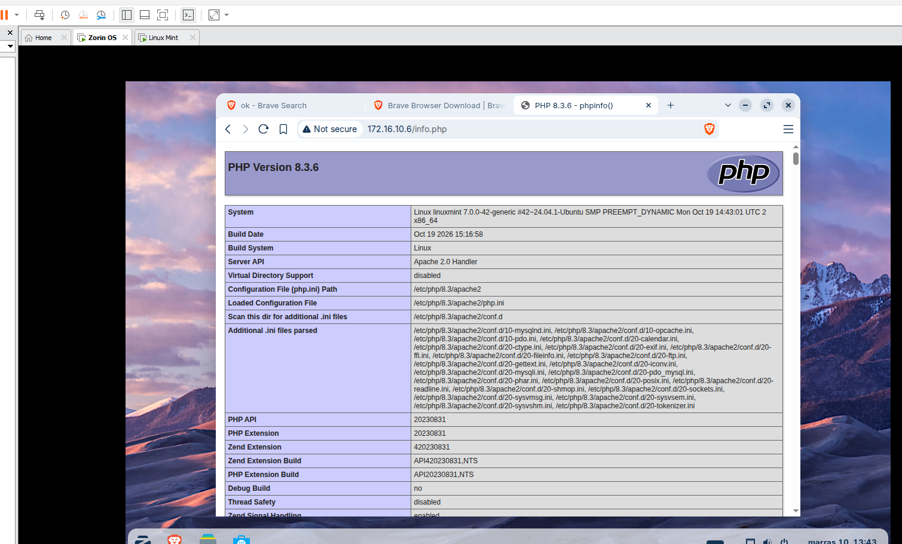

# Web server with Apache, MariaDB and PHP on Linux Mint

Installing a web server (Apache with MariaDB and PHP, a LAMP stack) on a Linux Mint virtual machine from the command line. The web server is tested locally on the Linux Mint machine and from a second virtual machine running Zorin OS.

## Procedure

### 1. Check that the network connection works

Check the connection, for example with `ping`:

```bash
ping -c 4 8.8.8.8
```

### 2. Update the package list

```bash
sudo apt-get update
```

### 3. Install Apache

```bash
sudo apt-get install apache2
```

### 4. Start the Apache service

```bash
sudo service apache2 start
```

### 5. Check the installation and start in a browser

Open `http://localhost/` in a browser on the Linux Mint machine. The Apache2 default page ("It works!") is shown.



### 6. Test from another machine

On the second virtual machine (Zorin OS), open the IP address of the Linux Mint machine in a browser. The same default page is shown (`172.16.10.6`).



### 7. Install MariaDB

```bash
sudo apt-get install mariadb-server mariadb-client
```

### 8. Install PHP

```bash
sudo apt-get install php php-mysql
```

### 9. Restart Apache

```bash
sudo service apache2 restart
```

### 10. Create the info.php page

1. Go to the web root of Apache:

```bash
cd /var/www/html/
```

2. Open Nano with `sudo`, which creates the file:

```bash
sudo nano info.php
```

3. Save the following text in the file:

```php
<?php phpinfo () ; ?>
```

### 11. Check info.php locally

Open `http://localhost/info.php` in a browser on the Linux Mint machine. The PHP information page (PHP Version 8.3.6) is shown. The terminal on the right shows the file in Nano.



### 12. Check info.php from another machine

Open `http://<IP address>/info.php` in a browser on the Zorin OS machine (`172.16.10.6/info.php`). The same PHP information page is shown, so PHP works through Apache also for the network clients.


