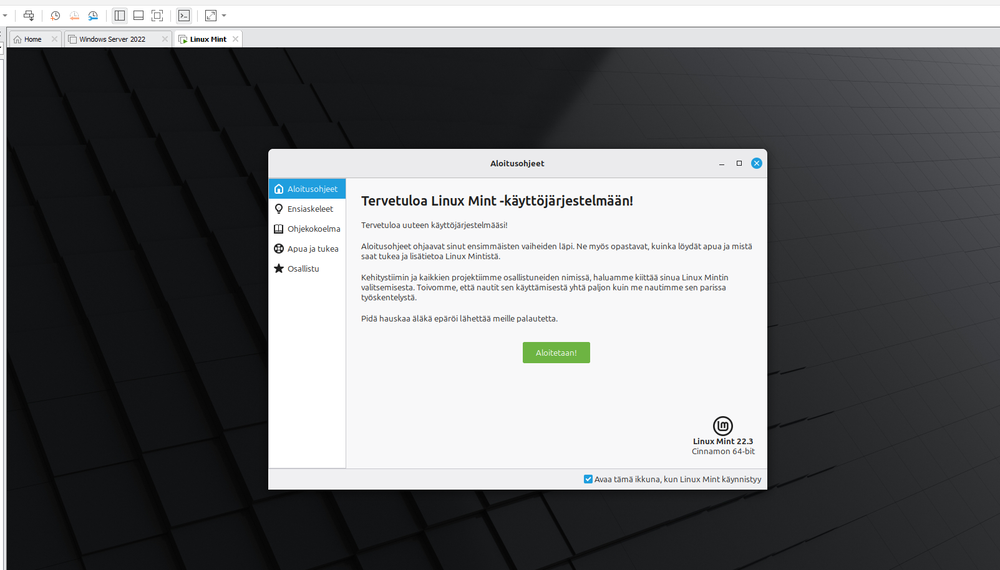
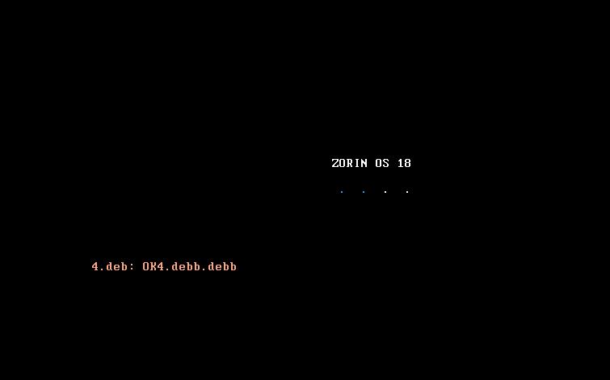
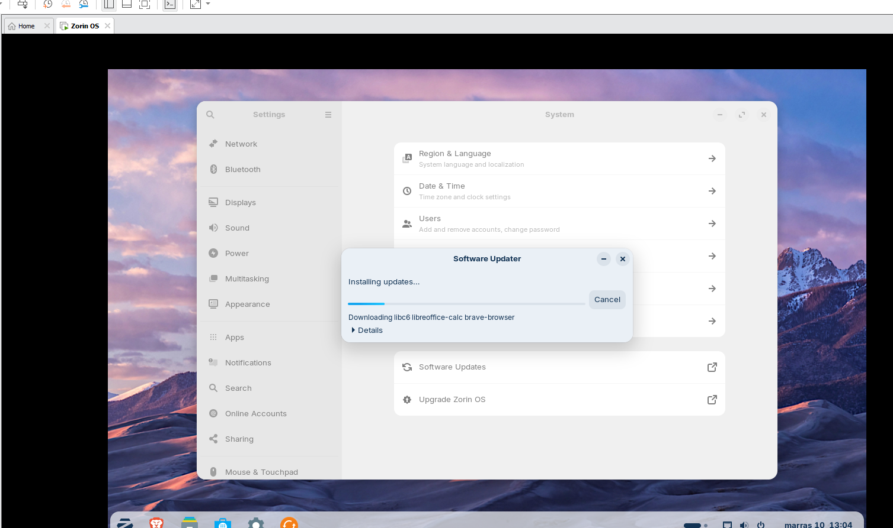
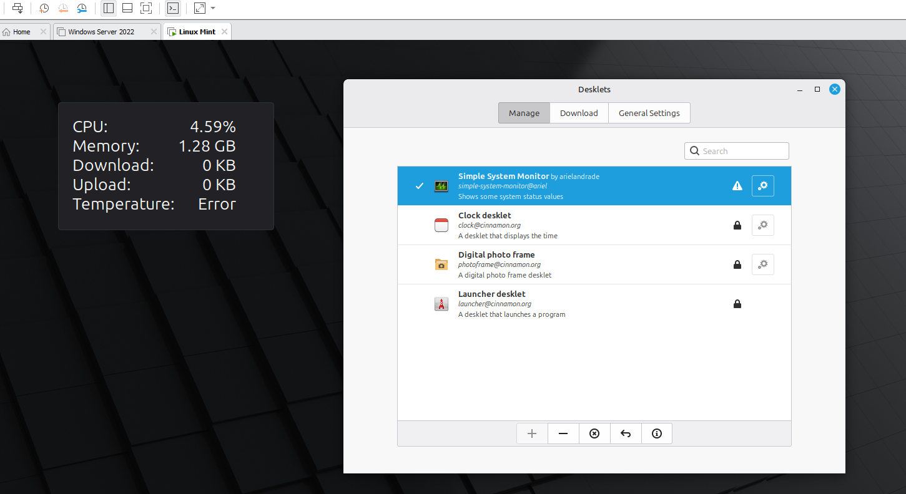

# Linux Mint and Zorin OS in a virtual machine

Installing two Linux distributions in VMware virtual machines, comparing their installation and desktop environments, and exploring the system settings of the Linux Mint machine.

## 1. Install two Linux distributions

1. **Linux Mint** (beginner friendly), version 22.3 Cinnamon 64-bit
2. **A distribution of choice:** Zorin OS (version 18)

*The Welcome screen of the newly installed Linux Mint 22.3 Cinnamon.*

*The Zorin OS 18 boot screen.*

*Zorin OS after installation: Settings and the Software Updater installing updates.*

## 2. Differences in the installation

The installation process of both operating systems was very similar, because both are based on Ubuntu. Starting the installation was slightly more straightforward in Zorin OS, because the installer was offered right after the boot. In Linux Mint the installation had to be started from the icon on the desktop. Otherwise the installation steps were almost identical.

## 3. Concrete differences between the distributions

Zorin OS uses the GNOME desktop environment, while the default desktop of Linux Mint is Cinnamon. Zorin OS looks more like Windows. Linux Mint is a clearer and more user-friendly environment. The difference is visible especially in the start menu, the taskbar and the general appearance of the system.

## 4. Explore the system settings of the Mint machine

### 4.1 Enable "Simple System Monitor"

The desklet is enabled from the system settings: **Desklets > Manage**. In the Manage tab, **Simple System Monitor** is selected and added to the desktop. The desklet shows the CPU usage, memory usage, download and upload traffic and the temperature in the top left corner of the desktop.

*The Desklets window with Simple System Monitor enabled, and the monitor shown on the desktop.*
