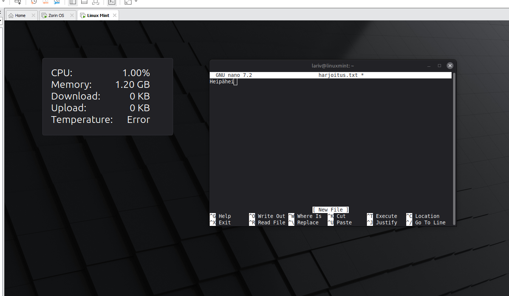
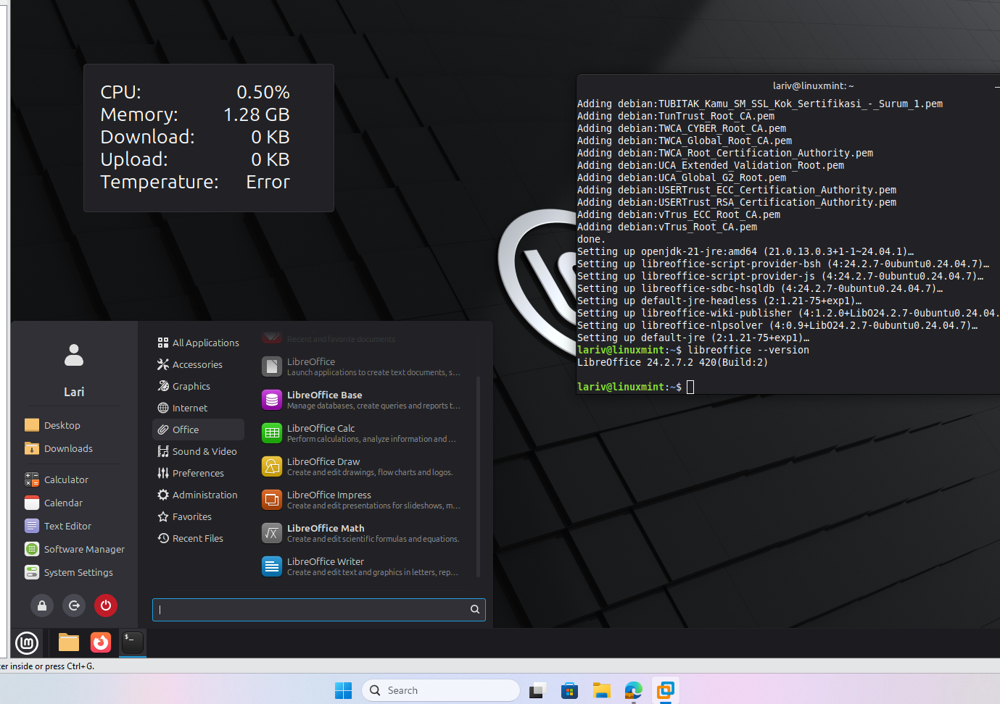

# Installing utilities on Linux Mint

Installing the Nano text editor and LibreOffice on a Linux Mint virtual machine, and using Nano to create, save and edit a text file.

## 1. Install the Nano editor

Nano is installed from the package manager in the terminal:

```bash
sudo apt update
sudo apt install nano
```

The installed version can be checked with `nano --version`. The editor in this exercise is GNU nano 7.2.

## 2. Create a text file with Nano

1. Open the file in Nano. If the file does not exist, Nano creates a new one:

```bash
nano harjoitus.txt
```

2. Type the content of the file. In this exercise the text is `Heipähei`.
3. Save the file with **Ctrl + O** and confirm the file name with **Enter**.
4. Edit the text in the file and save it again with **Ctrl + O** and **Enter**.
5. Exit Nano with **Ctrl + X**.



*GNU nano 7.2 editing the new file `harjoitus.txt` in the terminal of the Linux Mint machine.*

## 3. Install LibreOffice

LibreOffice is installed from the package manager in the terminal:

```bash
sudo apt install libreoffice
```

After the installation the version is checked with:

```bash
libreoffice --version
```

The output is `LibreOffice 24.2.7.2 420(Build:2)`. The start menu of Linux Mint lists the LibreOffice applications in the **Office** category: Base, Calc, Draw, Impress, Math and Writer.



*The terminal shows the end of the installation and the version of LibreOffice. The start menu shows the installed LibreOffice applications.*
