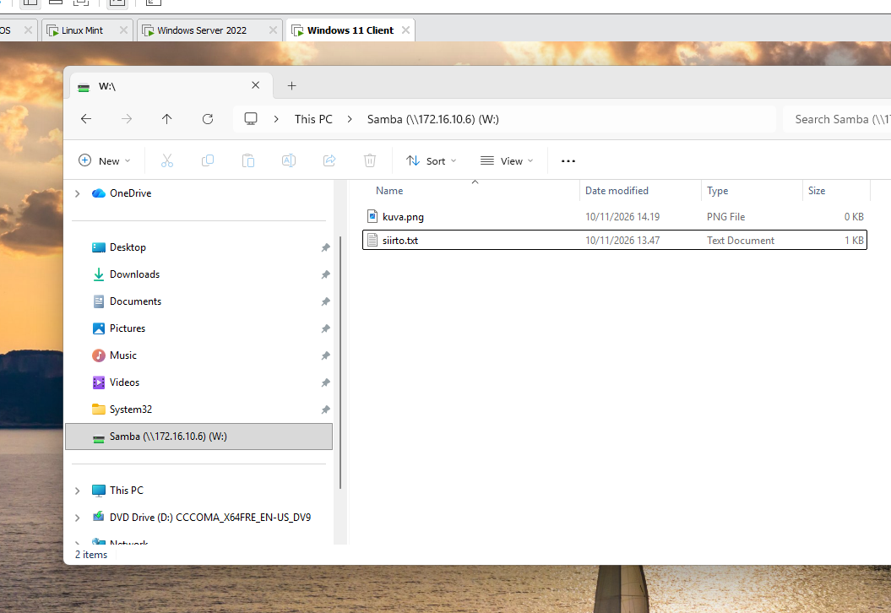

# File sharing between Linux and Windows with Samba

Installing and configuring Samba on a Linux Mint server, creating a shared folder and adding it as a network drive on a Windows 11 client. A text file is moved from the Linux server to the Windows machine, and an image file is moved from the Windows machine to the Linux server.

## Procedure

### 1. Install Samba on the server

```bash
sudo apt update
sudo apt install samba
```

### 2. Configure Samba

1. Add a share definition to the end of the Samba configuration file `/etc/samba/smb.conf`:

```bash
sudo nano /etc/samba/smb.conf
```

```ini
[Samba]
   path = /home/<username>/Desktop
   browseable = yes
   read only = no
   valid users = <username>
```

2. Set a Samba password for the user. The password is used when connecting from Windows:

```bash
sudo smbpasswd -a <username>
```

3. Restart the Samba service:

```bash
sudo systemctl restart smbd
```

### 3. Create the text file siirto.txt

Create the text file `siirto.txt` in the shared folder on the Linux server:

```bash
nano ~/Desktop/siirto.txt
```

### 4. Add the Samba share to the Windows machine

On the Windows 11 client, open **File Explorer > This PC > Map network drive**. Select the drive letter `W:` and the folder `\\172.16.10.6\Samba`, and sign in with the Samba user. The share is shown in File Explorer as **Samba (\\172.16.10.6) (W:)**.



*The Windows 11 client with the Samba share added as drive W:. The share contains `siirto.txt` and `kuva.png`.*

### 5. Move siirto.txt to the Windows desktop

Move the file `siirto.txt` from the `W:` drive to the desktop of the Windows machine.

### 6. Move kuva.png to the Linux server

Create the file `kuva.png` on the Windows machine and move it to the `W:` drive. The file then appears in the shared folder on the Linux server.
