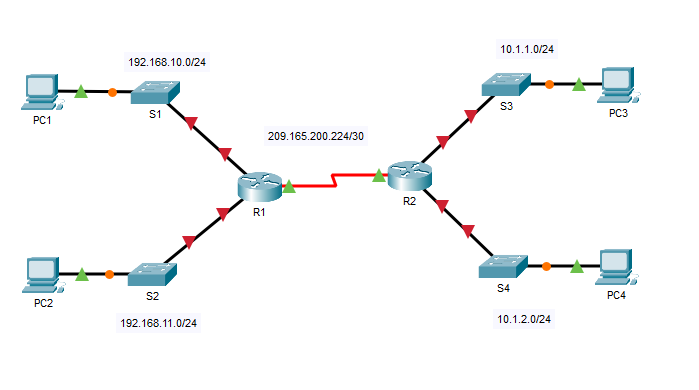

# Packet Tracer: Connect a Router to a LAN

Cisco Networking Academy Packet Tracer activity 10.3.4. The router interfaces of a small network with two routers (R1 and R2), four switches and four PCs are examined, configured and verified. The routers exchange routes with OSPF.

## Topology

| Network | Location |
|---|---|
| 192.168.10.0/24 | LAN between S1 and R1 (PC1) |
| 192.168.11.0/24 | LAN between S2 and R1 (PC2) |
| 209.165.200.224/30 | WAN link between R1 and R2 |
| 10.1.1.0/24 | LAN between S3 and R2 (PC3) |
| 10.1.2.0/24 | LAN between S4 and R2 (PC4) |

The original Packet Tracer activity file is [connect-a-router-to-a-lan.pka](connect-a-router-to-a-lan.pka). It can be opened with Cisco Packet Tracer.

## Part 1: Display router information

### Step 1: Interface statistics

**a. Which command displays the statistics for all interfaces configured on a router?**
`show interfaces`

**b. Which command displays the information about the Serial 0/0/0 interface only?**
`show interfaces Serial 0/0/0`

**c. Statistics for the Serial 0/0/0 interface on R1**
- IP address configured on R1: `209.165.200.225/30`
- Bandwidth on the Serial 0/0/0 interface: `1544 Kbit`

**d. Statistics for the GigabitEthernet 0/0 interface**
- IP address on R1: none (no IP address is configured)
- MAC address of the GigabitEthernet 0/0 interface: `000d.bd6c.7d01`
- Bandwidth (BW) of the GigabitEthernet 0/0 interface: `100000 Kbit`

### Step 2: Interface summary

**a. Which command displays a brief summary of the current interfaces, interface status and the IP addresses assigned to them?**
`show ip interface brief`

**b. Results on each router**
- Serial interfaces on R1 and R2: 2
- Ethernet interfaces: 6 on R1 and 2 on R2
- Are all the Ethernet interfaces on R1 the same? No. Some are Fast Ethernet (100 Mbps) and some are Gigabit Ethernet (1000 Mbps).

### Step 3: Routing table

**a. Which command displays the contents of the routing table?**
`show ip route`

**b. Results on R1**
- Connected routes (code C): 1
- Route listed: `209.165.200.224/30`
- How does a router handle a packet destined for a network that is not listed in the routing table? The gateway of last resort is not set, so the packet is discarded.

## Part 2: Configure router interfaces

**Save the configuration files on both routers to NVRAM. What command did you use?**
`copy running-config startup-config`

## Part 3: Verify the configuration

- Interfaces on R1 and R2 configured with IP addresses and in the "up" and "up" state: 3
- Part of the interface configuration that is not displayed in the command output: the subnet mask
- Command to verify the subnet mask: `show running-config`

**Routing tables (`show ip route` on R1 and R2)**
- Connected routes (code C) on each router: 3
- OSPF routes (code O) on each router: 2
- Number of LANs and WANs in the topology: 5
- Does this number match the number of C and O routes in the routing table? Yes (3 connected routes + 2 OSPF routes = 5).
