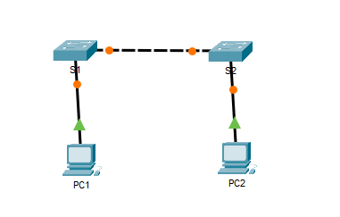

# Packet Tracer: Configure Initial Switch Settings

Cisco Networking Academy Packet Tracer activity 2.5.5. The default configuration of a switch is verified, a basic configuration with secured access and a MOTD banner is created, and the configuration is saved to NVRAM.

## Topology

| Device | Connection |
|---|---|
| S1 | PC1 and S2 |
| S2 | PC2 and S1 |
| PC1 | S1 |
| PC2 | S2 |

The original Packet Tracer activity file is [configure-initial-switch-settings.pka](configure-initial-switch-settings.pka). It can be opened with Cisco Packet Tracer.

## Part 1: Verify the default switch configuration

**How many Fast Ethernet interfaces does the switch have?**
24

**How many Gigabit Ethernet interfaces does the switch have?**
2

**What is the range of values shown for the vty lines?**
0-4 and 5-15

**Which command will display the current contents of non-volatile random-access memory (NVRAM)?**
`show startup-config`

**Why does the switch respond with "startup-config is not present"?**
The configuration has not been saved yet.

## Part 2: Create a basic switch configuration

**Why is the `login` command required (securing access to the console line)?**
It tells the switch to ask for the password.

**What is displayed for the enable secret password?**
The enable secret password is displayed as an MD5 hash (`enable secret 5 ...`), and the enable password is displayed in an encoded form (`enable password 7 ...`).

**Why is the enable secret password displayed differently from what was configured?**
It is stored as an MD5 hash.

**If you configure any more passwords on the switch, will they be displayed in the configuration file as plain text or in encrypted form?**
They are displayed in encrypted form, because `service password-encryption` stays enabled.

## Part 3: Configure a MOTD banner

**When will this banner be displayed?**
Every time someone connects to the device, before the password is asked.

**Why should every switch have a MOTD banner?**
The banner can warn against unauthorized use, which is important legally.

## Part 4: Save and verify the configuration files in NVRAM

**What is the shortest abbreviated version of the `copy running-config startup-config` command?**
`copy run start`

**Which command will display the contents of NVRAM?**
`show startup-config`

**Are all the changes that were entered recorded in the file?**
Yes
