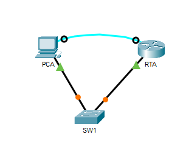

# Packet Tracer: Configure Secure Passwords and SSH

Cisco Networking Academy Packet Tracer activity 16.4.6. The administrative access of a router is secured with passwords and SSH.

## Topology

| Device | Role | Connection |
|---|---|---|
| PCA | Management PC | Ethernet to SW1, console cable to RTA |
| SW1 | Switch | Ethernet to PCA and RTA |
| RTA | Router | Ethernet to SW1, console cable from PCA |

The original Packet Tracer activity file is [configure-secure-passwords-and-ssh.pka](configure-secure-passwords-and-ssh.pka). It can be opened with Cisco Packet Tracer.
