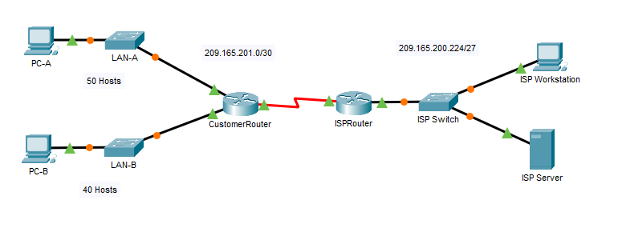

# Packet Tracer: Subnet an IPv4 Network

Cisco Networking Academy Packet Tracer activity 11.5.5. The customer network `192.168.0.0/24` is divided into subnets for two LANs and future expansion. The devices are then configured and the connectivity is tested with `ping`.

## Topology

The original Packet Tracer activity file is [subnet-an-ipv4-network.pka](subnet-an-ipv4-network.pka). It can be opened with Cisco Packet Tracer.

## Objectives

- Part 1: Design an IPv4 network subnetting scheme
- Part 2: Configure the devices
- Part 3: Test and troubleshoot the network

## Part 1: Subnet the assigned network

### Requirements

The network `192.168.0.0/24` must be divided into subnets as follows. All subnet masks have the same length (no variable length subnet masks).

- LAN-A: at least 50 host addresses
- LAN-B: at least 40 host addresses
- At least two additional unused subnets for future expansion

### Questions

**How many host addresses are needed in the largest required subnet?**
50

**What is the minimum number of subnets required?**
4

**What is the /24 subnet mask in binary?**
`11111111.11111111.11111111.00000000`

**In the network mask, what do the ones represent?**
Network

**In the network mask, what do the zeros represent?**
Host

**How many subnets and how many hosts are created with each mask?**

| Prefix | Dotted decimal mask | Number of subnets | Number of hosts per subnet |
|---|---|---|---|
| /25 | 255.255.255.128 | 2 | 126 |
| /26 | 255.255.255.192 | 4 | 62 |
| /27 | 255.255.255.224 | 8 | 30 |
| /28 | 255.255.255.240 | 16 | 14 |
| /29 | 255.255.255.248 | 32 | 6 |
| /30 | 255.255.255.252 | 64 | 2 |

**Which subnet masks meet the required number of host addresses?**
/25 and /26

**Which subnet masks meet the minimum number of subnets required?**
/26, /27, /28, /29 and /30

**Which subnet mask meets both requirements?**
/26

### Subnets

| Subnet address | Prefix | Subnet mask | Use |
|---|---|---|---|
| 192.168.0.0 | /26 | 255.255.255.192 | LAN-A |
| 192.168.0.64 | /26 | 255.255.255.192 | LAN-B |
| 192.168.0.128 | /26 | 255.255.255.192 | Future expansion |
| 192.168.0.192 | /26 | 255.255.255.192 | Future expansion |

### Addressing rules

- The first subnet is assigned to LAN-A and the second to LAN-B.
- The first host address of each subnet is used for the CustomerRouter interface (G0/0 for LAN-A and G0/1 for LAN-B).
- The second host address is used for the LAN switch, with the router interface as the default gateway.
- The last host address is used for the PC, with the router interface as the default gateway.

### Addressing table

| Device | Interface | IP address | Subnet mask | Default gateway |
|---|---|---|---|---|
| CustomerRouter | G0/0 | 192.168.0.1 | 255.255.255.192 | N/A |
| | G0/1 | 192.168.0.65 | 255.255.255.192 | |
| | S0/1/0 | 209.165.201.2 | 255.255.255.252 | |
| LAN-A Switch | VLAN1 | 192.168.0.2 | 255.255.255.192 | 192.168.0.1 |
| LAN-B Switch | VLAN1 | 192.168.0.66 | 255.255.255.192 | 192.168.0.65 |
| PC-A | NIC | 192.168.0.62 | 255.255.255.192 | 192.168.0.1 |
| PC-B | NIC | 192.168.0.126 | 255.255.255.192 | 192.168.0.65 |
| ISPRouter | G0/0 | 209.165.200.225 | 255.255.255.224 | N/A |
| | S0/1/0 | 209.165.201.1 | 255.255.255.252 | |
| ISPSwitch | VLAN1 | 209.165.200.226 | 255.255.255.224 | 209.165.200.225 |
| ISP Workstation | NIC | 209.165.200.235 | 255.255.255.224 | 209.165.200.225 |
| ISP Server | NIC | 209.165.200.240 | 255.255.255.224 | 209.165.200.225 |

## Part 2: Configure the devices

1. **CustomerRouter:** set the enable secret password and the console login password, set the hostname to `CustomerRouter`, configure and enable the G0/0 and G0/1 interfaces with the addresses above, and save the running configuration to the startup configuration.
2. **LAN switches:** configure the IP address of interface VLAN 1 and the default gateway on both customer LAN switches.
3. **PCs:** configure the IP address, subnet mask and default gateway on PC-A and PC-B.

## Part 3: Test and troubleshoot the network

| Test | Reply received? |
|---|---|
| PC-A to its default gateway | Yes |
| PC-B to its default gateway | Yes |
| PC-A to PC-B | Yes |
