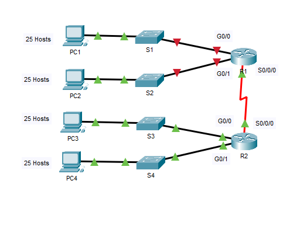

# Packet Tracer: Subnetting Scenario

Cisco Networking Academy Packet Tracer activity 11.7.5. The network `192.168.100.0/24` is divided into subnets for four LANs and one WAN link. The devices are then configured and the connectivity is tested with `ping`.

## Topology



The original Packet Tracer activity file is [subnetting-scenario.pka](subnetting-scenario.pka). It can be opened with Cisco Packet Tracer.

## Objectives

- Part 1: Design an IP addressing scheme
- Part 2: Assign IP addresses to network devices and verify connectivity

## Part 1: Design an IP addressing scheme

### Step 1: Subnet the 192.168.100.0/24 network

Each LAN requires at least 25 addresses for end devices, the switch and the router. The link between R1 and R2 requires an IP address for each end.

**Based on the topology, how many subnets are needed?**
5 (four LANs and one WAN link)

**How many bits must be borrowed to support the number of subnets?**
3 (`/27`)

**How many subnets does this create?**
8

**How many usable hosts does this create per subnet?**
30

**Binary value of the first five subnets**

| Subnet | Network address | Bit 7 | Bit 6 | Bit 5 | Bit 4 | Bit 3 | Bit 2 | Bit 1 | Bit 0 |
|---|---|---|---|---|---|---|---|---|---|
| 0 | 192.168.100. | 0 | 0 | 0 | 0 | 0 | 0 | 0 | 0 |
| 1 | 192.168.100. | 0 | 0 | 1 | 0 | 0 | 0 | 0 | 0 |
| 2 | 192.168.100. | 0 | 1 | 0 | 0 | 0 | 0 | 0 | 0 |
| 3 | 192.168.100. | 0 | 1 | 1 | 0 | 0 | 0 | 0 | 0 |
| 4 | 192.168.100. | 1 | 0 | 0 | 0 | 0 | 0 | 0 | 0 |

**New subnet mask**

| | First octet | Second octet | Third octet | Fourth octet |
|---|---|---|---|---|
| Binary | 11111111 | 11111111 | 11111111 | 11100000 |
| Decimal | 255 | 255 | 255 | 224 |

**Subnet table**

| Subnet | Subnet address | First usable host | Last usable host | Broadcast address |
|---|---|---|---|---|
| 0 | 192.168.100.0 | 192.168.100.1 | 192.168.100.30 | 192.168.100.31 |
| 1 | 192.168.100.32 | 192.168.100.33 | 192.168.100.62 | 192.168.100.63 |
| 2 | 192.168.100.64 | 192.168.100.65 | 192.168.100.94 | 192.168.100.95 |
| 3 | 192.168.100.96 | 192.168.100.97 | 192.168.100.126 | 192.168.100.127 |
| 4 | 192.168.100.128 | 192.168.100.129 | 192.168.100.158 | 192.168.100.159 |
| 5 | 192.168.100.160 | 192.168.100.161 | 192.168.100.190 | 192.168.100.191 |
| 6 | 192.168.100.192 | 192.168.100.193 | 192.168.100.222 | 192.168.100.223 |
| 7 | 192.168.100.224 | 192.168.100.225 | 192.168.100.254 | 192.168.100.255 |

Subnets 5, 6 and 7 are not used.

### Step 2: Assign the subnets

| Subnet | Network | Subnet address |
|---|---|---|
| 0 | LAN on R1 G0/0 | 192.168.100.0/27 |
| 1 | LAN on R1 G0/1 | 192.168.100.32/27 |
| 2 | LAN on R2 G0/0 | 192.168.100.64/27 |
| 3 | LAN on R2 G0/1 | 192.168.100.96/27 |
| 4 | WAN link between R1 and R2 | 192.168.100.128/27 |

### Step 3: Addressing table

Addressing rules:

- R1 uses the first usable address of each of its subnets (two LANs and the WAN link).
- R2 uses the first usable address of its LAN subnets and the last usable address of the WAN subnet.
- The switches use the second usable address of their subnet.
- The PCs use the last usable address of their subnet.

| Device | Interface | IP address | Subnet mask | Default gateway |
|---|---|---|---|---|
| R1 | G0/0 | 192.168.100.1 | 255.255.255.224 | N/A |
| | G0/1 | 192.168.100.33 | 255.255.255.224 | |
| | S0/0/0 | 192.168.100.129 | 255.255.255.224 | |
| R2 | G0/0 | 192.168.100.65 | 255.255.255.224 | N/A |
| | G0/1 | 192.168.100.97 | 255.255.255.224 | |
| | S0/0/0 | 192.168.100.158 | 255.255.255.224 | |
| S1 | VLAN 1 | 192.168.100.2 | 255.255.255.224 | 192.168.100.1 |
| S2 | VLAN 1 | 192.168.100.34 | 255.255.255.224 | 192.168.100.33 |
| S3 | VLAN 1 | 192.168.100.66 | 255.255.255.224 | 192.168.100.65 |
| S4 | VLAN 1 | 192.168.100.98 | 255.255.255.224 | 192.168.100.97 |
| PC1 | NIC | 192.168.100.30 | 255.255.255.224 | 192.168.100.1 |
| PC2 | NIC | 192.168.100.62 | 255.255.255.224 | 192.168.100.33 |
| PC3 | NIC | 192.168.100.94 | 255.255.255.224 | 192.168.100.65 |
| PC4 | NIC | 192.168.100.126 | 255.255.255.224 | 192.168.100.97 |

## Part 2: Assign IP addresses and verify connectivity

Most of the addressing is already configured in the activity file. EIGRP dynamic routing is already configured between R1 and R2.

### Step 1: Configure the R1 LAN interfaces

Both LAN interfaces are configured with the addresses from the addressing table and enabled with `no shutdown`, so that the hosts on the LANs can reach their default gateway.

```
interface g0/0
 ip address 192.168.100.1 255.255.255.224
 no shutdown
interface g0/1
 ip address 192.168.100.33 255.255.255.224
 no shutdown
```

### Step 2: Configure IP addressing on S3

The VLAN 1 interface of S3 is given its address and the switch is given the default gateway address.

```
interface vlan 1
 ip address 192.168.100.66 255.255.255.224
 no shutdown
ip default-gateway 192.168.100.65
```

### Step 3: Configure PC4

PC4 is configured with a static address.

| Setting | Value |
|---|---|
| IP address | 192.168.100.126 |
| Subnet mask | 255.255.255.224 |
| Default gateway | 192.168.100.97 |

### Step 4: Verify connectivity

Connectivity is verified with `ping` from R1, S3 and PC4. Every IP address listed in the addressing table replies.
