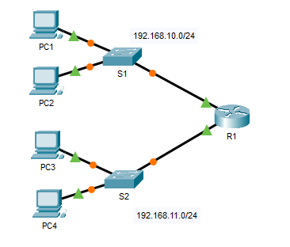

# Packet Tracer: Troubleshoot Default Gateway Issues

Cisco Networking Academy Packet Tracer activity 10.3.5. Connectivity problems in a small network with one router, two switches and four PCs are found with step-by-step tests, fixed and verified. The results are recorded in a testing and verification table.

## Topology

Network: R1 (G0/0 192.168.10.1, G0/1 192.168.11.1), S1 and S2, PC1 to PC4.

| Network | Devices |
|---|---|
| 192.168.10.0/24 | PC1, PC2, S1, R1 (G0/0) |
| 192.168.11.0/24 | PC3, PC4, S2, R1 (G0/1) |

The original Packet Tracer activity file is [troubleshoot-default-gateway-issues.pka](troubleshoot-default-gateway-issues.pka). It can be opened with Cisco Packet Tracer.

## Testing and verification documentation

| # | Test | Successful? | Issues | Solution | Verified |
|---|---|---|---|---|---|
| 1 | PC1 to PC2 | No | IP address on PC1 | Change PC1 IP address | Yes |
| 2 | PC1 to S1 | Yes | | | |
| 3 | PC1 to R1 (192.168.10.1) | Yes | | | |
| 4 | PC2 to S1 | Yes | | | |
| 5 | PC2 to R1 (192.168.10.1) | Yes | | | |
| 6 | PC3 to PC4 | Yes | | | |
| 7 | PC3 to S2 | No | Vlan1 not assigned | Assign 192.168.11.2 and default gateway 192.168.11.1 | Yes |
| 8 | PC3 to R1 (192.168.11.1) | Yes | | | |
| 9 | PC4 to S2 | Yes | | | |
| 10 | PC4 to R1 (192.168.11.1) | Yes | | | |
| 11 | PC1 to PC3 (end-to-end) | Yes | | | |
| 12 | PC1 to PC4 (end-to-end) | No | PC4 wrong default gateway | 192.168.1.1 to 192.168.11.1 | |
| 13 | PC2 to PC3 (end-to-end) | Yes | | | |
| 14 | PC2 to PC4 (end-to-end) | Yes | | | |
| 15 | PC3 to PC1 | Yes | | | |
| 16 | PC4 to PC2 | Yes | | | |

## Summary of the problems found

1. **PC1 (test 1):** wrong IP address on PC1, fixed by changing the address.
2. **S2 (test 7):** Vlan1 had no address assigned, fixed by assigning 192.168.11.2 and the default gateway 192.168.11.1.
3. **PC4 (test 12):** wrong default gateway 192.168.1.1, fixed by changing it to 192.168.11.1.
