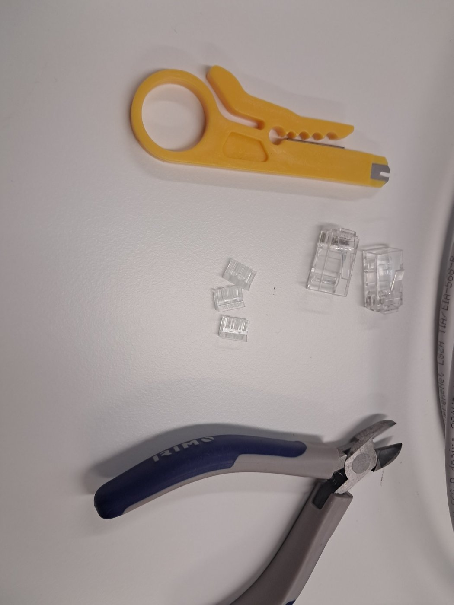
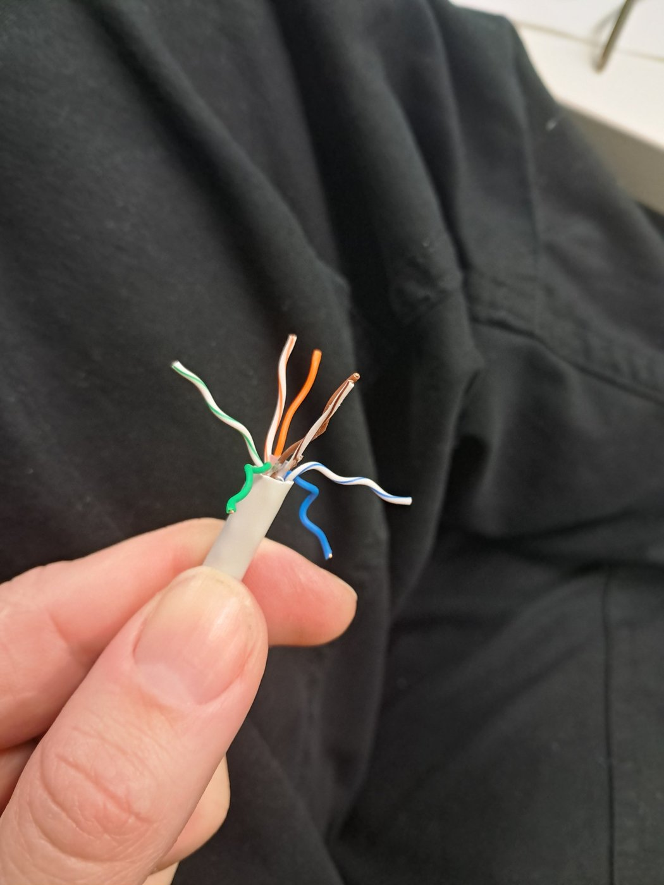
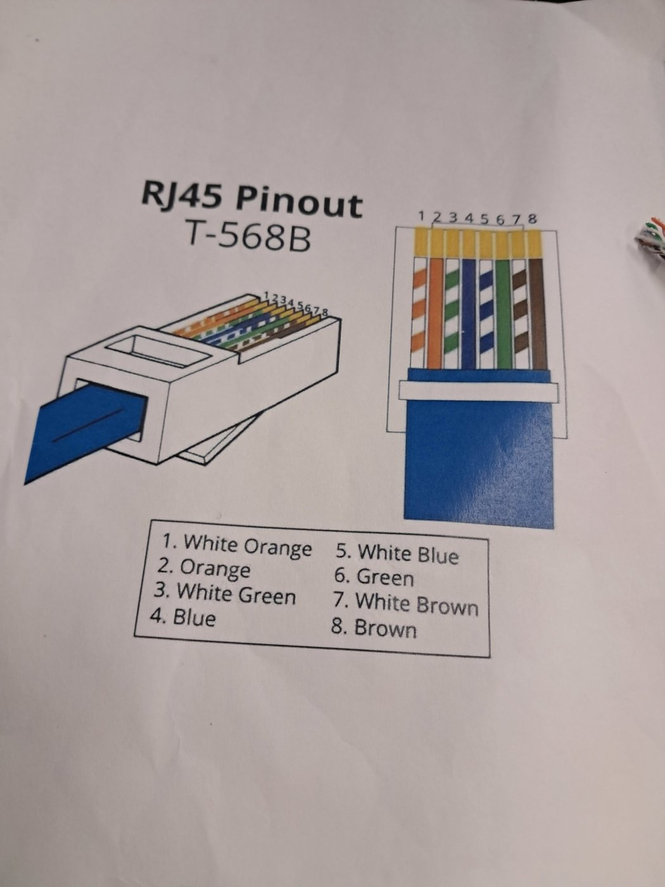
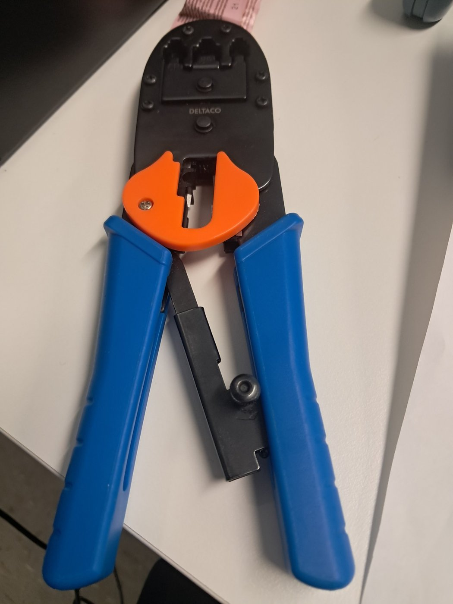
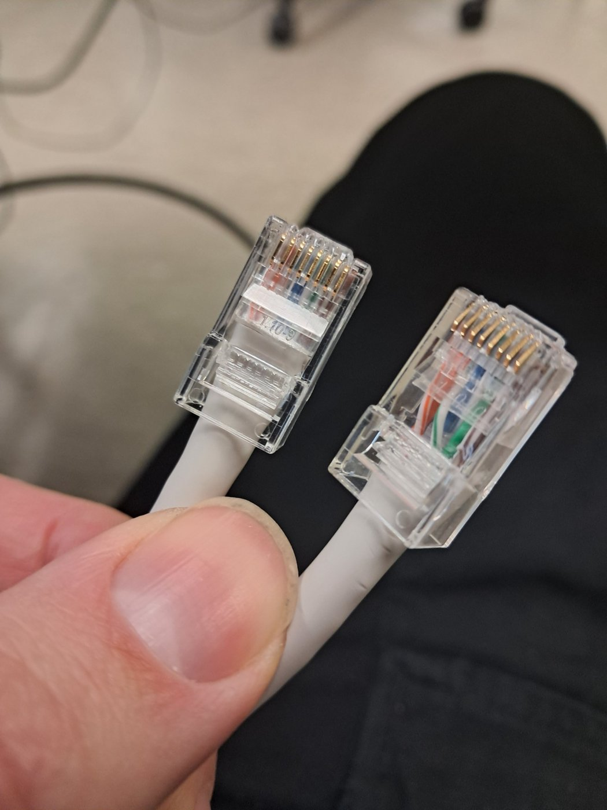
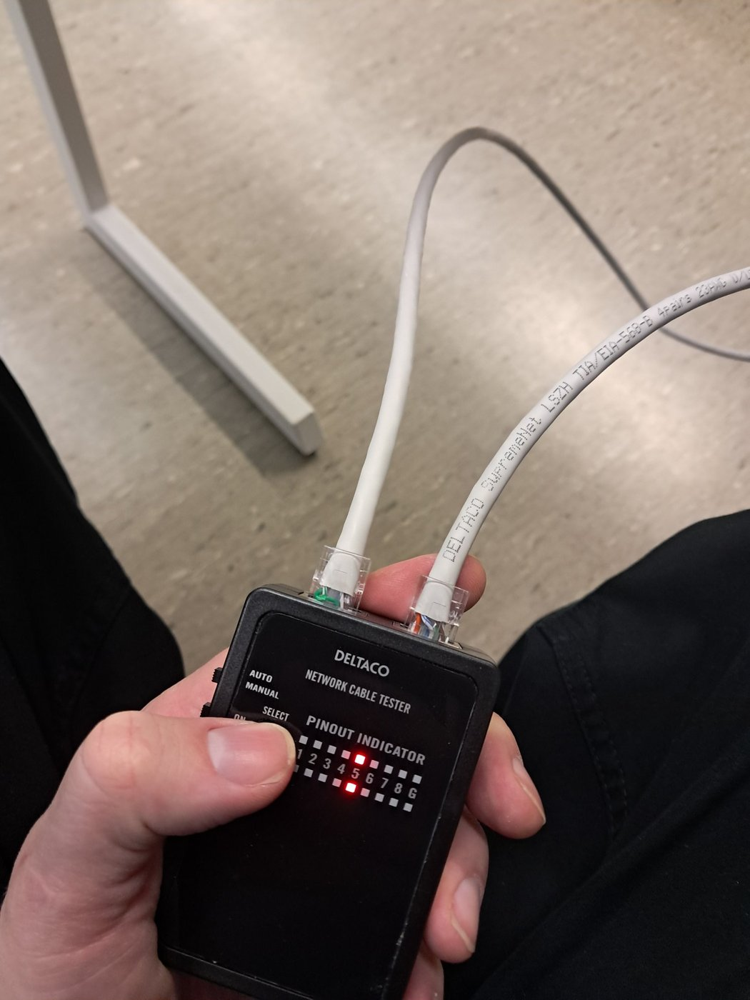

# Making an Ethernet RJ45 cable end

Making the RJ45 plug of an Ethernet cable by hand: stripping the cable, arranging the wires according to the T-568B standard, crimping the plug and testing the cable with a cable tester.

## Tools and materials

- A twisted pair cable with four pairs (the cable is marked TIA/EIA-568-B, 4 pairs, 23AWG)
- RJ45 plugs with a separate wire guide (load bar) insert
- A cable stripper (the yellow tool)
- Side cutters
- A crimping tool
- A cable tester

*The cable stripper, the RJ45 plugs with their wire guide inserts and the side cutters.*

## Procedure

### 1. Strip the outer jacket

Remove the outer jacket from the end of the cable with the cable stripper without damaging the wires inside.

### 2. Untwist the pairs

Untwist the four wire pairs so that all eight wires are separate. The wires are green, white-green, orange, white-orange, blue, white-blue, brown and white-brown.

*The cable after the jacket has been stripped and the pairs have been untwisted.*

### 3. Arrange the wires in the T-568B order

Arrange the wires in the following order, counting from pin 1:

| Pin | Wire color |
|---|---|
| 1 | White orange |
| 2 | Orange |
| 3 | White green |
| 4 | Blue |
| 5 | White blue |
| 6 | Green |
| 7 | White brown |
| 8 | Brown |

*The RJ45 pinout diagram for T-568B that was used as the reference.*

### 4. Trim the wires and insert them into the plug

Hold the wires flat and in order, trim the ends to the same length with the side cutters and push the wires through the wire guide into the RJ45 plug. Every wire must reach the end of the plug, and the jacket should go inside the plug so that the cable is held in place.

### 5. Crimp the plug

Place the plug into the crimping tool and press the handles firmly together. The crimp presses the contacts into the wires and fixes the plug onto the cable.

*The crimping tool.*

### 6. Make the other end

Repeat steps 1 to 5 on the other end of the cable. Both ends must use the same T-568B order so that the cable is a straight-through cable.

*The finished RJ45 plugs. The wire colors and the gold contacts can be seen through the clear plug.*

### 7. Test the cable

The cable was tested with a cable tester and it works.

*The cable tester with the cable connected.*
