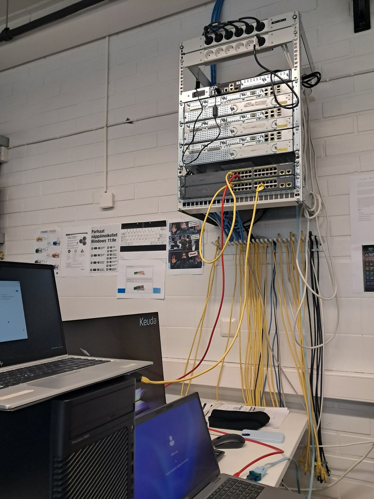

# Lab: Secure Network Devices

Cisco Networking Academy lab 16.5.2. A router and a switch are configured to accept remote management only over SSH, and basic best practice security measures are applied with the IOS command line. The measures are then tested. The lab was done on the physical Cisco equipment of the Keuda network lab.



*The lab rack with the Cisco routers, two Catalyst 2960 switches, the patch panel and the management laptops.*

## Objectives

- Part 1: Configure basic device settings
- Part 2: Configure basic security measures on the router
- Part 3: Configure basic security measures on the switch

## Topology

| Device | Interface | Connected to |
|---|---|---|
| R1 | G0/0/1 | S1 F0/5 |
| S1 | F0/5 | R1 G0/0/1 |
| S1 | F0/6 | PC-A NIC |
| PC-A | NIC | S1 F0/6 |

The devices are configured through their console ports with a terminal emulator (PuTTY) on PC-A.

## Addressing table

| Device | Interface | IP address | Subnet mask | Default gateway |
|---|---|---|---|---|
| R1 | G0/0/1 | 192.168.1.1 | 255.255.255.0 | N/A |
| S1 | VLAN 1 | 192.168.1.11 | 255.255.255.0 | 192.168.1.1 |
| PC-A | NIC | 192.168.1.3 | 255.255.255.0 | 192.168.1.1 |

## A note about passwords

The passwords used in the lab are not published here. In the commands below they are shown as placeholders such as `<enable-password>`. The passwords were at least 12 characters long, as the lab requires.

## Part 1: Configure basic device settings

The devices were cabled as shown in the topology, and the router and the switch were erased and reloaded so that they had no startup configuration.

### Router R1

```
enable
configure terminal
hostname R1
no ip domain-lookup
enable secret <enable-password>
line console 0
 password <console-password>
 login
 exit
line vty 0 4
 password <vty-password>
 login
 exit
banner motd # Unauthorized access is prohibited! #
interface g0/0/1
 ip address 192.168.1.1 255.255.255.0
 no shutdown
 exit
end
copy running-config startup-config
```

### Switch S1

```
enable
configure terminal
hostname S1
no ip domain-lookup
enable secret <enable-password>
line console 0
 password <console-password>
 login
 exit
line vty 0 15
 password <vty-password>
 login
 exit
banner motd # Unauthorized access is prohibited! #
interface vlan 1
 ip address 192.168.1.11 255.255.255.0
 no shutdown
 exit
ip default-gateway 192.168.1.1
end
copy running-config startup-config
```

### PC-A

The network adapter was set to the IP address 192.168.1.3, the subnet mask 255.255.255.0 and the default gateway 192.168.1.1.

### Connectivity test

R1 and S1 were pinged from PC-A. All pings were successful.

## Part 2: Configure basic security measures on the router

```
configure terminal
service password-encryption
security passwords min-length 12
enable secret <new-enable-password>
line console 0
 password <new-console-password>
 exec-timeout 5 0
 exit
line vty 0 4
 password <new-vty-password>
 exec-timeout 5 0
 exit
username SSHadmin secret <ssh-password>
ip domain-name ccna-lab.com
crypto key generate rsa modulus 1024
line vty 0 4
 login local
 transport input ssh
 exit
login block-for 120 attempts 3 within 60
end
copy running-config startup-config
```

What each part does:

| Command | Purpose |
|---|---|
| `service password-encryption` | Encrypts all clear-text passwords in the configuration |
| `security passwords min-length 12` | Requires a minimum of 12 characters in new passwords, so the privileged exec, console and VTY passwords were changed |
| `username SSHadmin secret ...` | Creates the local account used for SSH logins |
| `ip domain-name ccna-lab.com` and `crypto key generate rsa modulus 1024` | Generate the RSA key pair that SSH needs, with a 1024 bit key |
| `transport input ssh` | Allows only SSH on the VTY lines, so Telnet is refused |
| `exec-timeout 5 0` | Disconnects an inactive user after 5 minutes |
| `login block-for 120 attempts 3 within 60` | Blocks logins for 2 minutes after 3 failed attempts within 1 minute |

### Unused ports

The interface status was checked with `show ip interface brief`. The unused router interfaces were in the administratively down state, and any that were not were shut down with `shutdown`.

### Verification

| Test | Result |
|---|---|
| Telnet from PC-A to R1 | Not accepted. The VTY lines allow only SSH, so the connection is refused. |
| SSH from PC-A to R1 | Accepted. |
| Wrong user name and password on purpose | The login failed. After the failed attempts the router went into quiet mode and did not accept new login attempts for 120 seconds. |
| `show login` during the block | Shows that the router is in quiet mode and how many seconds are left. |
| SSH again after 120 seconds, user `SSHadmin` | The login succeeded and the banner was displayed before the `R1>` prompt. |
| Wrong privileged exec password three times | The SSH session was not disconnected. The router only reports bad secrets and stays in user EXEC mode, because the login block applies to logins and not to the `enable` password. |
| `show running-config` | Shows the applied settings, with the passwords encrypted. |

## Part 3: Configure basic security measures on the switch

```
configure terminal
service password-encryption
security passwords min-length 12
enable secret <new-enable-password>
line console 0
 password <new-console-password>
 exec-timeout 5 0
 exit
line vty 0 15
 password <new-vty-password>
 exec-timeout 5 0
 exit
username SSHadmin secret <ssh-password>
ip domain-name ccna-lab.com
crypto key generate rsa modulus 1024
line vty 0 15
 login local
 transport input ssh
 exit
login block-for 120 attempts 3 within 60
interface range f0/1 - 4 , f0/7 - 24 , g0/1 - 2
 shutdown
 exit
end
copy running-config startup-config
```

Only F0/5 (to R1) and F0/6 (to PC-A) were left active. The other ports were shut down with `interface range`. The result was checked with `show ip interface brief`, where all the unused ports are administratively down.

### Verification

| Test | Result |
|---|---|
| Telnet to S1 | Not possible, because only SSH is allowed on the VTY lines. |
| SSH with a wrong user name and password on purpose | The login failed and further logins were blocked for the block period. |
| SSH after the block period, user `SSHadmin` | The login succeeded and the banner appeared. |
| Privileged EXEC mode with the enable password | Worked. |
| `show running-config` | Shows the applied security settings. |

## Reflection questions

**1. The `password cisco` command was entered for the console and VTY lines in Part 1. When is this password used after the best practice security measures have been applied?**

After the passwords were changed to meet the 12 character requirement, the original `cisco` password is no longer used anywhere. The console is protected by the new console password, and remote access goes through SSH with the local `SSHadmin` account.

**2. Are preconfigured passwords shorter than 10 characters affected by the `security passwords min-length 12` command?**

No. The command only affects passwords that are configured after it is entered. Existing shorter passwords keep working until they are changed.

## What I learned

- Why Telnet should be disabled and SSH used for remote management: SSH encrypts the session, while Telnet sends everything, including passwords, in clear text.
- How to slow down password guessing with `login block-for`, and how inactivity timeouts close forgotten sessions.
- Why unused switch ports should be shut down, so nobody can plug in a device and get onto the network.
- Related exercise: [Packet Tracer: Configure Secure Passwords and SSH](../packet-tracer-secure-passwords-and-ssh/README.md).
