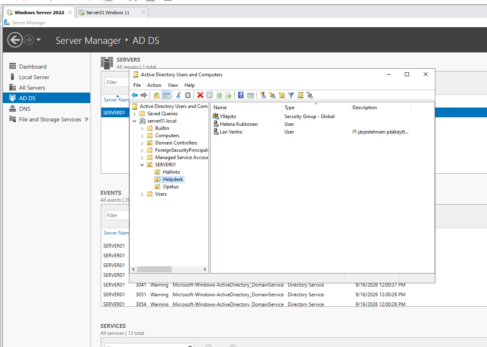

# AD users, home folders and shared drives

Active Directory exercise (Keuda) in a Windows Server 2022 environment. The domain is `server01.local` and the server is `SERVER01`. A Windows 11 virtual machine is used as the client.

## Screenshot



*Active Directory Users and Computers: under `server01.local` is the SERVER01 organizational unit with the sub-OUs Hallinto, Helpdesk and Opetus. The Helpdesk OU contains the Ylläpito group (Security Group - Global) and the users Helena Kukkonen and Lari Venho.*

## Organizational units and groups

| OU | Group |
|---|---|
| Helpdesk | Ylläpito (administration) |
| Hallinto | Hallinto (management) |
| Opetus | Opiskelijat (students) |

## Users

| OU | Name | Groups | Job title | Logon script |
|---|---|---|---|---|
| Hallinto | Maija Mutikainen | Hallinto | Johdon assistentti | hallinto.bat |
| Hallinto | Risto Ratilainen | Hallinto | Johtaja | hallinto.bat |
| Hallinto | Simo Siili | Hallinto | Koulutuspäällikkö | hallinto.bat |
| Opetus | Jukka Mäntylä | Opiskelijat | opiskelija | oppilaat.bat |
| Opetus | Antti Ajattelija | Opiskelijat | opiskelija | oppilaat.bat |
| Helpdesk | Lari Venho | Ylläpito, Domain Admins, Enterprise Admins | ICT manager | PC.bat |
| Helpdesk | Helena Kukkonen | Ylläpito, Domain Admins | IT-tukihenkilö | PC.bat |

On each user's Profile tab:
- **Logon script:** the .bat file from the table above
- **Home folder:** Connect `K:` to `\\SERVER01\homes\%username%`

## Shared folders (C:\)

| Folder | Share | Drive | Permissions |
|---|---|---|---|
| Homes | `\\SERVER01\homes` | K: (home folder) | The user themselves |
| Opiskelijat | `\\SERVER01\opiskelijat` | O: | Opiskelijat: Modify, Hallinto: Read, Ylläpito: Full control |
| Hallinto | `\\SERVER01\hallinto` | M: | Hallinto: Full control, Ylläpito: Full control |
| Util | `\\SERVER01\util` | Z: | Ylläpito: Full control |

## Logon scripts

The scripts were written in Notepad and saved in the server's NETLOGON folder (`C:\Windows\SYSVOL\sysvol\server01.local\scripts`, or `\\SERVER01\netlogon` from the network). Copies are in the [scripts](scripts/) folder.

| Script | Users | Mapped drives |
|---|---|---|
| [PC.bat](scripts/PC.bat) | Ylläpito | O:, M:, Z: |
| [hallinto.bat](scripts/hallinto.bat) | Hallinto | O:, M: |
| [oppilaat.bat](scripts/oppilaat.bat) | Opiskelijat | O: |

Example, `PC.bat`:

```bat
@echo off
net use o: \\SERVER01\opiskelijat
net use m: \\SERVER01\hallinto
net use z: \\SERVER01\util
```
