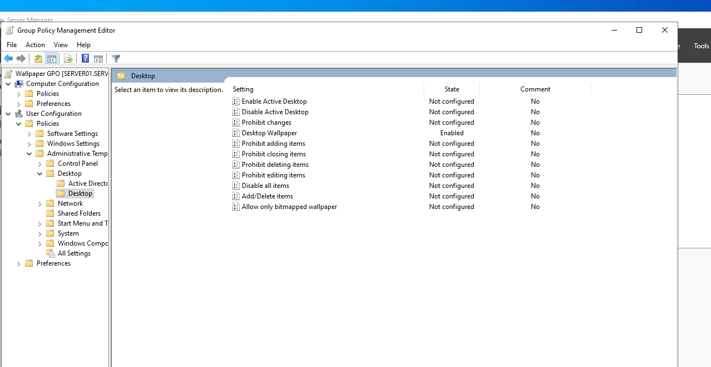
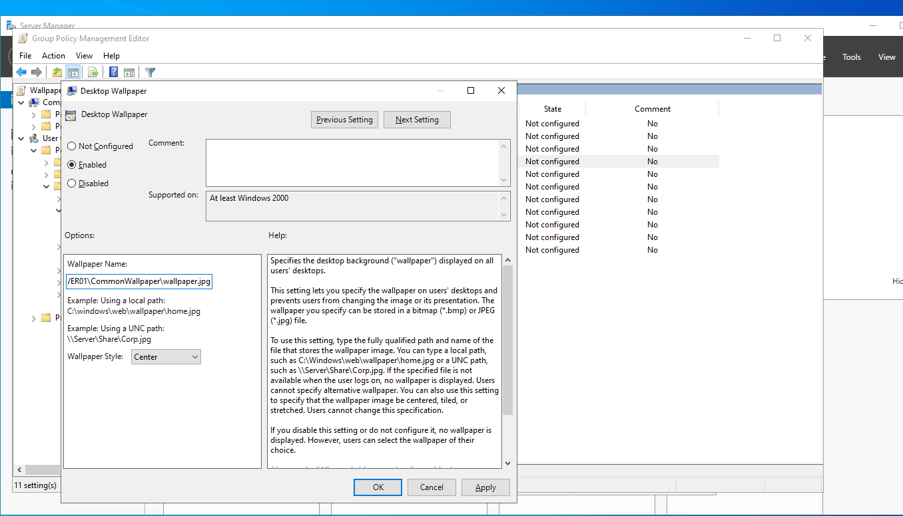
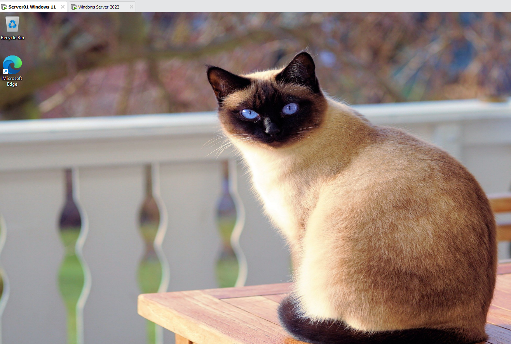

# Desktop wallpaper Group Policy

Creating a new Group Policy Object (GPO) that sets a common desktop wallpaper for domain users in the `server01.local` domain, enabling it and testing it on a domain-joined Windows 11 client.

## Screenshots

*Group Policy Management Editor for `Wallpaper GPO`: User Configuration > Policies > Administrative Templates > Desktop > Desktop. The **Desktop Wallpaper** setting is Enabled.*

*The Desktop Wallpaper setting: Enabled, the wallpaper is read from a shared folder named `CommonWallpaper` (file `wallpaper.jpg`) with the wallpaper style **Center**.*

*The Windows 11 client (`Server01 Windows 11`) after the policy was applied: the common wallpaper is shown on the desktop.*

## Step-by-step procedure

### 1. Share the wallpaper image

1. On `SERVER01`, create a folder, for example `C:\CommonWallpaper`, and copy the image file `wallpaper.jpg` into it. The policy accepts a bitmap (`.bmp`) or JPEG (`.jpg`) image.
2. Share the folder as `CommonWallpaper` and give the domain users (for example **Domain Users** or **Authenticated Users**) read permission. If the file is not available when a user logs on, no wallpaper is displayed, so every user must be able to read it.
3. The wallpaper is then available at `\\SERVER01\CommonWallpaper\wallpaper.jpg`.

### 2. Create the GPO

1. Open **Server Manager > Tools > Group Policy Management**.
2. Right-click the domain or the organizational unit whose users should get the wallpaper and select **Create a GPO in this domain, and Link it here**.
3. Name the GPO `Wallpaper GPO`.

### 3. Configure the wallpaper setting

1. Right-click `Wallpaper GPO` and select **Edit**.
2. Go to **User Configuration > Policies > Administrative Templates > Desktop > Desktop**.
3. Open **Desktop Wallpaper** and set:
   - **Enabled**
   - **Wallpaper Name:** the full UNC path of the image, `\\SERVER01\CommonWallpaper\wallpaper.jpg`
   - **Wallpaper Style:** Center
4. Select **Apply** and **OK**.

According to the setting's help text, users cannot change the wallpaper or its style while the policy is in effect.

### 4. Apply the policy

On the client, run `gpupdate /force` in a command prompt and sign out and back in. User Configuration settings are applied at logon.

### 5. Test

1. Sign in to the Windows 11 client with a domain user who is in the scope of the GPO.
2. Check that the common wallpaper is shown on the desktop (see the last screenshot).
3. Optionally run `gpresult /r` to confirm that `Wallpaper GPO` is listed under the applied user policies.
