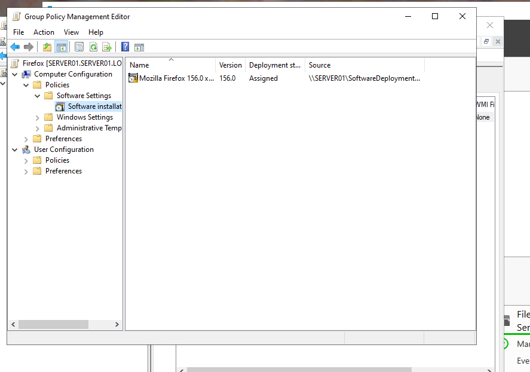

# Installing Firefox on clients with Group Policy

Deploying the Firefox browser to domain-joined client computers with Group Policy software installation. The policy is a computer policy, so it applies only to the client computers that are moved to a dedicated organizational unit, not to the server.

## Screenshots



*Group Policy Management Editor for the `Firefox` GPO: Computer Configuration > Policies > Software Settings > Software installation. The package **Mozilla Firefox 156.0** is **Assigned** and its source is a network share on `SERVER01` (`\\SERVER01\SoftwareDeployment...`).*


*The Windows 11 client (`Server01 Windows 11`) after `gpupdate /force` and a restart: the Firefox shortcut has appeared on the desktop next to Microsoft Edge, so the GPO works on the client.*

## Step-by-step procedure

### 1. Download the Firefox MSI package

1. Download the Firefox **MSI** installer (64-bit) from the Mozilla download page for all platforms and languages. Group Policy software installation works only with MSI packages.
2. Optional: download the Firefox Group Policy templates (ADMX files) if Firefox settings will be managed with Group Policy later.

### 2. Share the installer

1. On `SERVER01`, create a folder for software deployment (for example `C:\SoftwareDeployment`) and copy the Firefox MSI file into it.
2. Share the folder and give **Domain Computers** (or **Authenticated Users**) read permission. The software is installed by the computer account at startup, so the computers must be able to read the share.

### 3. Create the organizational unit and move the client computer

1. Open **Active Directory Users and Computers**.
2. Right-click the domain (or the parent OU) and select **New > Organizational Unit**. Name it `tietokoneet` (computers).
3. Open the **Computers** container, right-click the client computer and select **Move**. Select the `tietokoneet` OU.

### 4. Create the GPO and assign the package

1. Open **Group Policy Management**.
2. Right-click the `tietokoneet` OU and select **Create a GPO in this domain, and Link it here**. Name the GPO `Firefox`.
3. Right-click the GPO and select **Edit**.
4. Go to **Computer Configuration > Policies > Software Settings > Software installation**.
5. Right-click and select **New > Package**. Browse to the MSI with its **network path** (`\\SERVER01\<share name>\...`), not a local path, so that the clients can reach it.
6. Select the deployment method **Assigned**.

### 5. Apply the policy on the client

1. On the client, open a command prompt and run:

```
gpupdate /force
```

2. Restart the client. Software that is assigned to a computer is installed during startup, before the user signs in.

### 6. Test

1. Sign in to the client and check that Firefox is installed (desktop shortcut, Start menu or installed apps).
2. Optionally run `gpresult /r` on the client to check that the `Firefox` GPO is listed under the applied computer policies.
3. Take screenshots of the GPO on the server and of the client showing that Firefox was installed.
