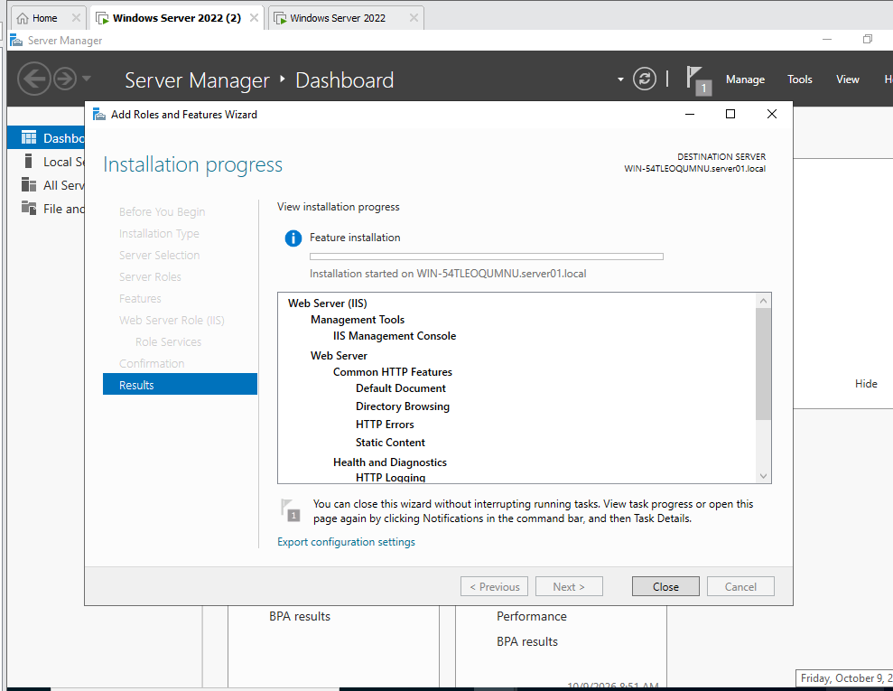
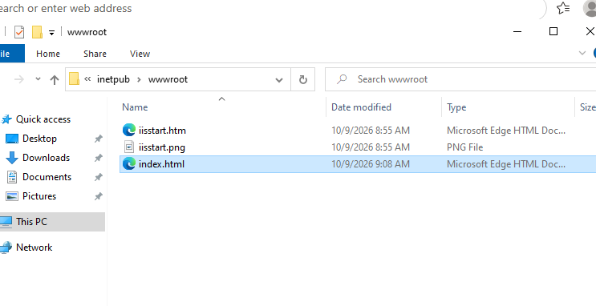
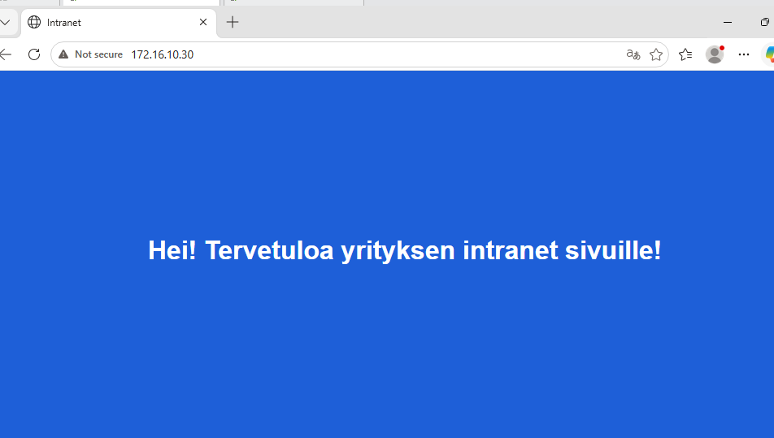
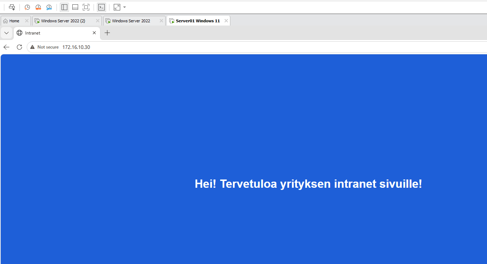

# Setting up an intranet on a Windows Server 2022 server

Installing a new Windows Server 2022 server, joining it to the existing `server01.local` domain, installing the IIS role and publishing a simple HTML page as the intranet front page. The page is tested from a domain-joined Windows 11 client.

## Screenshots

*Add Roles and Features Wizard on the new server (`WIN-54TLEOQUMNU.server01.local`). The Web Server (IIS) role is being installed with the IIS Management Console, Default Document, Directory Browsing, HTTP Errors, Static Content and HTTP Logging.*

*The `C:\inetpub\wwwroot` folder. The default IIS files `iisstart.htm` and `iisstart.png` are there, plus the new `index.html`.*

*The intranet page opened in Microsoft Edge on the server at `172.16.10.30`.*

*The same page opened in Microsoft Edge on the domain-joined Windows 11 client at `172.16.10.30`.*

## Step-by-step procedure

### 1. Install the server

1. Create a new virtual machine in VMware and install **Windows Server 2022**.
2. Connect the virtual machine to the same VMware virtual network as the domain controller and the clients.
3. Set a static IPv4 address, for example `172.16.10.30`. Set the domain controller as the preferred DNS server, because the domain controller is the DNS server of the domain.

### 2. Join the server to the domain

1. Press **Win + R**, type `sysdm.cpl` and press Enter.
2. On the **Computer Name** tab, select **Change**, select **Domain**, enter `server01.local` and confirm.
3. Sign in with a domain account that is allowed to join computers to the domain.
4. Restart the server and sign in with a domain account.

### 3. Install the IIS role

1. Open **Server Manager > Manage > Add Roles and Features**.
2. Select **Role-based or feature-based installation** and the local server as the destination.
3. Select the **Web Server (IIS)** role and accept the additional features that it asks for.
4. Keep the default role services, which include Default Document, Directory Browsing, HTTP Errors, Static Content, HTTP Logging and the IIS Management Console.
5. Select **Install** and wait until the installation finishes (see the first screenshot).

### 4. Publish the intranet front page

1. Open `C:\inetpub\wwwroot` in File Explorer. IIS serves this folder as the default website.
2. Create a new text file in Notepad with the HTML from [index.html](index.html).
3. Save it as `index.html` in `C:\inetpub\wwwroot`. Choose **Save as type: All files** so that Notepad does not add `.txt`.
4. IIS finds the page automatically, because `index.html` is in the default document list of the website.

### 5. Test the page

1. On the server, open Microsoft Edge and browse to `http://172.16.10.30` (or `http://localhost`). The intranet page opens.
2. On the domain-joined Windows 11 client, sign in with a domain user, open Edge and browse to `http://172.16.10.30`. The same page opens, so the intranet is reachable from the domain clients.
3. Take screenshots of both tests.

## Files

- [index.html](index.html): an example of the front page as it appears in the screenshots.
