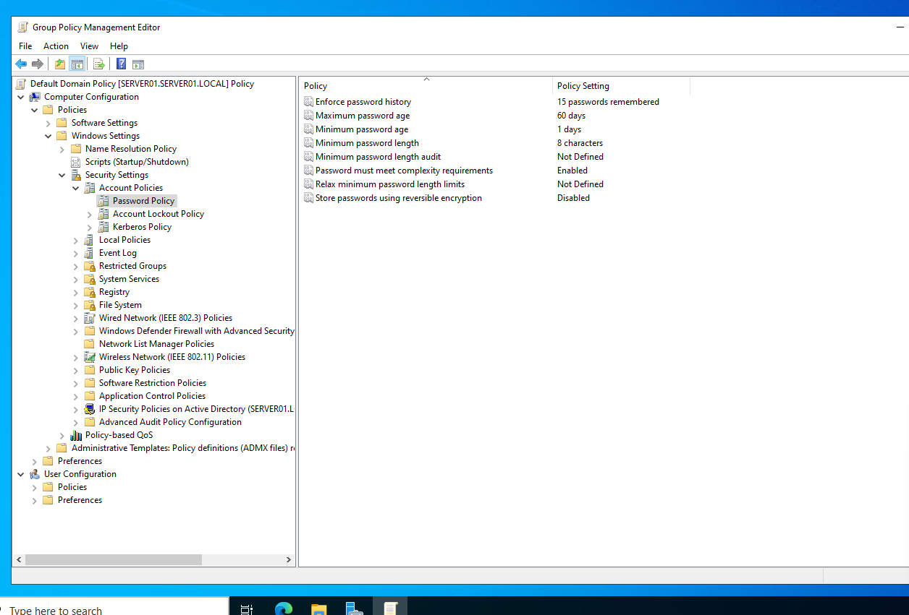
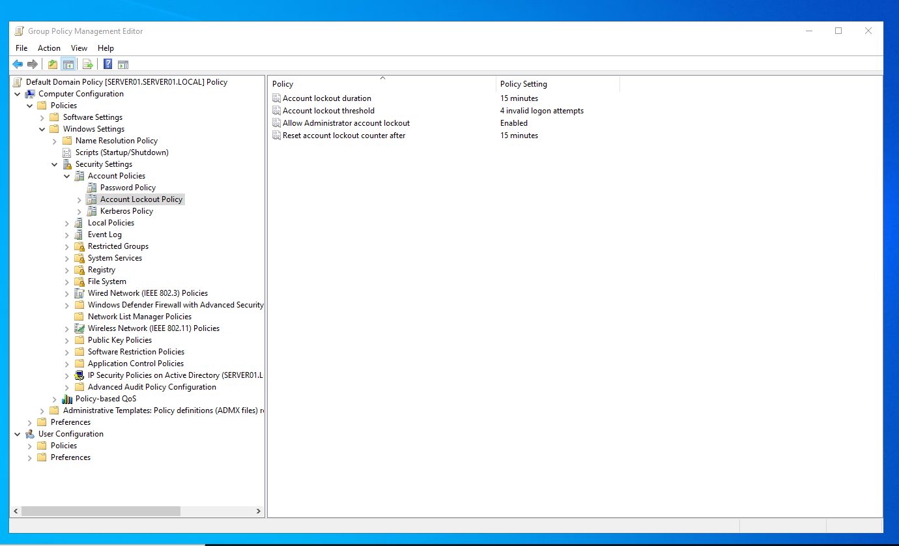

# Domain password and account lockout policy

Configuring the password and account lockout settings of the `server01.local` domain with the **Default Domain Policy** in Group Policy Management.

## Requirements

- The system remembers the last 15 passwords
- Maximum password age is 60 days
- Minimum password age is 1 day
- Passwords must meet complexity requirements
- Minimum password length is 8 characters
- An account is locked out for 15 minutes after 4 invalid logon attempts

## Settings

### Password Policy

| Policy | Setting |
|---|---|
| Enforce password history | 15 passwords remembered |
| Maximum password age | 60 days |
| Minimum password age | 1 day |
| Minimum password length | 8 characters |
| Password must meet complexity requirements | Enabled |
| Store passwords using reversible encryption | Disabled |



*Group Policy Management Editor: Default Domain Policy > Computer Configuration > Policies > Windows Settings > Security Settings > Account Policies > Password Policy.*

### Account Lockout Policy

| Policy | Setting |
|---|---|
| Account lockout threshold | 4 invalid logon attempts |
| Account lockout duration | 15 minutes |
| Reset account lockout counter after | 15 minutes |
| Allow Administrator account lockout | Enabled |



*Group Policy Management Editor: the same policy under Account Policies > Account Lockout Policy.*

## Step-by-step procedure

All steps are done on `SERVER01` as a domain administrator.

1. Open **Server Manager > Tools > Group Policy Management**.
2. Expand **Forest > Domains > server01.local**.
3. Right-click **Default Domain Policy** and select **Edit**. The **Group Policy Management Editor** opens.
4. Go to **Computer Configuration > Policies > Windows Settings > Security Settings > Account Policies > Password Policy** and set:
   - **Enforce password history:** 15 passwords remembered
   - **Maximum password age:** 60 days
   - **Minimum password age:** 1 day
   - **Minimum password length:** 8 characters
   - **Password must meet complexity requirements:** Enabled
5. Go to **Account Policies > Account Lockout Policy** and set:
   - **Account lockout threshold:** 4 invalid logon attempts
   - **Account lockout duration:** 15 minutes
   - **Reset account lockout counter after:** 15 minutes
6. Apply the policy right away by running `gpupdate /force` in a command prompt.
7. Take screenshots of both policy folders (see above).

Password and lockout settings for domain accounts must be in a policy linked at the domain level, which is why the **Default Domain Policy** is edited.

## Verifying the settings

Run the following command on the server or on a domain-joined client:

```
net accounts /domain
```

The output shows the domain's minimum and maximum password age, minimum password length, password history length, lockout threshold, lockout duration and lockout observation window. They should match the values above.
