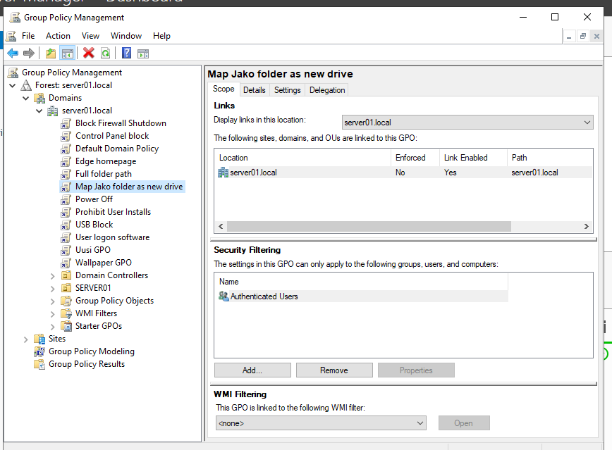
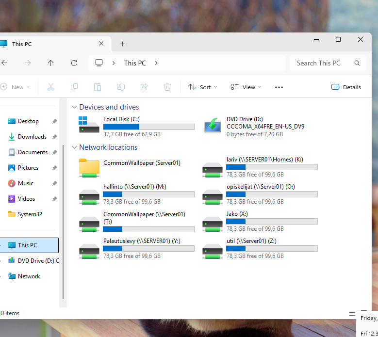

# Shared folder and drive mapping with Group Policy

Creating a shared folder named `Jako` on `SERVER01`, restricting its permissions and mapping it as a network drive for domain users with a Group Policy Object (GPO).

## Screenshots

*Group Policy Management on `SERVER01`: the GPO `Map Jako folder as new drive` is linked to the domain `server01.local` (link enabled, not enforced). Security filtering is set to **Authenticated Users**.*

*Windows 11 client, File Explorer > This PC: the `Jako` share is connected as a network drive (`Jako (X:)`), next to the other mapped drives of the domain user.*

## Step-by-step procedure

### 1. Create the folder

On `SERVER01`, create a new folder named `Jako` (for example `C:\Jako`).

### 2. Remove the Users group from the folder permissions

1. Right-click the folder and select **Properties > Security > Advanced**.
2. Select **Disable inheritance** and convert the inherited permissions to explicit permissions.
3. Remove all entries of the local **Users** group from the list.

### 3. Add the required groups with Full control

1. In **Properties > Security > Edit > Add**, add the groups that need access to the folder.
2. Give each of them **Full control**.

### 4. Share the folder

1. Open **Properties > Sharing > Advanced Sharing** and select **Share this folder**.
2. Use the share name `Jako`. The folder is then available at `\\SERVER01\Jako`.
3. Check that the share permissions allow the same groups access.

### 5. Create the Group Policy that maps the drive

1. Open **Server Manager > Tools > Group Policy Management**.
2. Right-click the domain `server01.local` and select **Create a GPO in this domain, and Link it here**. Name the GPO `Map Jako folder as new drive`.
3. Right-click the GPO and select **Edit**.
4. Go to **User Configuration > Preferences > Windows Settings > Drive Maps**.
5. Right-click and select **New > Mapped Drive** and set:
   - **Action:** Create
   - **Location:** `\\SERVER01\Jako`
   - **Reconnect:** enabled
   - **Drive letter:** the letter for the drive (shown as `X:` in the client screenshot)
6. Select **Apply** and **OK**.

### 6. Test on the client

1. On the Windows 11 client, run `gpupdate /force` in a command prompt and sign out and back in.
2. Open **File Explorer > This PC**. The `Jako` share is listed under **Network locations** as a mapped drive (see the second screenshot).
