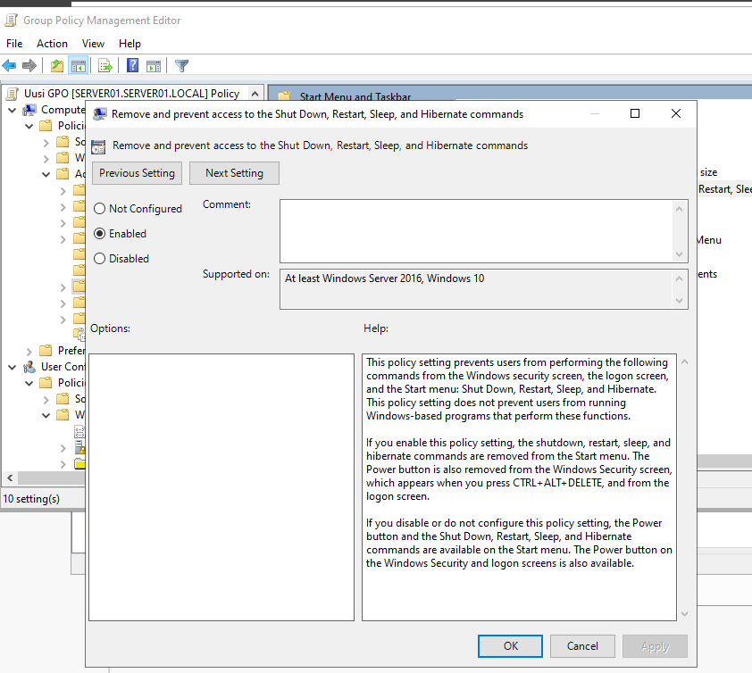
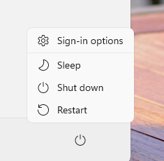

# Removing power commands from the Start menu with Group Policy

A new Group Policy Object (GPO) that removes power commands from the Start menu of the domain-joined Windows 11 clients in the `server01.local` domain.

## Screenshots

*Group Policy Management Editor for the GPO `Uusi GPO` (New GPO): the setting **Remove and prevent access to the Shut Down, Restart, Sleep, and Hibernate commands** is **Enabled**.*

*Windows 11 client before the policy: the Start menu power button offers Sign-in options, Sleep, Shut down and Restart.*

*Windows 11 client after the policy: the power button shows the message "There are currently no power options available."*

## Scope of the setting

The setting used here removes **all** of the following commands from the Start menu, the Windows Security screen (Ctrl + Alt + Delete) and the logon screen:

- Shut down
- Restart
- Sleep
- Hibernate

It does not prevent programs from performing these functions. As the "after" screenshot shows, the Start menu then has no power options at all.

## Step-by-step procedure

1. Open **Server Manager > Tools > Group Policy Management** on `SERVER01`.
2. Create a new GPO (`Uusi GPO`) and link it to the domain or to the organizational unit that contains the client computers.
3. Right-click the GPO and select **Edit**.
4. Go to **Computer Configuration > Policies > Administrative Templates > Start Menu and Taskbar**.
5. Open **Remove and prevent access to the Shut Down, Restart, Sleep, and Hibernate commands**, select **Enabled** and select **OK**.
6. On the client, run `gpupdate /force` in a command prompt and restart the client or sign out and back in.
7. Open the Start menu on the client and check the power button (see the screenshots above).

## Removing only Sleep and Hibernate

If only Sleep and Hibernate should be removed and Shut down and Restart must stay available, use these two separate settings instead:

- **Computer Configuration > Policies > Administrative Templates > Windows Components > File Explorer > Show sleep in the power options menu:** set to **Disabled**
- **Computer Configuration > Policies > Administrative Templates > Windows Components > File Explorer > Show hibernate in the power options menu:** set to **Disabled**
