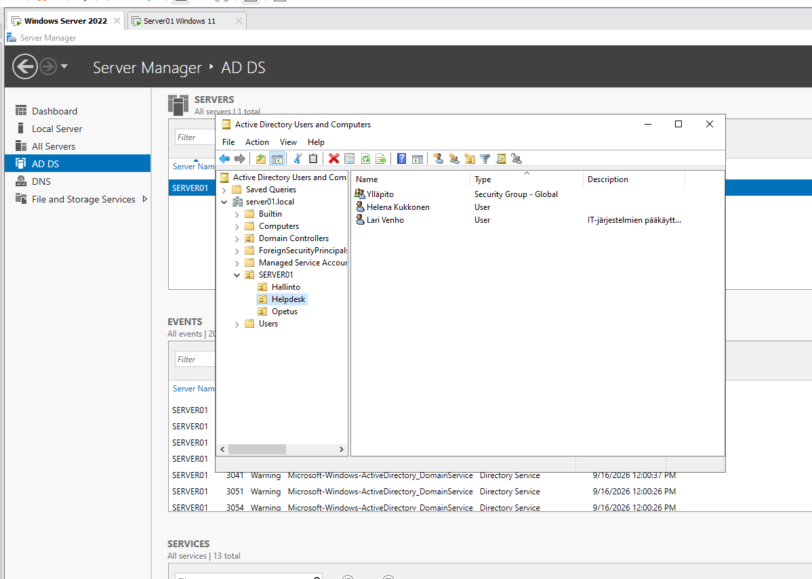
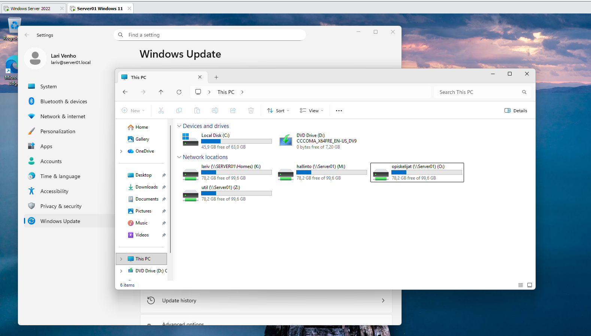

# Windows 11 workstation and domain join

Installing a Windows 11 workstation in a VMware virtual machine, joining it to the `server01.local` Active Directory domain and testing the domain users, home folder and shared drives created in [AD users, home folders and shared drives](../ad-users-and-shared-drives/README.md).

## Screenshots

*Active Directory Users and Computers on `SERVER01`: the organizational units and the Helpdesk users.*

*Windows 11 workstation, logged in as Lari Venho (`lariv@server01.local`). In File Explorer > This PC the network drives are connected: `K:` (`\\SERVER01\Homes`, home folder), `M:` (hallinto), `O:` (opiskelijat) and `Z:` (util).*

## Step-by-step procedure

### 1. Create the virtual machine

1. Create a new Windows 11 virtual machine in VMware.
2. Set the network adapter to **VMnet8 (NAT)**, the same network as the server.

### 2. Install Windows 11

1. During installation, select the **Pro** or **Education** edition. The Home edition cannot be joined to a domain.
2. **Do not sign in with a Microsoft account.** If the installer asks to create an account, create a **local account** instead. The workstation joins the local on-premises domain (domain join), not Azure AD.

### 3. Configure the network

Set a static IPv4 address in the adapter properties (**Internet Protocol Version 4 (TCP/IPv4)**), for example:

| Setting | Example value |
|---|---|
| IP address | 172.16.10.100 |
| Subnet mask | 255.255.255.0 |
| Preferred DNS server | 172.16.10.10 (the real IP address of the server) |

The server works as the DNS server of the domain, so it must be the only DNS server. No external DNS servers are configured. Use the values that match your own server and network.

Test the connection with `ping` to the server and `nslookup server01.local`.

### 4. Join the domain

1. Press **Win + R**, type `sysdm.cpl` and press Enter.
2. On the **Computer Name** tab, select **Change**.
3. Select **Domain**, enter `server01.local` and confirm.
4. Sign in with a domain account that is allowed to join computers to the domain, for example the administrator account.
5. Restart the computer when prompted.

### 5. Sign in with a domain user

1. After the restart, select **Other user** on the sign-in screen.
2. Sign in with a domain user, for example `lariv@server01.local`.

### 6. Test the users and shared folders

1. Open **File Explorer > This PC** and check that the drives from the logon script and the profile settings are connected (see the screenshot above).
2. Test each group:

| User group | Expected drives |
|---|---|
| Ylläpito (Lari Venho, Helena Kukkonen) | K:, O:, M:, Z: |
| Hallinto | K:, O:, M: |
| Opiskelijat | K:, O: |

3. Check the permissions. For example, a student can modify files in `O:` but cannot open `M:` or `Z:`.
4. Take a screenshot of **Active Directory Users and Computers** on the server, showing the users, and a screenshot of **This PC** on the workstation, showing the connected drives.
