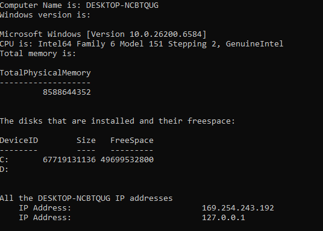
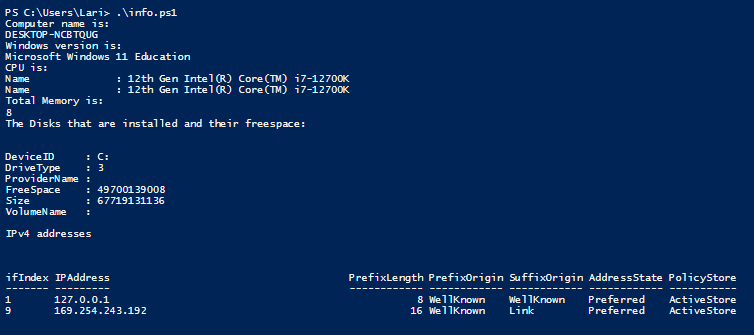
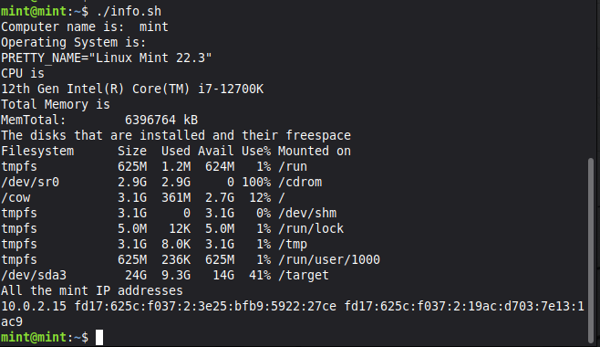

# Basic scripts in Windows and Linux

Cisco Networking Academy lab. Three scripts that collect the same system information are written in three scripting languages to compare how each language automates a simple task: a Windows batch script, a PowerShell script and a Bash script. Each script prints the computer name, the operating system, the CPU, the total memory, the disks with their free space and the IP addresses.

| Script | Language | Platform | File |
|---|---|---|---|
| `info.bat` | Windows batch | Windows 11 | [scripts/info.bat](scripts/info.bat) |
| `info.ps1` | PowerShell | Windows 11 | [scripts/info.ps1](scripts/info.ps1) |
| `info.sh` | Bash | Linux Mint 22.3 (virtual machine) | [scripts/info.sh](scripts/info.sh) |

## 1. Windows batch script

`info.bat` is saved in the home folder (`C:\Users\<user name>`) and run from a command prompt by entering `info.bat`. If the file is saved with the wrong extension (`info.bat.txt`), it is renamed with `rename info.bat.txt info.bat`.

*Output of `info.bat`: computer name, Windows version, CPU, total memory in bytes, disks and IP addresses.*

**What are the `%text%` parts used for in the script?**
They are variables. The value of the variable (for example `%computername%`) replaces the text when the script is run.

**What do these commands do in the script?**

| Command | What it does |
|---|---|
| `echo` | Prints text or the values of variables to the window |
| `findstr` | Searches for a text string in the output of a command, filtering the lines |
| `netsh` | Shows (and can change) the network settings of the computer |
| `ver` | Shows the Windows version |
| `wmic` | An older command line tool that shows information about the hardware and the operating system of the computer |

## 2. PowerShell script

`info.ps1` is created in PowerShell ISE (started as administrator) and saved in the home folder. Running scripts is first allowed with `Set-ExecutionPolicy RemoteSigned`, and the setting can be changed back after the script is finished. The script is run with `.\info.ps1` (note the backslash).

*Output of `.\info.ps1`: computer name, Windows 11 Education, the CPU name, total memory in GB (8), the disk C: with its free space and the IPv4 addresses.*

The commands of the two Windows scripts correspond to each other like this:

| Task | Batch | PowerShell |
|---|---|---|
| Computer name | `echo Computer Name is: %computername%` | `get-content env:computername` |
| Windows version | `ver` | `(Get-WmiObject -class Win32_OperatingSystem).Caption` |
| CPU | `echo CPU is: %PROCESSOR_IDENTIFIER%` | `Get-WmiObject Win32_Processor \| findstr "Name"` |
| Total memory | `wmic ComputerSystem get TotalPhysicalMemory` | `[Math]::Round((Get-WmiObject -Class win32_computersystem -ComputerName localhost).TotalPhysicalMemory/1Gb)` |
| Disks and free space | `wmic logicaldisk get size,freespace,caption` | `Get-WmiObject -Class Win32_logicaldisk -Filter "DriveType = '3'"` |
| IP addresses | `netsh interface ip show address \| findstr "IP Address"` | `Get-NetIPAddress -AddressFamily IPv4 \| Format-Table IPAddress` |

## 3. Bash script

`info.sh` is created with a text editor in the home folder of a Linux virtual machine. It is made executable with `chmod 755 info.sh` and run with `./info.sh`.

*Output of `./info.sh` on Linux Mint 22.3: host name, operating system, CPU, total memory, disks with `df -h` and IP addresses.*

**What does `#!/bin/bash` at the beginning of the script mean?**
It is called a shebang. It tells the operating system which interpreter is used to run the script, in this case Bash.

**What command would you use to learn more about the `df` and `lscpu` commands?**
`man df` and `man lscpu` show the full manual. A shorter help is shown with `df --help` and `lscpu --help`.

## Lessons learned

- The same task can be done in all three languages, but the commands differ. Batch and PowerShell use Windows tools (`wmic`, `Get-WmiObject`), while Bash uses text files and tools of the system (`/proc/meminfo`, `lscpu`, `df`) combined with pipes.
- PowerShell returns objects that can be filtered and formatted (`Format-Table`), but batch and Bash scripts handle plain text, so `findstr` and `grep` are used to pick the right lines.
- `wmic` is an older tool. The PowerShell commands are the more modern way to get the same information on Windows.
- A script must be allowed to run: the execution policy in PowerShell and `chmod` in Linux.
