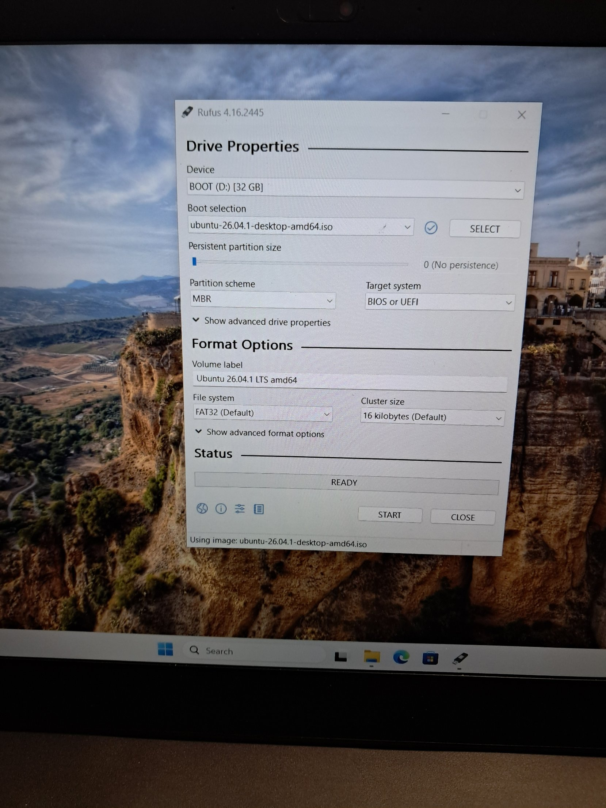
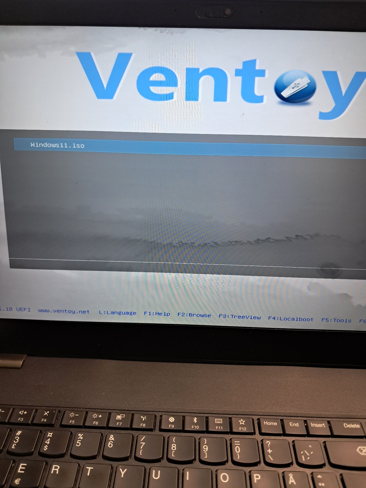
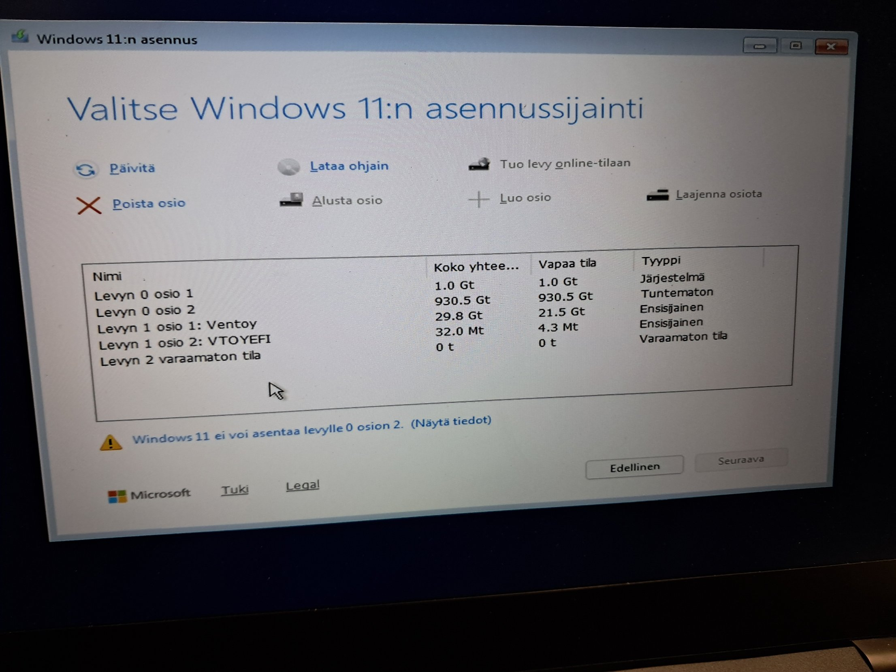
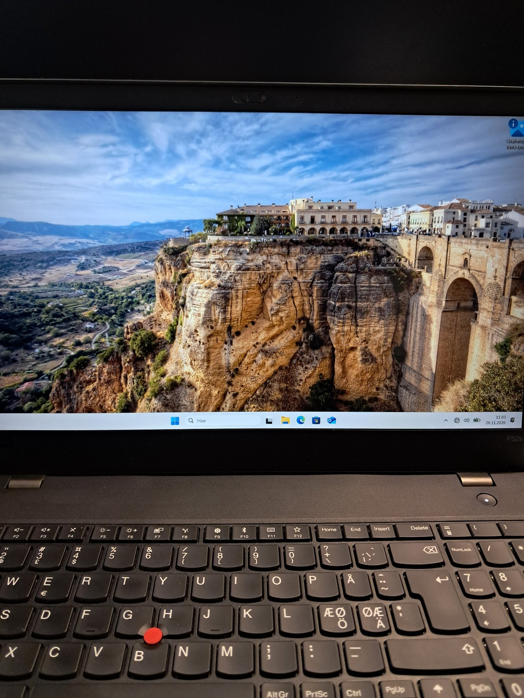
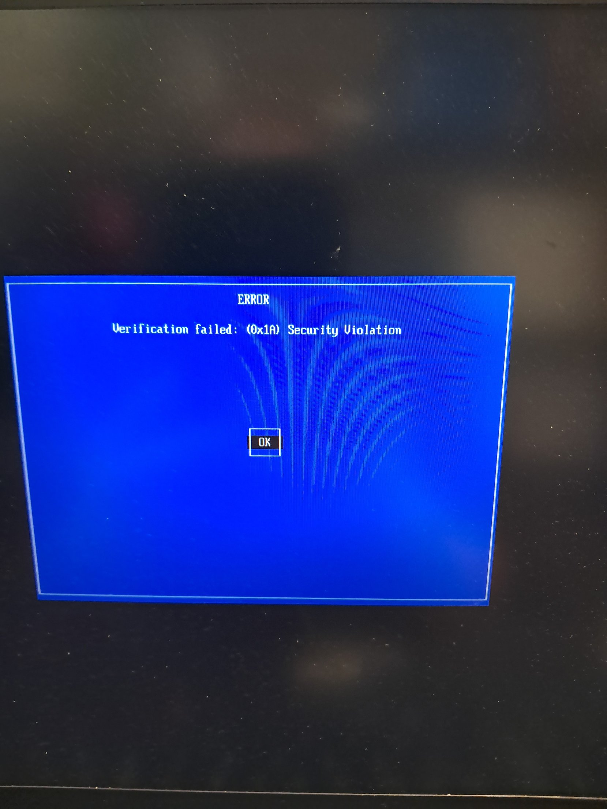

# Bootable USB media with Rufus and Ventoy (Lenovo ThinkPad P52s)

Documentation of how two bootable 32 GB USB drives were made and used to install Ubuntu 26.04 LTS and Windows 11 on a Lenovo ThinkPad P52s, using Rufus on Windows and Ventoy on Ubuntu.

| | |
|---|---|
| **Device** | Lenovo ThinkPad P52s (UEFI boot, 1 TB WD Green SN350 NVMe drive) |
| **Task** | Create bootable USB media with two different tools and install an operating system from each |
| **Date** | November 2026 |
| **Performed by** | Lari Venho |
| **Result** | ✅ Both USB drives booted and both installations worked (a Secure Boot error with Ventoy was solved, see [Troubleshooting](#troubleshooting)) |

---

## Table of contents

1. [Objective](#objective)
2. [Tools](#tools)
3. [Part 1: Ubuntu USB with Rufus](#part-1-ubuntu-usb-with-rufus)
4. [Part 2: Windows 11 USB with Ventoy](#part-2-windows-11-usb-with-ventoy)
5. [Troubleshooting](#troubleshooting)
6. [Lessons learned](#lessons-learned)

---

## Objective

Learn two ways of creating bootable USB media and compare them:

- **Rufus** writes one ISO image to the drive and erases everything on it.
- **Ventoy** is installed to the drive once, after which ISO files are simply copied to it as normal files. The same drive can hold several ISO images and ordinary files.

## Tools

| Tool | Version | Used on |
|---|---|---|
| Rufus (portable) | 4.16 | Windows 11 |
| Ventoy (Ventoy2Disk GUI) | 1.1.18 | Ubuntu 26.04.1 LTS |
| Ubuntu desktop ISO | 26.04.1 LTS amd64 | |
| Windows 11 ISO | | |
| USB drive | 32 GB | |

> Both tools erase the drive, so anything important on it must be backed up first. Rufus needs administrator rights.

---

## Part 1: Ubuntu USB with Rufus

1. Open Rufus and select the 32 GB USB drive as the **Device**.
2. Under **Boot selection**, select `ubuntu-26.04.1-desktop-amd64.iso`.
3. Settings used:
   - Partition scheme: **MBR**
   - Target system: **BIOS or UEFI**
   - File system: **FAT32**, cluster size 16 kilobytes
   - Persistent partition: none
4. Press **START**. Rufus writes the ISO to the drive.

### Booting from the USB drive

Press F12 at startup to open the boot menu. The drive appears as **USB HDD: USB SG Flash**.

The Ubuntu USB drive opens the GRUB menu, and from there the Ubuntu installer starts.

---

## Part 2: Windows 11 USB with Ventoy

From the Ubuntu installation, Ventoy was installed on the same USB drive:

1. Download and extract `ventoy-1.1.18`, then run `VentoyGUI`.
2. Select the USB drive (`sdb [32 GB] USB SG Flash`), partition style MBR, and press **Install**.
3. Copy `Windows11.iso` to the Ventoy partition of the drive.
4. Run `sync` in a terminal before removing the drive, so that all data has been written.

After booting from the drive, the Ventoy menu lists the ISO file:

### Windows 11 installation

In the Windows 11 setup, **Install Windows 11** was selected. This option erases all content, including files, apps and settings.

The installation location screen shows both the laptop's internal drive (disk 0) and the Ventoy USB drive (disk 1, with the `Ventoy` and `VTOYEFI` partitions). The installation must target the internal drive, not the USB drive.

Ubuntu was already installed on the internal drive, and Windows could not be installed while its partitions were in the way (the setup warned that Windows 11 cannot be installed on the selected partition). To make room, the partitions where Ubuntu was installed had to be deleted in the installer (**Delete partition**), after which the unallocated space was selected as the installation target and Windows 11 installed there. This permanently removed the Ubuntu installation from the drive.

Result: Windows 11 installed and running.

---

## Troubleshooting

### Secure Boot: `Verification failed: (0x1A) Security Violation`

The first boot from the Ventoy drive stopped with this error.

**Cause:** Secure Boot does not trust the Ventoy boot loader by default.

**Solution:** The key that is included on the Ventoy USB drive was enrolled on the laptop (MOK enrollment). After that, Ventoy booted with Secure Boot still enabled. The other option would have been to disable Secure Boot temporarily in the BIOS.

---

## Lessons learned

- Rufus is the simplest choice for a single ISO. Ventoy is better when one drive should hold several ISO images or files larger than 4 GB, because its data partition is not limited by FAT32.
- FAT32 limits single files to 4 GB. Rufus works around this for the Ubuntu ISO, which is why the file system can stay FAT32.
- Secure Boot can block third-party boot loaders such as Ventoy. The error `0x1A Security Violation` is the typical sign, and enrolling the key solves it without turning Secure Boot off.
- An existing Ubuntu installation has to be removed (its partitions deleted) before Windows can be installed on the same drive. Deleting partitions destroys the data on them, so back up anything needed first.
- Always check which drive the installer targets, because the USB drive appears in the same list as the internal drive.
- Back up the USB drive first. Both tools wipe it.
