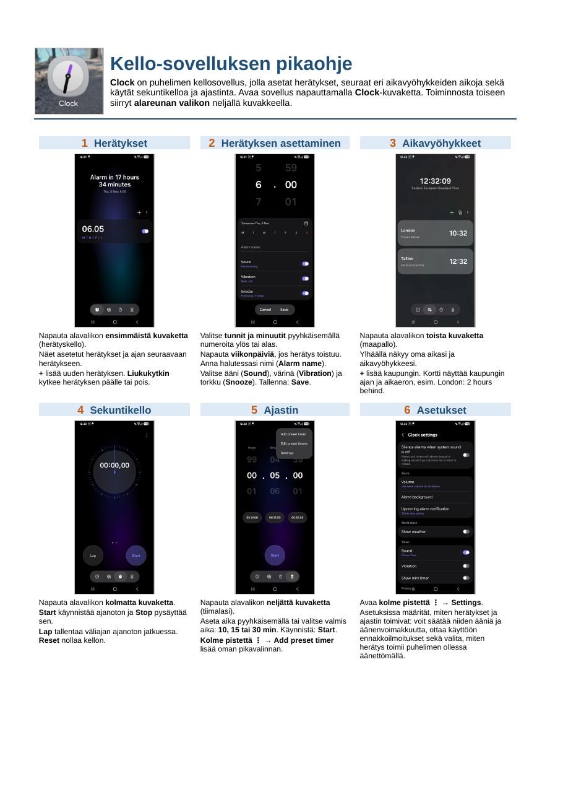

# Clock app quick guide

A one-page A4 quick guide (in Finnish) for the Clock application of an Android phone. The guide explains with screenshots how to use alarms, world clock, stopwatch and timer, and where to find the settings.

## Preview

## Contents of the guide

1. Alarms: opening the alarm list and turning alarms on and off
2. Setting an alarm: time, repeat days, name, sound, vibration and snooze
3. Time zones: adding cities and reading the time difference
4. Stopwatch: start, stop, lap and reset
5. Timer: setting the time, ready-made times and a custom preset timer
6. Settings: sound and volume of alarms and timers, upcoming alarm notifications and behavior in silent mode

## Files

- [clock-app-quick-guide.pdf](clock-app-quick-guide.pdf): the guide in PDF format (A4, one page)
- [clock-app-quick-guide.docx](clock-app-quick-guide.docx): the original Word document that the PDF was created from
