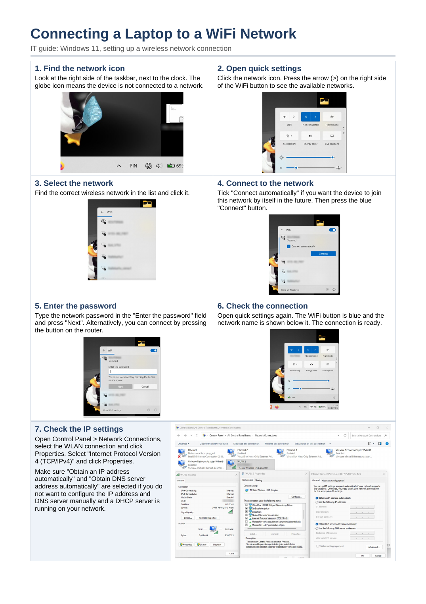

# Connecting a laptop to a WiFi network

A one-page A4 IT guide (in English) for connecting a Windows 11 laptop to a wireless network. The guide explains with screenshots how to find the network icon, select a network, enter the password and check the connection, and how to check that the IP address and DNS server are obtained automatically. Network names in the screenshots are blurred.

## Preview

## Contents of the guide

1. Find the network icon in the taskbar
2. Open quick settings and the list of available networks
3. Select the network
4. Connect, with the option to connect automatically in the future
5. Enter the network password (or connect with the button on the router)
6. Check the connection in quick settings
7. Check the IPv4 settings: "Obtain an IP address automatically" and "Obtain DNS server address automatically" are selected if the addresses are not configured manually and a DHCP server is running on the network

## Files

- [connect-laptop-to-wifi.pdf](connect-laptop-to-wifi.pdf): the guide in PDF format (A4, one page)
- [connect-laptop-to-wifi.docx](connect-laptop-to-wifi.docx): the original Word document that the PDF was created from
