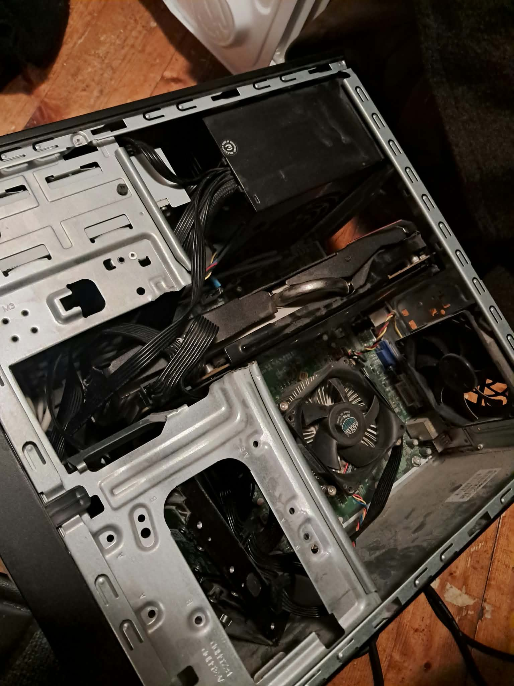
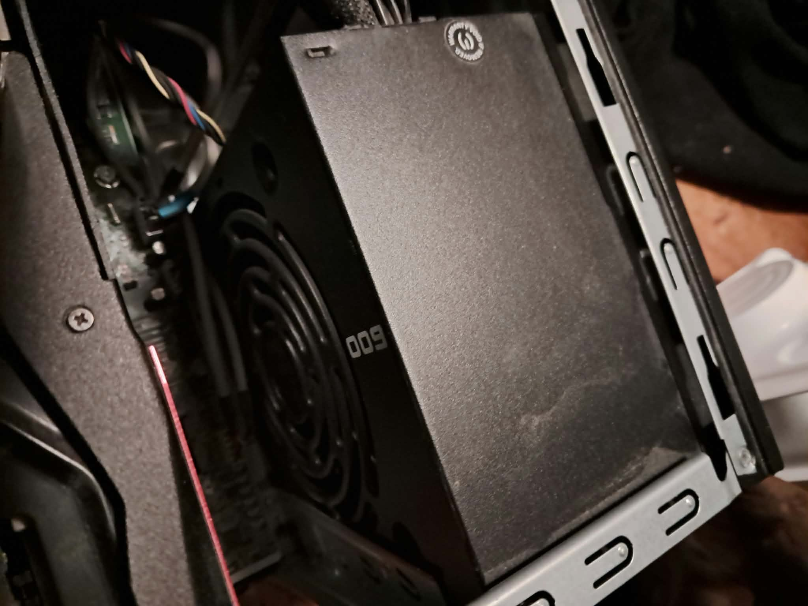
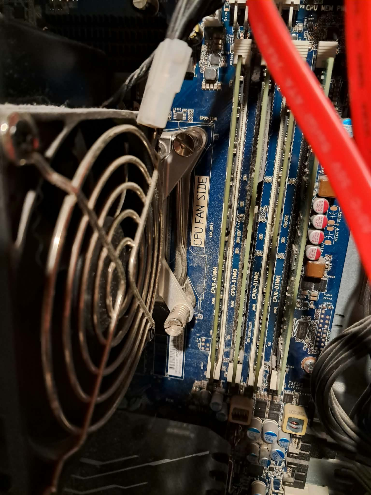
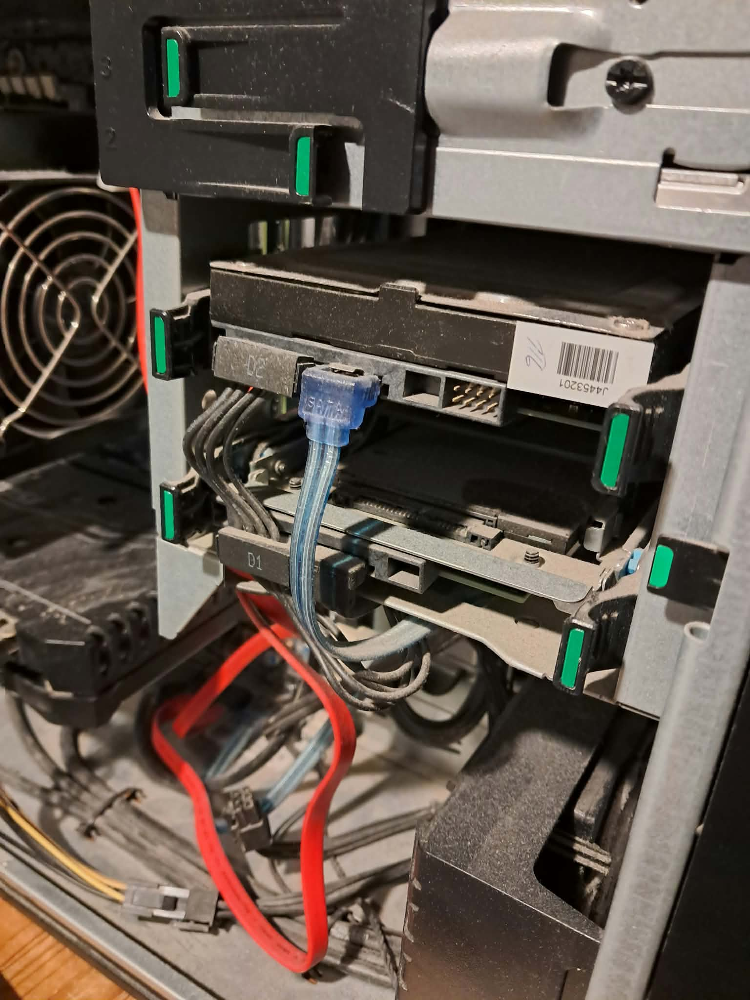

# PC hardware upgrades

Two home PC upgrade projects: component replacement on an older machine, and a memory and storage expansion on a newer one.

## 1. Old PC: CPU and PSU replacement, graphics card added

**Changes made**
- Replaced the processor
- Replaced the power supply unit
- Added a graphics card

**Notes**
- The case is a smaller model, so the support brackets had to be modified more heavily than usual to fit the new components.

*Inside of the PC after the upgrade: CPU cooler, graphics card and power supply.*

*Installed power supply unit (600 W).*

## 2. New PC: memory and hard drive added

**Changes made**
- Memory increased from 16 GB to 32 GB
- Hard disk drive (HDD) added

*Motherboard memory slots (CPU0-DIMM1 to DIMM4).*

*Drive bays and SATA cabling.*
