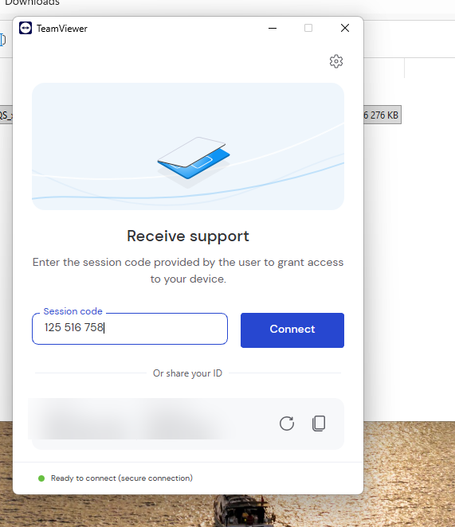
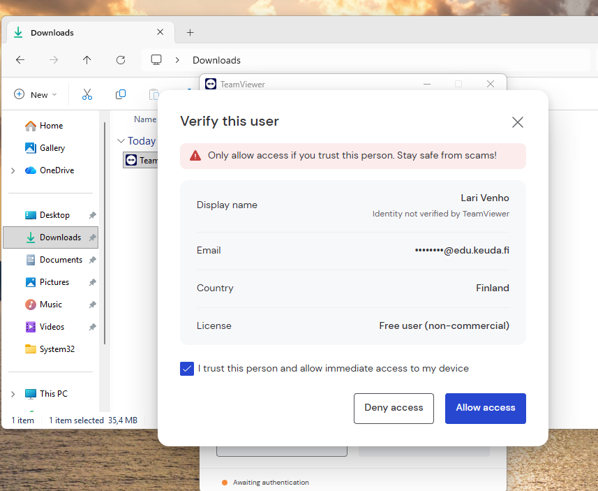
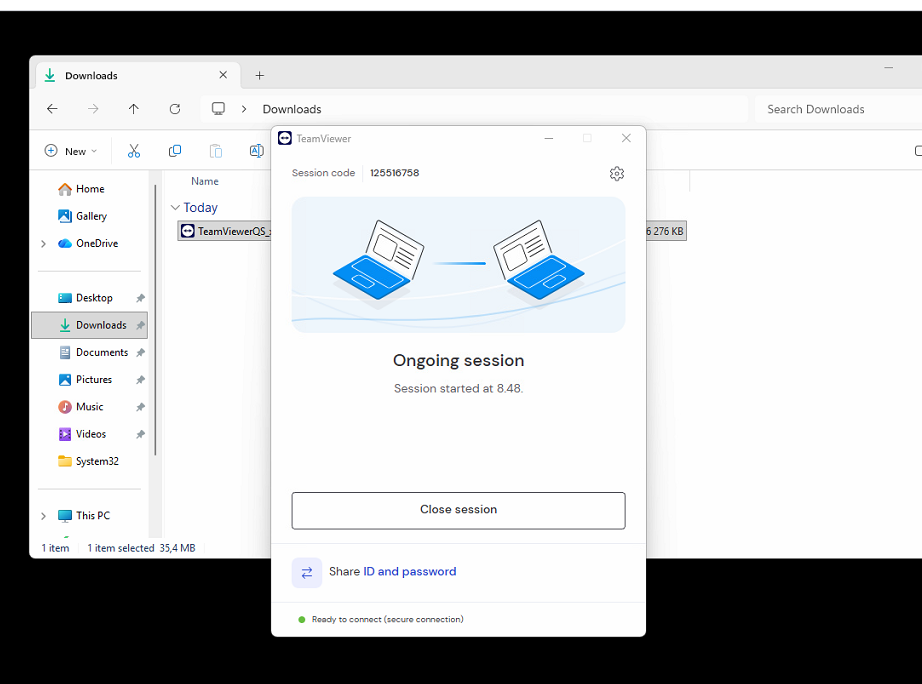
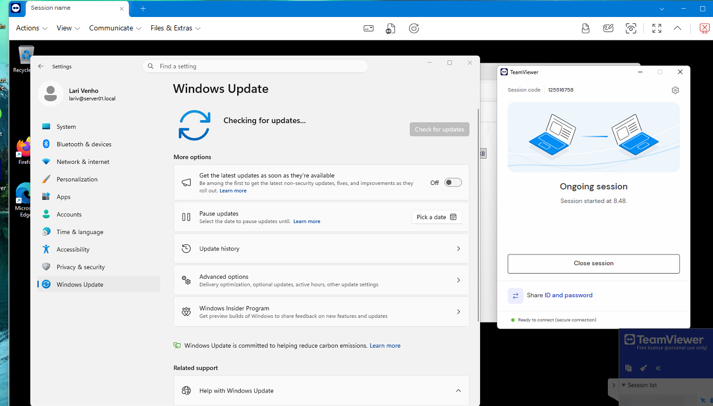
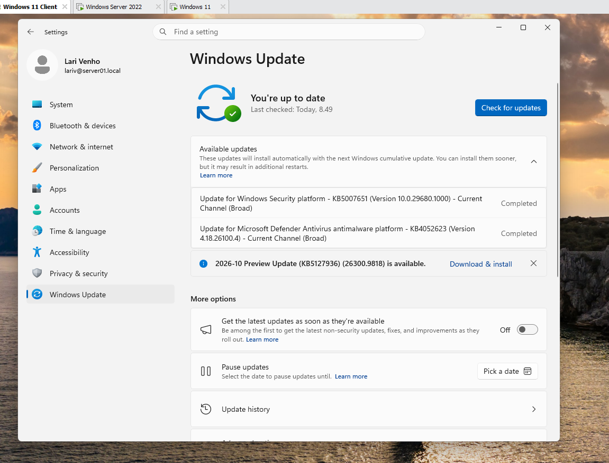
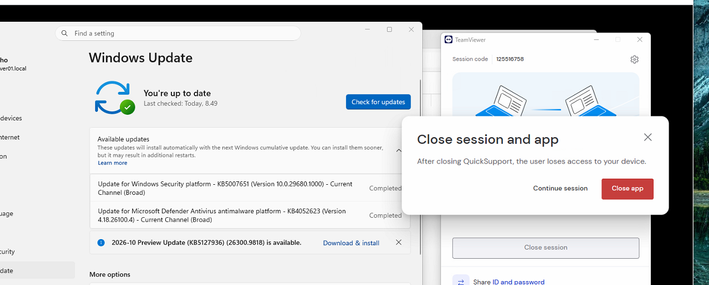

# TeamViewer remote support exercise

A remote support exercise done with two virtual machines. One machine is the helper (supporter) and the other is the person being helped. The helper creates a support session and a session code, the person being helped accepts the session and verifies the helper's identity, the helper then checks the update status on the remote desktop and runs the updates, and finally the session is closed.

## Procedure

### 1. The helper creates the session and the session code

The helper creates a support session in TeamViewer, which gives a session code (`125 516 758` in this exercise). The helper gives the code to the person being helped.

### 2. The person being helped enters the session code

On the machine that needs help, the TeamViewer QuickSupport file is run from the Downloads folder. The session code is entered in the **Receive support** window.

### 3. The person being helped verifies the helper

TeamViewer shows a **Verify this user** dialog with the helper's display name, masked email address, country and license type (free user, non-commercial). The dialog warns to allow access only if the person is trusted, and it notes that the identity is not verified by TeamViewer. After the helper's identity has been checked, the person being helped selects **I trust this person and allow immediate access to my device** and **Allow access**.

### 4. The session is ongoing

The TeamViewer window shows **Ongoing session**. The session started at 8:48.

### 5. The helper checks the update status

In the remote session the helper sees the desktop of the person being helped, opens **Settings > Windows Update** and selects **Check for updates**. The page shows **Checking for updates...**.

### 6. The updates are completed

After the check, Windows Update shows **You're up to date** (last checked at 8:49). Two updates are listed as **Completed**:

- Update for Windows Security platform, KB5007651 (version 10.0.29680.1000)
- Update for Microsoft Defender Antivirus antimalware platform, KB4052623 (version 4.18.26100.4)

A preview update, 2026-10 Preview Update (KB5127936), is shown as available, but it is not installed.

### 7. The session is closed

The session is ended with **Close session**. TeamViewer asks for confirmation in the **Close session and app** dialog and warns that after QuickSupport is closed, the helper loses access to the device. The app is closed with **Close app**.

