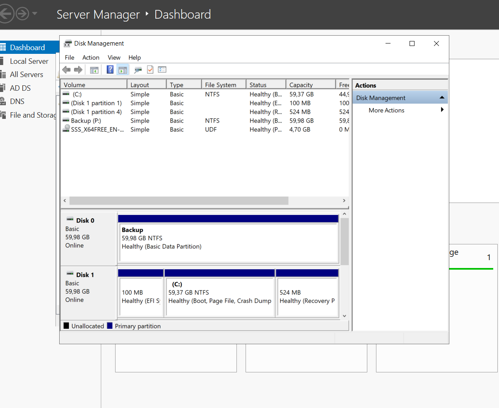
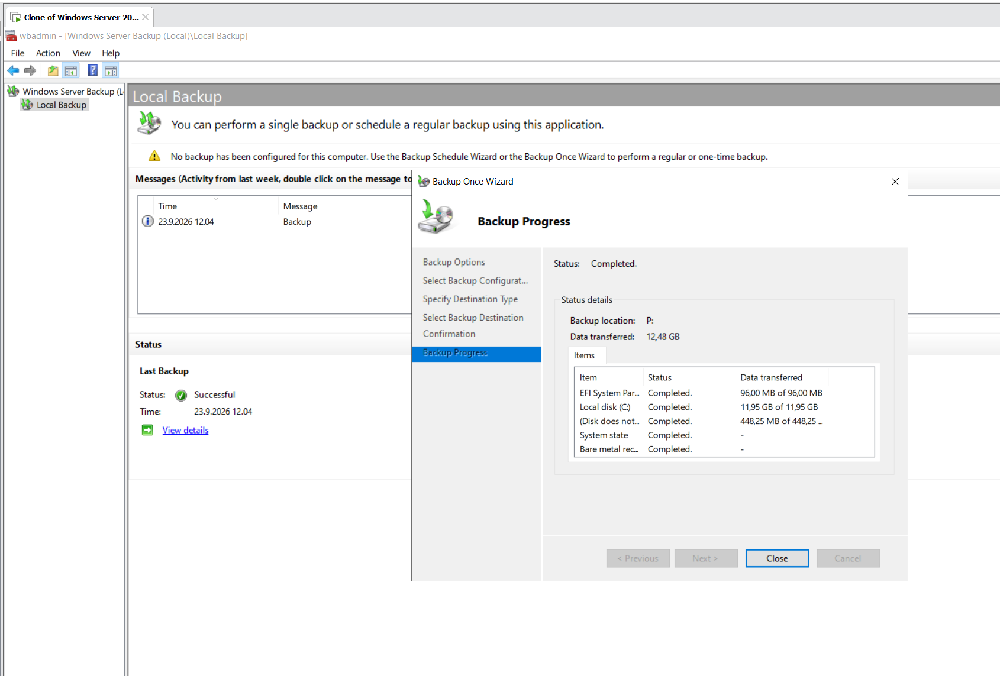
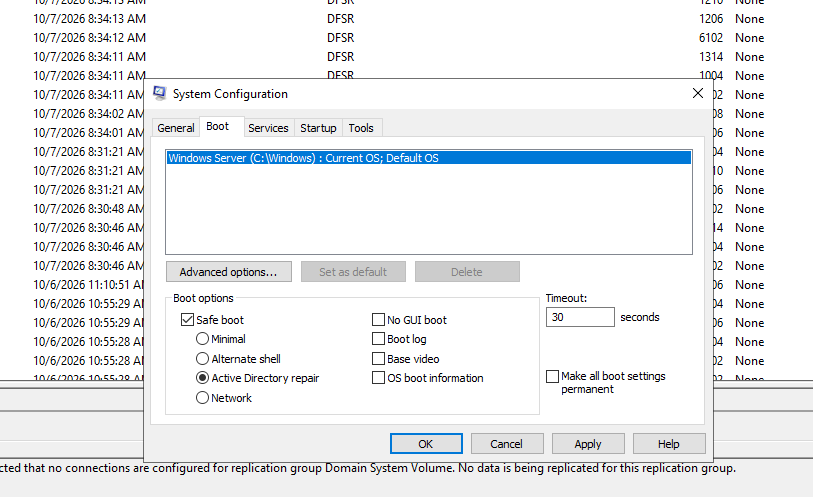
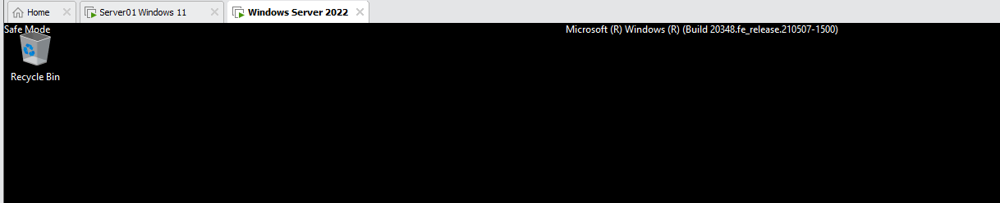
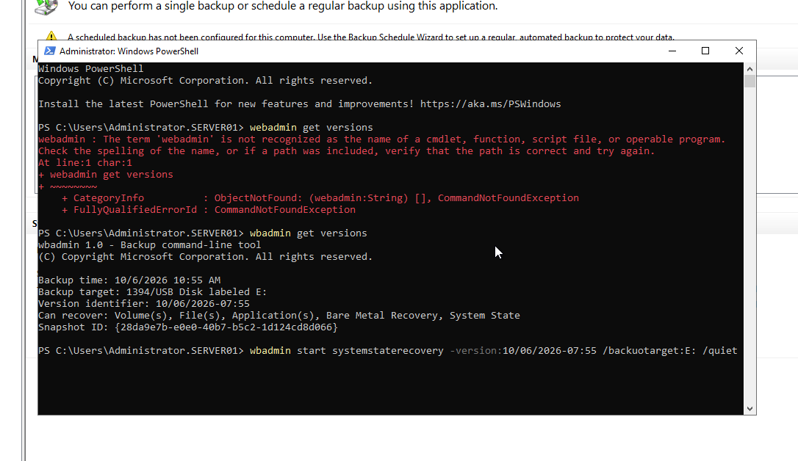
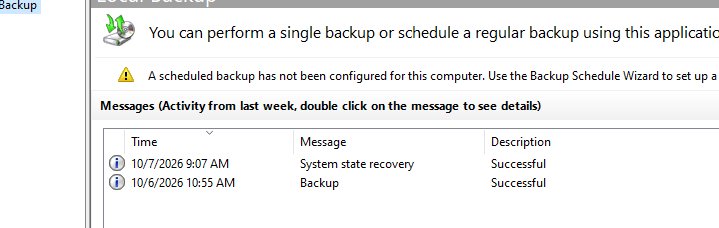
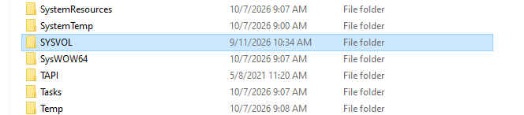

# Windows Server 2022: backup and restore

Two exercises on a Windows Server 2022 domain controller (AD DS, DNS) running in a VMware virtual machine:

1. [Full server backup](#1-full-server-backup): a full backup to a new disk
2. [Restore from backup](#2-restore-from-backup): recovering the domain controller from a System State backup after SYSVOL has been damaged

---

## 1. Full server backup

### Steps

| Step | Done |
|---|---|
| New disk | A new 60 GB virtual disk added to the server |
| Initialization | GPT partition table (partition type *Basic Data Partition*), NTFS, label **Backup**, drive letter **P:** |
| Feature | Windows Server Backup installed with *Add Roles and Features* in Server Manager |
| Backup | *Backup Once* > *Different options* > *Full server* > local drive P: |
| Result | Status *Completed*, 12.48 GB transferred; last backup *Successful* |

The full server backup contained all of these items:

| Item | Status | Transferred |
|---|---|---|
| EFI System Partition | Completed | 96 MB |
| Local disk (C:) | Completed | 11.95 GB |
| Recovery partition | Completed | 448 MB |
| System state | Completed | - |
| Bare metal recovery | Completed | - |

*System state* includes the Active Directory database (NTDS) and SYSVOL of the domain controller, so the domain can be restored from this backup. *Bare metal recovery* makes it possible to restore the whole server to an empty disk. The backup is stored in `P:\WindowsImageBackup\<server name>\`.

### Screenshots



*Disk Management: the new disk is online as Backup (P:), NTFS, 59.98 GB.*



*Windows Server Backup: the Backup Once wizard finished with status Completed and the last backup is Successful.*

---

## 2. Restore from backup

### Scenario

The environment is a Windows Server 2022 domain controller and a Windows 11 workstation joined to the domain. A shared folder is mapped as a drive and a wallpaper is set with Group Policy. A new System State backup is taken to another new disk (about 50 GB), and then the script `RenameSysvol.ps1` is run on the server as administrator.

### What the fault does

`RenameSysvol.ps1` renames the SYSVOL folder of the domain controller. SYSVOL contains the Group Policy files and logon scripts, so without it the workstations no longer get the policies: the network drive and the wallpaper disappear even though users can still sign in. The fault is fixed by restoring the System State of the domain controller from the backup.

### Restore steps

**1. Boot into Directory Services Restore Mode (DSRM).** The System State of a domain controller cannot be restored while AD is running. In `msconfig` select *Boot* > *Safe boot* > *Active Directory repair* and restart. In this mode you sign in with the local DSRM administrator account (the password that was set when the server was promoted to a domain controller).





**2. Find the backup version and restore the System State** (PowerShell as administrator):

```powershell
wbadmin get versions
wbadmin start systemstaterecovery -version:10/06/2026-07:55 -backupTarget:E: -quiet
```

`get versions` shows the version identifier of the backup and what can be recovered from it (volumes, files, applications, Bare Metal Recovery and System State). In DSRM the backup disk has the drive letter `E:`. The restore is non-authoritative by default, which is enough when the domain has only one domain controller.



**3. Boot normally.** After the restore, turn *Safe boot* off in `msconfig` and restart. The restore shows as successful in the Windows Server Backup log:



**4. Verify.** `C:\Windows\SYSVOL` is back in its original place and keeps its original creation date. When a user signs in on the workstation, the shared drive and the wallpaper are applied again by Group Policy. The DFSR event *no connections are configured for replication group Domain System Volume* is expected in a domain with a single domain controller (there is no replication partner).



## Lessons learned

- A domain controller must be started in DSRM before its System State can be restored.
- Drive letters can differ in DSRM. The backup disk was `P:` in normal mode but `E:` in DSRM, so check the letter with `wbadmin get versions` before restoring.
- A System State backup is enough to bring back SYSVOL and the Group Policy files, but only a full server backup also allows bare metal recovery.
