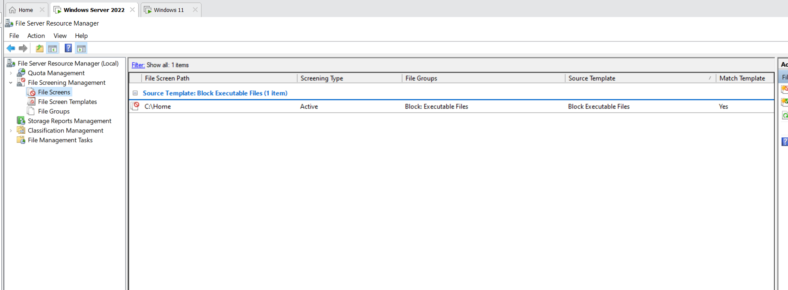
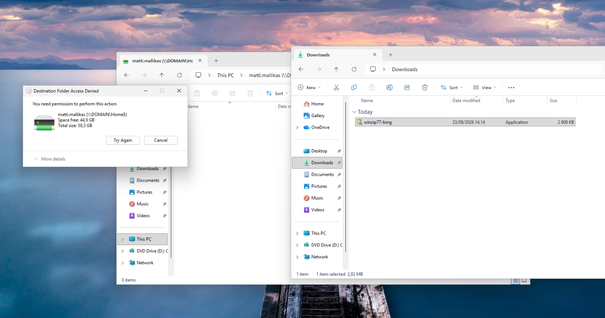

# Blocking executable files on a file server

Preventing executable files from being saved to the shared folders of a Windows Server 2022 file server, so that malware is not installed on the server by accident. The block is set up with a file screen in File Server Resource Manager (FSRM) and tested from a Windows 11 domain workstation.

## Task

Change the storage settings of the server so that `.exe` and `.com` files cannot be saved to the common network shares. The configuration is done in File Server Resource Manager.

## Configuration

1. Open **File Server Resource Manager** (Server Manager > Tools).
2. Go to **File Screening Management** > **File Screens** and create a new file screen.
3. Set the file screen path to the shared folder `C:\Home`.
4. Derive the file screen from the template **Block Executable Files**.
5. Leave the screening type as **Active**, so that saving a matching file is actually blocked (a passive screen only logs it).

The template uses the file group **Executable Files**, which contains `.exe` and `.com` files (and other executable file types).

*File Server Resource Manager: the file screen for `C:\Home` is Active and uses the file group Block: Executable Files from the template Block Executable Files. The filter shows that the template matches (Match Template: Yes).*

## Testing

On the Windows 11 workstation, a domain user (`matti.mallikas`) tries to copy an installer (`winzip77-bing.exe`) from the Downloads folder to the home folder on the server (`\\DOMAIN\Home$`). The copy is blocked with the message *Destination Folder Access Denied*.

*The `.exe` file cannot be saved to the home folder on the server.*

## Lessons learned

- A file screen works on the server side, so the block applies to every user and every client that saves files to the protected folder.
- The built-in template blocks more than `.exe` and `.com`. If only those two types should be blocked, create a custom file group with the patterns `*.exe` and `*.com` and a file screen template based on it.
- The screening type must be **Active** for the block to work.
