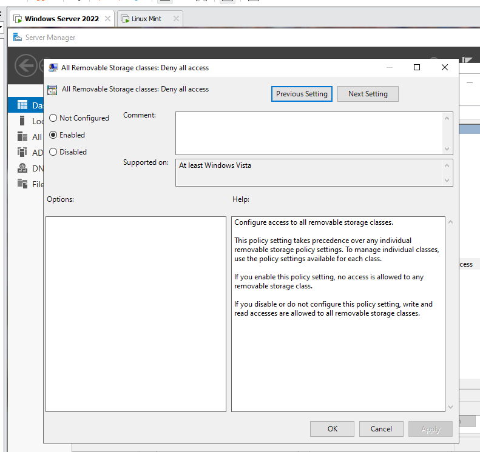

# Blocking USB storage devices with Group Policy

USB sticks can easily bring malware into a company's internal network. This project uses a Group Policy Object (GPO) to deny access to removable storage devices connected to the USB ports of domain computers. A keyboard and a mouse are not storage devices, so they keep working.

## Configuration

1. Open **Group Policy Management** on the domain controller and edit the GPO that applies to the users.
2. Go to **User Configuration** > **Policies** > **Administrative Templates** > **System** > **Removable Storage Access**.
3. Open the setting **All Removable Storage classes: Deny all access**.
4. Set it to **Enabled** and click **OK**.
5. To apply the policy on a client without waiting, run `gpupdate /force` and sign in again.

*Group Policy Management Editor: the setting All Removable Storage classes: Deny all access is Enabled.*

## What the setting does

When the setting is enabled, no access is allowed to any removable storage class (reading or writing). It takes precedence over the policy settings of the individual removable storage classes. If the setting is disabled or not configured, read and write access is allowed to all removable storage classes.

## Lessons learned

- The setting blocks **storage** devices (USB sticks, external drives and similar removable media), not every USB device, so keyboards and mice work normally.
- The same setting exists under both **Computer Configuration** and **User Configuration**. This project uses the User Configuration one, so it applies to the users the GPO is linked to.
- Together with [blocking executable files on the file server](../block-executable-files-fsrm/README.md) and [preventing application installation](../prohibit-user-installs-gpo/README.md), this limits the ways malware can enter a network through users.
