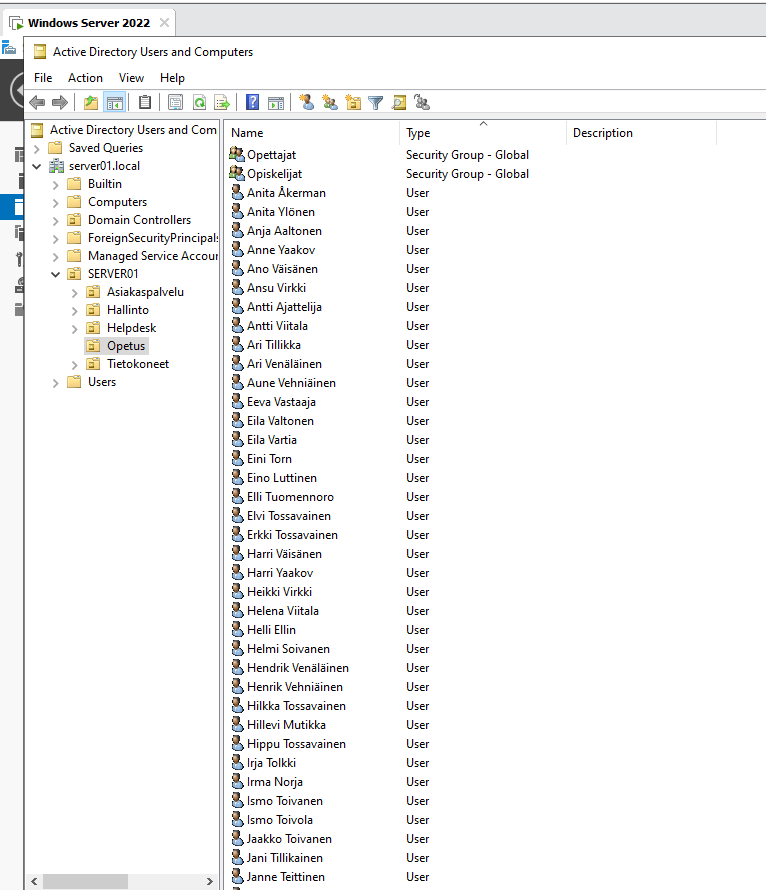
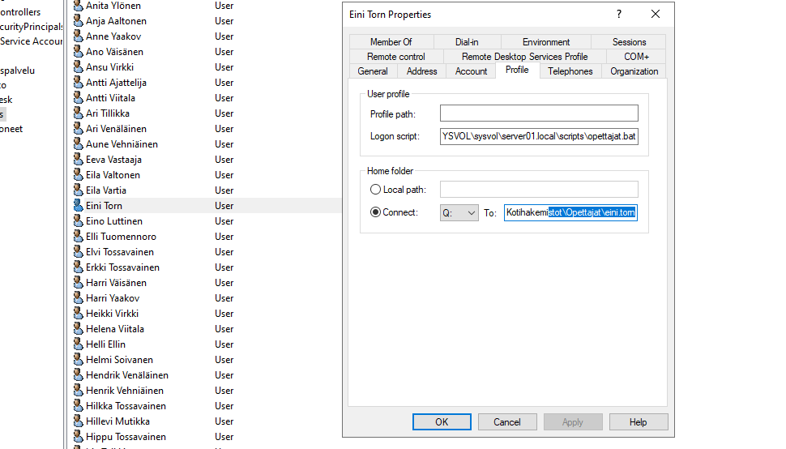
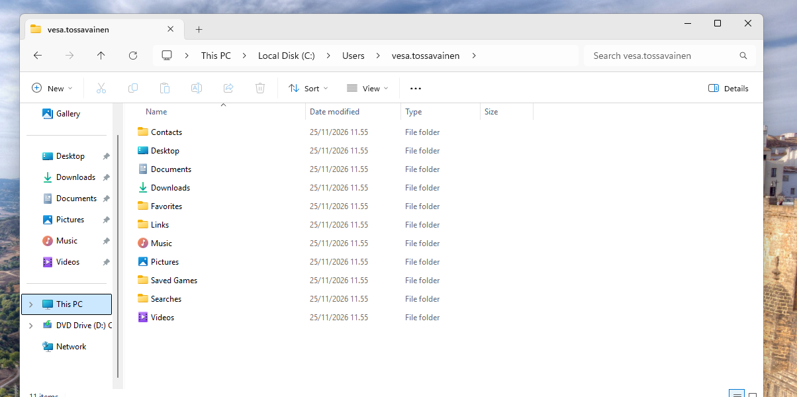
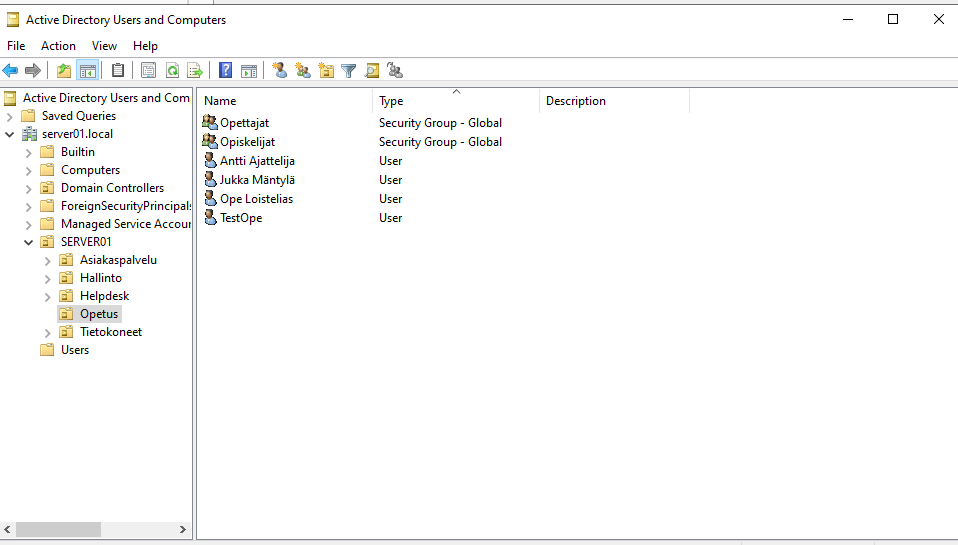
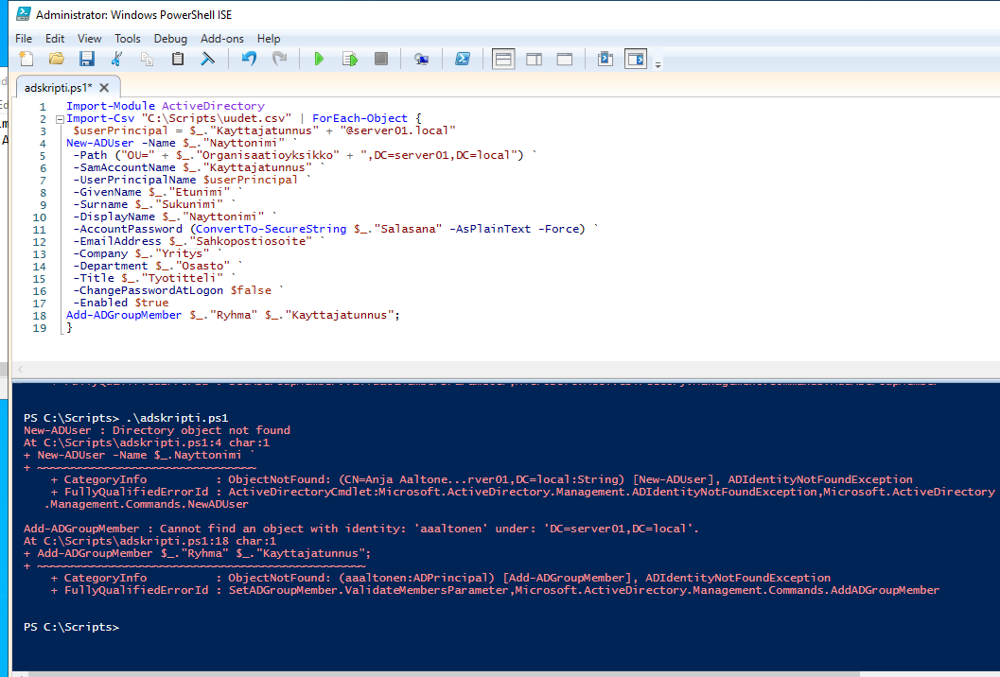
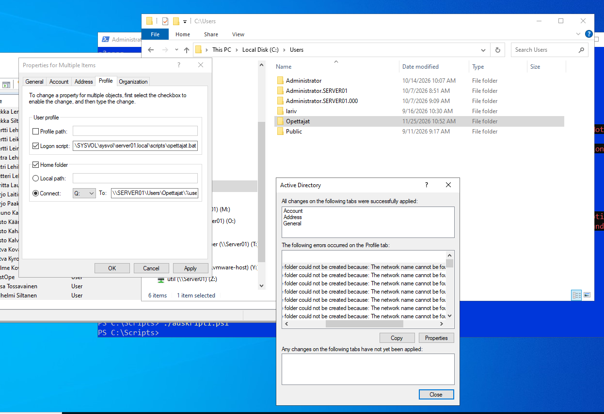

# Creating users in bulk with PowerShell

Active Directory exercise (Keuda) in a Windows Server 2022 environment. The domain is `server01.local` and the server is `SERVER01`. A Windows 11 virtual machine is used as the client.

When a school gets a large number of new users at once, creating the accounts one by one by hand is slow and causes typing mistakes. In this exercise 123 user accounts are created from a CSV file with a PowerShell script. Each user gets a home folder and a logon script.

## Result

All users are created in the `Opetus` organizational unit under `SERVER01` and are members of the `Opettajat` group.



*Active Directory Users and Computers: the Opetus OU contains the groups Opettajat and Opiskelijat and the new users, for example Anita Åkerman, Anja Aaltonen and Anne Yaakov. Names with å, ä and ö are shown correctly.*

The Profile tab of a user shows the logon script and the home folder, which is connected as drive `Q:`.



*Properties of Eini Torn: the logon script is `opettajat.bat` in the SYSVOL scripts folder and the home folder `...\Kotihakemistot\Opettajat\eini.torn` is connected as `Q:`.*

When a user signs in on the Windows 11 client, the profile folder of the user is created.



*The Windows 11 client after signing in as `vesa.tossavainen`: Windows has created the profile folder `C:\Users\vesa.tossavainen`.*

## The CSV file

The file [uudet.csv](scripts/uudet.csv) has one row per user. The column names are used by the script, so they must match exactly.

| CSV column | Example | Used for |
|---|---|---|
| Etunimi | Helli | `-GivenName` |
| Sukunimi | Ellin | `-Surname` |
| Nayttonimi | Helli Ellin | `-Name` and `-DisplayName` |
| Kayttajatunnus | helli.ellin | `-SamAccountName`, the user principal name `helli.ellin@server01.local` and the group membership |
| Organisaatioyksikko | Opetus | the OU in `-Path` |
| Salasana | (password) | `-AccountPassword` |
| Sahkopostiosoite | helli.ellin@mail.com | `-EmailAddress` |
| Yritys | Keuda | `-Company` |
| Osasto | Opetus | `-Department` |
| Tyotitteli | Opettaja | `-Title` |
| Ryhma | Opettajat | `Add-ADGroupMember` |

Example rows:

```
Etunimi,Sukunimi,Nayttonimi,Kayttajatunnus,Organisaatioyksikko,Salasana,Sahkopostiosoite,Yritys,Osasto,Tyotitteli,Ryhma
Helli,Ellin,Helli Ellin,helli.ellin,Opetus,ChangeMe123!,helli.ellin@mail.com,Keuda,Opetus,Opettaja,Opettajat
Anita,Åkerman,Anita Åkerman,anita.akerman,Opetus,ChangeMe123!,anita.akerman@mail.com,Keuda,Opetus,Opettaja,Opettajat
```

Notes about the user list:
- The usernames have the form `firstname.lastname`. The letters å, ä and ö are replaced with a and o in the usernames and e-mail addresses (`anita.akerman`), but the real names keep their letters.
- Marita Pia Piirainen has the username `marita.piirainen`.
- The name list contained Mika Mokkonen twice. Only one account is created for him, because two accounts cannot have the same name in the same OU.
- In this repository the password column is replaced with the placeholder `ChangeMe123!`. The real file used a password that meets the domain password policy.

## The script

The script [adskripti.ps1](scripts/adskripti.ps1) reads the CSV file and creates one user for each row.

```powershell
Import-Module ActiveDirectory
Import-Csv "C:\Scripts\uudet.csv" | ForEach-Object {
 $userPrincipal = $_."Kayttajatunnus" + "@server01.local"
New-ADUser -Name $_."Nayttonimi" `
 -Path ("OU=" + $_."Organisaatioyksikko" + ",OU=SERVER01,DC=server01,DC=local") `
 -SamAccountName $_."Kayttajatunnus" `
 -UserPrincipalName $userPrincipal `
 -GivenName $_."Etunimi" `
 -Surname $_."Sukunimi" `
 -DisplayName $_."Nayttonimi" `
 -AccountPassword (ConvertTo-SecureString $_."Salasana" -AsPlainText -Force) `
 -EmailAddress $_."Sahkopostiosoite" `
 -Company $_."Yritys" `
 -Department $_."Osasto" `
 -Title $_."Tyotitteli" `
 -ChangePasswordAtLogon $false `
 -Enabled $true
Add-ADGroupMember $_."Ryhma" $_."Kayttajatunnus";
}
```

| Part | What it does |
|---|---|
| `Import-Module ActiveDirectory` | Loads the Active Directory cmdlets such as `New-ADUser`. |
| `Import-Csv ... \| ForEach-Object {` | Reads the CSV file and runs the block once for each row. `$_` is the current row. |
| `$userPrincipal = ...` | Builds the user principal name, for example `helli.ellin@server01.local`. |
| `New-ADUser ...` | Creates the account. The backtick at the end of a line continues the command on the next line. |
| `-Path (...)` | The OU where the account is created, as a full distinguished name. The Opetus OU is inside the SERVER01 OU. |
| `-AccountPassword (ConvertTo-SecureString ...)` | Converts the plain text password in the CSV to a secure string. |
| `-ChangePasswordAtLogon $false` and `-Enabled $true` | The user does not have to change the password and the account is enabled immediately. |
| `Add-ADGroupMember` | Adds the user to the group named in the CSV (`Opettajat`). |

## Step-by-step procedure

### 1. Make the user list

1. The assignment gives a file with the names of the users. In Excel, add the columns from the table above next to the first names and last names.
2. Fill in the display name, the username (`firstname.lastname`), the organizational unit, the password, the e-mail address, the company, the department, the job title and the group.

### 2. Save as CSV and fix the file in Notepad

The Finnish version of Excel saves a CSV file with semicolons. The file was saved as CSV and opened in Notepad, where **Edit > Replace** was used to change:
- `;` to `,`
- `"""` to `"`

The letters å, ä and ö were checked at the same time, so that they are shown correctly. The file was saved as `C:\Scripts\uudet.csv`.

### 3. Practice with one user

The assignment recommends trying the script with one user first. The CSV had only the header row and one user, Anja Aaltonen (`aaaltonen`). Errors were fixed one by one (see Troubleshooting) until the account was created correctly.

### 4. Create all the users

Before the import the Opetus OU contained the groups Opettajat and Opiskelijat and four users.



*Active Directory Users and Computers: the Opetus OU under SERVER01 before the import, with the groups Opettajat and Opiskelijat and the users Antti Ajattelija, Jukka Mäntylä, Ope Loistelias and TestOpe.*

The CSV was extended to all the other users and the script was run in PowerShell ISE on `SERVER01`. The result is in the screenshot at the top of this page.

### 5. Add the home folders and logon script

The home folder and the logon script are added to all the new users at once:

1. In the Opetus OU, select all the new users (not the groups). Select **Properties** with the right mouse button.
2. Open the **Profile** tab. Select the checkbox of each field to enable the change.
3. **Logon script:** the file `opettajat.bat` in the SYSVOL scripts folder (`\SYSVOL\sysvol\server01.local\scripts\opettajat.bat`).
4. **Home folder:** select **Connect**, drive `Q:` and the path `\\SERVER01\Kotihakemistot\Opettajat\%username%`. `%username%` is replaced with the username of each user, so everyone gets their own folder.
5. Click **OK**.

The logon script [opettajat.bat](scripts/opettajat.bat) maps the network drive `T:` to the `asiakaspalvelu` share. The line that maps `M:` to the `hallinto` share is disabled with `rem`.

```bat
@echo off
net use t: \\Server01\asiakaspalvelu
rem net use m: \\Server01\hallinto
```

### 6. Test

Sign in to the Windows 11 client with one of the new users and check that the profile is created and the home folder and logon script work.

## Troubleshooting

The first versions of the script gave errors. These were fixed:

| Problem | Fix |
|---|---|
| `Import-Cvs` is not a command | The command is `Import-Csv`. |
| The script used `$_."samAccountName"`, `$_.Name` and `$_."ParentOU"`, but the CSV has no such columns | The variable names must match the CSV headers, for example `Kayttajatunnus`, `Nayttonimi` and `Organisaatioyksikko`. |
| `-Organisation` and `-Group` | The parameter for the company is `-Company`. `New-ADUser` has no `-Group` parameter, so the group is added with `Add-ADGroupMember`. |
| `New-ADUser : Directory object not found` | The path `OU=Opetus,DC=server01,DC=local` does not exist, because the Opetus OU is inside the SERVER01 OU. The correct path is `OU=Opetus,OU=SERVER01,DC=server01,DC=local`. |
| `Add-ADGroupMember : Cannot find an object with identity` | This is a follow-up error. The user was not created, so it could not be added to the group. |
| The password `1234` | The password must meet the domain password policy, so a stronger password is used in the CSV. |
| The home folder could not be created | See below. |



*PowerShell ISE: the first run failed with `Directory object not found` because the OU path was missing `OU=SERVER01`.*

When the home folder was first set, the path was `\\SERVER01\Users\Opettajat\%username%`. Active Directory showed the error "The network name cannot be found", because there was no share with that name. The other tabs were saved successfully. The home folder path was changed to a share that exists, `\\SERVER01\Kotihakemistot\Opettajat\%username%`.



*Properties for Multiple Items: the first attempt at the home folder failed on the Profile tab.*

## Lessons learned

- A script saves a lot of time with many users, but the column names in the CSV and the names in the script must match exactly. It is easiest to practice with one user first.
- `-Path` needs the full distinguished name of the OU, including every parent OU.
- The home folder and the logon script can be set for many users at once with **Properties** on a multiple selection in Active Directory Users and Computers. The share used in the home folder path must exist.
- If the script is run again with the same CSV file, `New-ADUser` gives an error for each existing user, so the file should only contain the new users.
- The CSV file contains plain text passwords and `-ChangePasswordAtLogon` is `$false`. This is acceptable in a lab, but in a real environment the file should be deleted after use and users should change the password at first logon.
