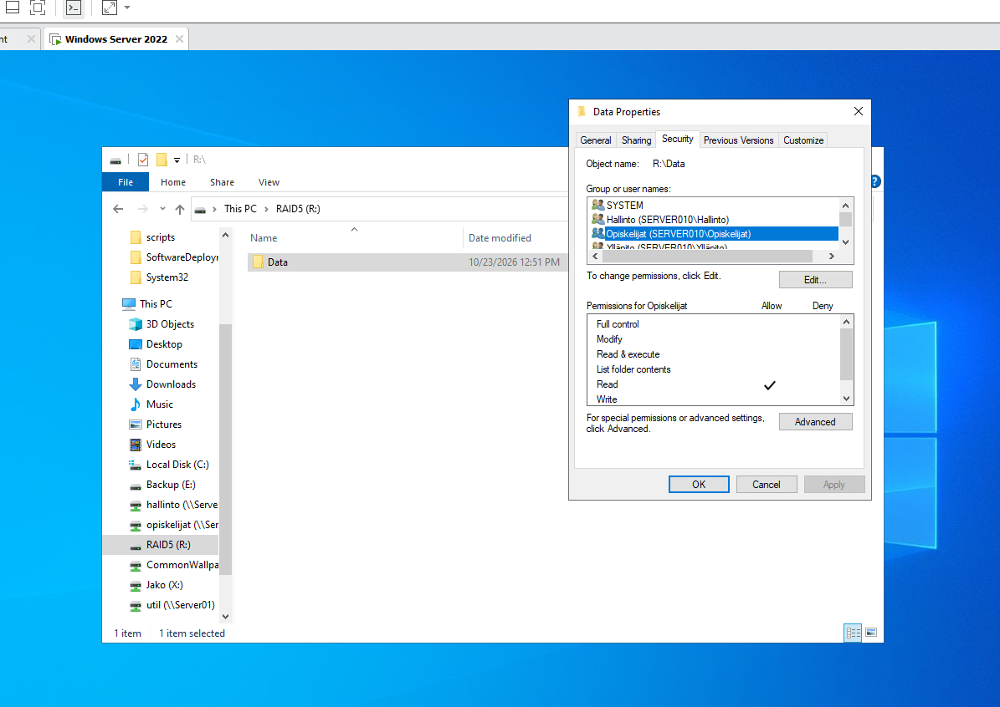
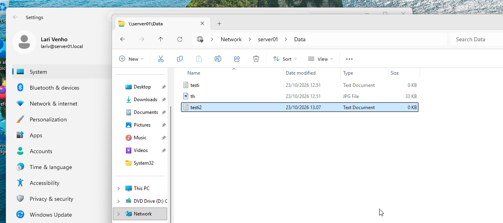
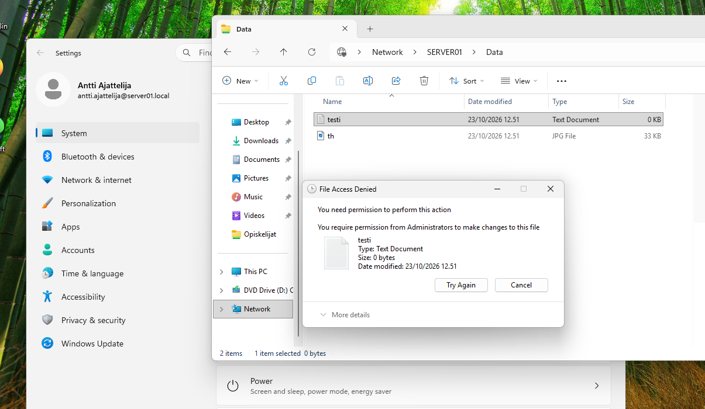

# Shared folder with group-based permissions

A shared folder `Data` on the RAID 5 drive (`R:`) of the server. Different user groups get different NTFS permissions to the folder, and the access is tested from a Windows 11 client with users from different groups.

## Steps

1. Create the folder `Data` on the RAID5 drive (`R:\Data`).
2. Share the folder: **Properties** > **Sharing** > **Advanced Sharing...** > **Share this folder**, with the share name `Data`. The folder is then available as `\\server01\Data`.
3. Set the permissions on the **Security** tab of the folder so that each user group has different rights:

   | Group | Permission |
   |---|---|
   | Ylläpito (administration) | Full control |
   | Hallinto (management) | Modify |
   | Opiskelijat (students) | Read |

4. Save some files in the folder (a text file and a JPG image, for example `testi.txt` and `th.jpg`).
5. Sign in on the Windows 11 client and open `\\server01\Data` in File Explorer.

*The Security tab of `R:\Data` on the server: the groups Hallinto, Opiskelijat and Ylläpito (and SYSTEM) have their own permissions. The group Opiskelijat is selected and has only the Read permission.*

## Testing

**Administration group (Ylläpito):** the user Lari Venho opens `\\server01\Data` on the client. The user can see the files and can create, edit and delete files, because the group has Full control. The file `testi2` has been created by this user.

*Lari Venho (`lari@server01.local`) in `\\server01\Data`: the files `testi`, `th` and the new file `testi2`.*

**Students group (Opiskelijat):** the user Antti Ajattelija signs in on the client and opens the same folder. The user can see and read the files, but trying to change a file gives the message *File Access Denied*, because the group only has the Read permission.

*Antti Ajattelija (`antti.ajattelija@server01.local`) in `\\SERVER01\Data`: *You require permission from Administrators to make changes to this file.**

## Lessons learned

- The permissions are given to groups, not to single users. A user gets the rights of all the groups they are a member of, so adding a user to a group changes their access without touching the folder.
- The effective permission of a shared folder is the more restrictive of the share permissions and the NTFS (Security) permissions. Here the access is controlled with the NTFS permissions.
- The same folder shows different possibilities to different users, which can be tested only by signing in as a user of each group.
