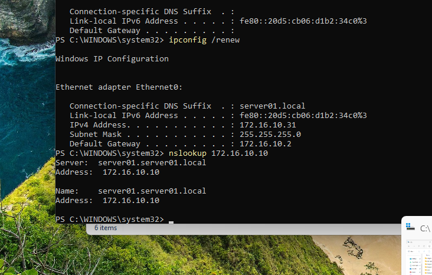
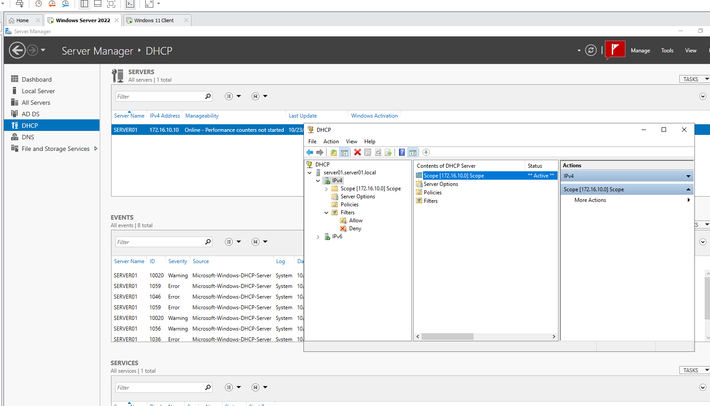
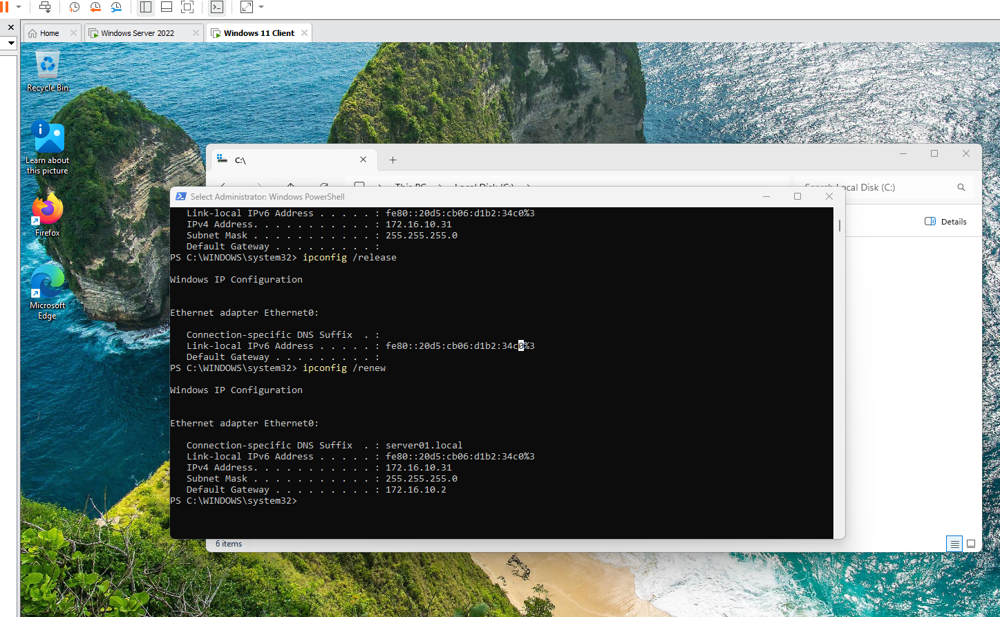

# DNS reverse lookup zone and DHCP server

Adding a reverse lookup zone to the DNS server of the `server01.local` domain, installing the DHCP server role on Windows Server 2022 and creating a scope that gives addresses to the Windows 11 client of the test network.

## Part 1: DNS reverse lookup zone

A reverse lookup zone makes it possible to find the host name of an IP address (a PTR record). It is the opposite of the normal forward lookup, which finds the IP address of a name.

1. Open **DNS Manager** on the server.
2. Right-click **Reverse Lookup Zones** and select **New Zone...**.
3. Create a primary zone for IPv4 with the network ID `172.16.10`. The zone is named `10.16.172.in-addr.arpa`.
4. Make sure that the server has a PTR record, so its address resolves to its name.

Test with `nslookup` on the client by giving an IP address:

```powershell
nslookup 172.16.10.10
```



*`nslookup 172.16.10.10` returns the name `server01.server01.local`, so the reverse lookup works. The address of the server that answers the query is `172.16.10.10`.*

## Part 2: DHCP server role and scope

### Install the role

1. In Server Manager, select **Manage** > **Add Roles and Features** and install the **DHCP Server** role.
2. Complete the post-installation configuration (authorize the DHCP server in Active Directory).

### Create the scope

In the DHCP console go to **IPv4** > **New Scope...** and set the following:

| Setting | Value |
|---|---|
| Name | A name that describes the address range |
| Description | The IP address range, the same as in the scope definition |
| Address range | `172.16.10.1` - `172.16.10.100`, subnet mask `255.255.255.0` (/24) |
| Exclusions | `172.16.10.1` - `172.16.10.30`, reserved for static addresses (servers, routers, switches, printers and so on) |
| Router (default gateway) | `172.16.10.2` |
| DNS domain | `server01.local` |
| DNS server | The server `172.16.10.10` |

The clients get addresses from the range `172.16.10.31` - `172.16.10.100`. Activate the scope when the wizard asks for it.

> **Note:** make sure that the servers do not start giving addresses outside the test network. In VMware the virtual network adapter must be a network (for example VMnet8 NAT) where the DHCP service of VMware is not in use, so that only the Windows Server hands out the addresses.



*The DHCP role in Server Manager and the DHCP console: the IPv4 scope `172.16.10.0` is active (`** Active **`).*

### Test on the client

On the Windows 11 client the address is released and renewed in PowerShell:

```powershell
ipconfig /release
ipconfig /renew
```

After `ipconfig /release` the adapter has no IPv4 address. After `ipconfig /renew` the client gets an address from the scope.



*The client receives the address `172.16.10.31` (the first address after the reserved range), the subnet mask `255.255.255.0`, the default gateway `172.16.10.2` and the DNS suffix `server01.local`.*

## Lessons learned

- Addresses for servers and network devices are reserved with an exclusion range, so that DHCP does not give them to clients. Here `172.16.10.1` - `172.16.10.30` is excluded, and the first client gets `172.16.10.31`.
- The scope options (router and DNS) are given to the clients with the lease, so the client does not need any manual settings.
- A second DHCP server on the same network can give wrong addresses to the clients, so the virtual network must not have another DHCP service.
- The reverse lookup is tested with `nslookup <IP address>`.
