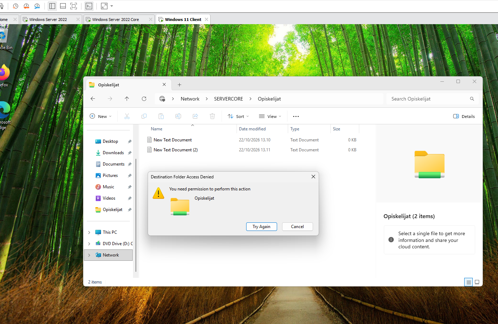
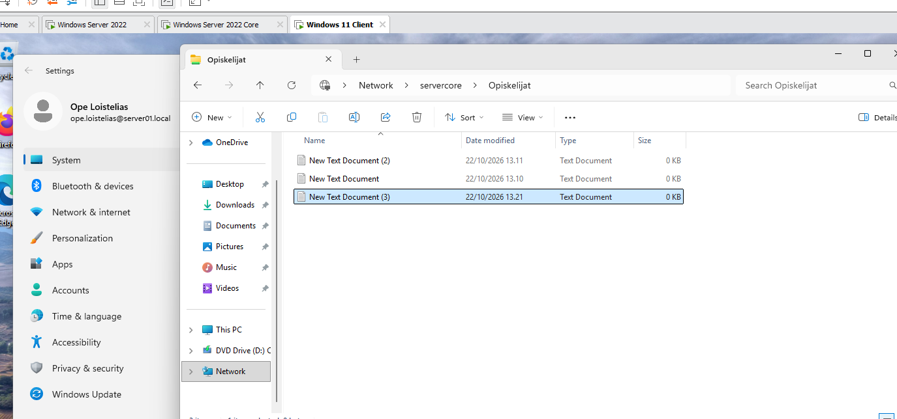

# File server on Windows Server Core

Installing the File Server role on the Windows Server 2022 Core server (`SERVERCORE`), sharing a folder with PowerShell and giving different permissions to two groups: teachers (administration) can read and write, students can only read. The result is tested from a Windows 11 client.

## Steps

All commands are run in PowerShell on the Server Core server. In the commands `DOMAIN` is the domain of the lab, `server01.local` (NetBIOS name `SERVER01`). The teachers' group is the administration group, `Ylläpito` (task note: "Opettajat = Ylläpito").

1. Sign in to the Server Core server, open PowerShell and check the name and IP address of the server:

   ```powershell
   hostname
   ipconfig
   ```

2. Install the File Server role and check that the installation succeeded:

   ```powershell
   Install-WindowsFeature FS-FileServer
   Get-WindowsFeature FS-FileServer
   ```

3. Create the folder and share it with the name `Opiskelijat`. Teachers get full access and students read access to the share:

   ```powershell
   New-Item -Path "C:\Jaettu" -ItemType Directory
   New-SmbShare -Name "Opiskelijat" -Path "C:\Jaettu" -FullAccess "DOMAIN\Opettajat" -ReadAccess "DOMAIN\Opiskelijat"
   ```

4. Set the NTFS permissions of the folder. `(OI)(CI)` makes the permission inherited by the files and folders inside, `F` is full control and `R` is read:

   ```powershell
   icacls "C:\Jaettu" /grant "DOMAIN\Opettajat:(OI)(CI)F"
   icacls "C:\Jaettu" /grant "DOMAIN\Opiskelijat:(OI)(CI)R"
   ```

5. On the client, open File Explorer and go to `\\servercore\Opiskelijat`.

## Testing

**Student:** a student user opens `\\SERVERCORE\Opiskelijat` on the Windows 11 client. The user can see the two text files that were created earlier, but trying to create a new file gives the message *Destination Folder Access Denied: You need permission to perform this action*. The group only has the read permission.



*The student sees the files `New Text Document` and `New Text Document (2)` in `\\SERVERCORE\Opiskelijat`, but creating a new file is denied.*

**Teacher:** the user Ope Loistelias (`ope.loistelias@server01.local`) opens the same share on the client and creates a new file, `New Text Document (3)`. The creation succeeds because the teachers' group has full access.



*The teacher user creates `New Text Document (3)` in `\\servercore\Opiskelijat`, so now there are three files in the folder.*

Result: teachers can read and write and students can only read, as required.

## Lessons learned

- The File Server role and the share can be installed and configured on Server Core completely with PowerShell (`Install-WindowsFeature`, `New-SmbShare`, `icacls`).
- A shared folder has two permission layers: the share permissions (`New-SmbShare`) and the NTFS permissions (`icacls`). The effective permission is the more restrictive of the two, so both should be set to match each other.
- Permissions are given to groups instead of single users. A user gets the rights of the groups they belong to, so access is changed by changing group membership.
- Permissions have to be tested by signing in as a user of each group, because the same folder behaves differently for different users.
