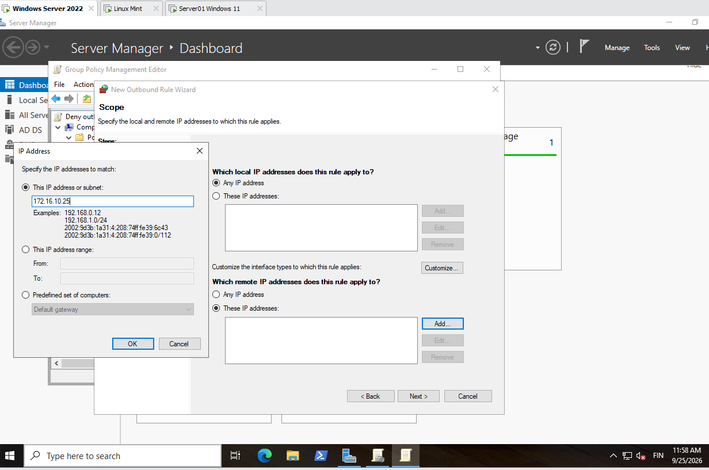
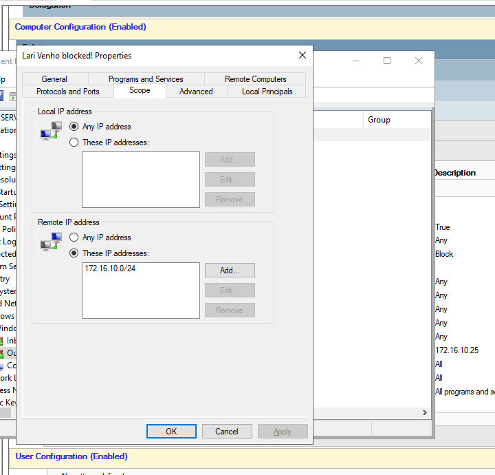
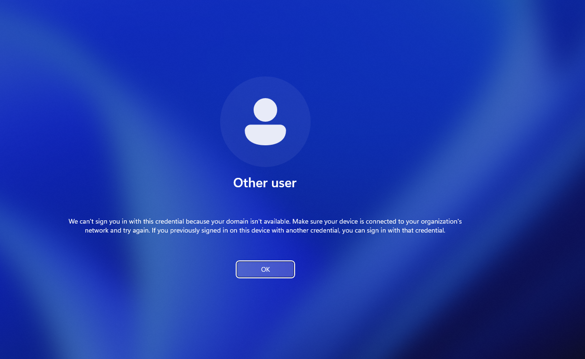

# Blocking network traffic with a firewall rule in Group Policy

An outbound Windows Defender Firewall rule is created in a Group Policy Object (GPO) to block the traffic of domain computers to a subnet of the internal network. The effect is tested on a Windows 11 client.

> **Warning:** a rule like this can lock clients out of the network. Take a snapshot of the test virtual machine before running `gpupdate /force` on it, or test on a client that is not needed otherwise. Remove the GPO after testing.

## Configuration

1. Open **Group Policy Management** on the domain controller and create or edit a GPO for the test computers.
2. Go to **Computer Configuration** > **Policies** > **Windows Settings** > **Security Settings** > **Windows Defender Firewall with Advanced Security** > **Windows Defender Firewall with Advanced Security** > **Outbound Rules**.
3. Right-click and select **New Rule...**.
4. **Rule Type:** Custom.
5. **Protocol and Ports:** Protocol type *Any*.
6. **Scope:** under *Which remote IP addresses does this rule apply to?* select **These IP addresses** and click **Add...**. Enter the address or subnet to block. The rule was first tested with a single address (`172.16.10.25`) and then extended to the whole subnet `172.16.10.0/24`.
7. **Action:** Block the connection.
8. Give the rule a name and finish the wizard.
9. On the test client, run `gpupdate /force` (after taking the snapshot).

*New Outbound Rule Wizard: the remote IP address `172.16.10.25` is added in the Scope step.*

*Properties of the rule: on the Scope tab the remote IP addresses are set to the subnet `172.16.10.0/24`. The rule is in Computer Configuration and its action is Block.*

## Testing

After the policy is applied, the Windows 11 client can no longer sign in with a domain account. The sign-in screen shows the message that the domain is not available: *We can't sign you in with this credential because your domain isn't available.* The traffic to the blocked subnet is stopped by the firewall rule.

*Windows 11 sign-in screen after the rule is applied.*

## Cleanup

The GPO is removed after the test and the policy is refreshed on the client, so the traffic is allowed again.

## Lessons learned

- A firewall rule in a GPO is applied to every computer in the scope of the GPO. A rule that blocks a whole subnet also blocks the servers in it, so domain sign-in and Group Policy can stop working.
- Taking a snapshot before `gpupdate /force` makes it easy to recover a client that has been locked out.
- Testing with a single address first and then with the subnet shows the effect step by step.
