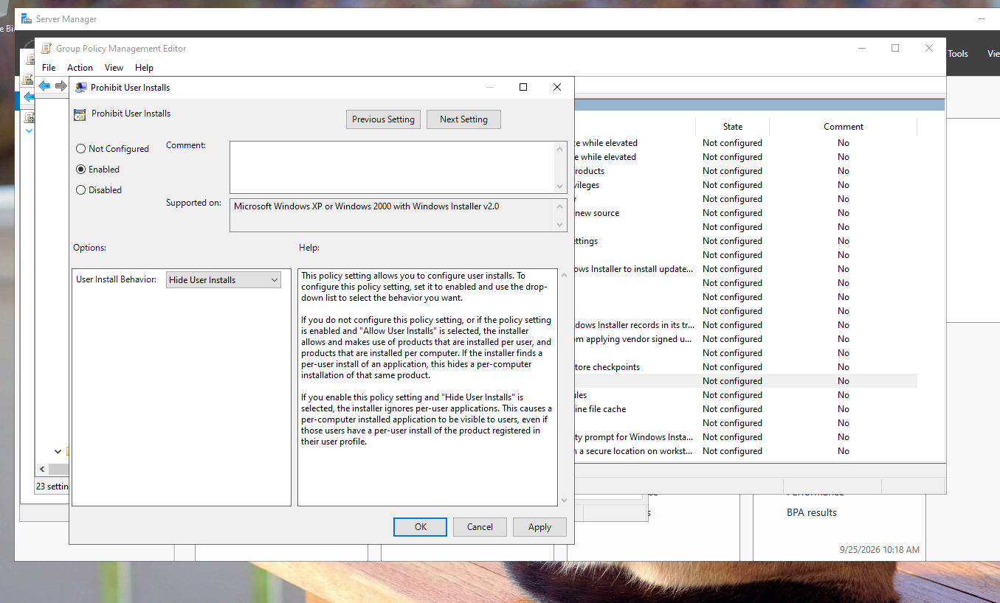

# Preventing application installation with Group Policy

Restricting application installation on domain computers with a Windows Installer policy in Group Policy.

## Configuration

1. Open **Group Policy Management** on the domain controller and edit the Group Policy Object (GPO) that applies to the computers.
2. Go to **Computer Configuration** > **Administrative Templates** > **Windows Components** > **Windows Installer**.
3. Open the setting **Prohibit User Installs**.
4. Set it to **Enabled** and select **Hide User Installs** in the *User Install Behavior* list.
5. Click **OK**.
6. To apply the policy on a client without waiting, run `gpupdate /force`.

*Group Policy Management Editor: the policy setting Prohibit User Installs is Enabled and User Install Behavior is Hide User Installs.*

## What the setting does

Windows Installer can install an application for the current user only (a per-user install) or for the whole computer (a per-computer install). With **Hide User Installs** selected, the installer ignores per-user applications, so only the applications installed for the whole computer are visible to users.

## Lessons learned

- *Prohibit User Installs* controls how per-user installations are handled. To block Windows Installer packages (`.msi`) completely, use the setting **Turn off Windows Installer** and set it to **Always**.
- Blocking installers is stronger when combined with file blocking on the server, as in [Blocking executable files on a file server](../block-executable-files-fsrm/README.md).
