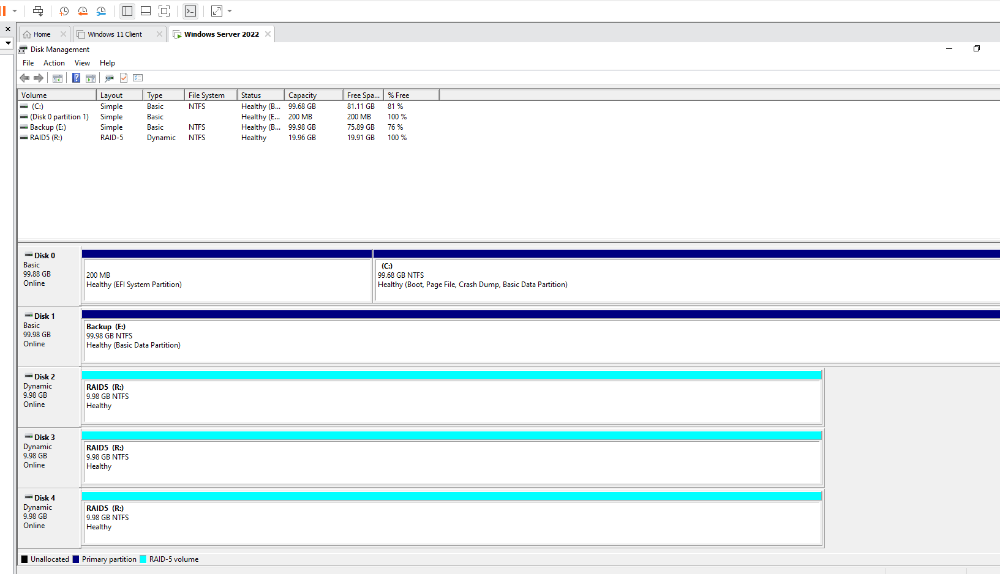
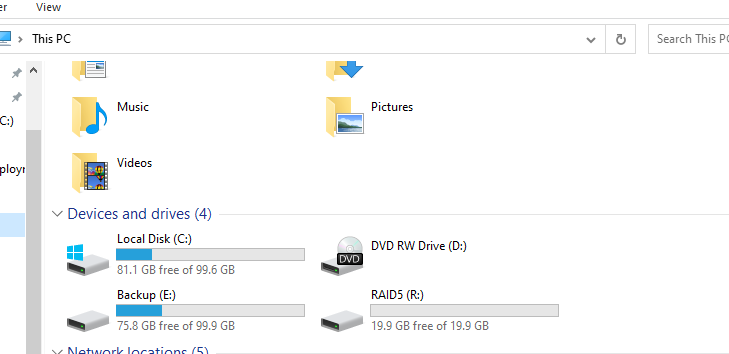

# Software RAID 5 volume on Windows Server 2022

Creating a RAID 5 volume from three additional virtual disks on a Windows Server 2022 server. The volume is made with dynamic disks in Disk Management.

## Steps

### 1. Add the disks

Three new 10 GB virtual disks are added to the server's virtual machine and named `Raid_1`, `Raid_2` and `Raid_3`.

### 2. Bring the disks online and convert them to dynamic disks

1. Start the server and open **Disk Management** (right-click the Start button > **Disk Management**).
2. Initialize the new disks when the wizard asks for it.
3. Convert the three disks to **dynamic disks**: right-click a disk and select **Convert to Dynamic Disk...**. A RAID 5 volume can only be made on dynamic disks.

### 3. Create the RAID 5 volume

1. Right-click the unallocated space of one of the new disks and select **New RAID-5 Volume...**.
2. Add the three disks (Disk 2, Disk 3 and Disk 4) to the selected disks.
3. Set the drive letter to **R**.
4. Format the volume as NTFS and set the volume label to **RAID5**.
5. Finish the wizard and wait until the volume status is **Healthy**.

*Disk Management: Disk 2, Disk 3 and Disk 4 are dynamic disks of 9.98 GB. Each of them holds a part of the RAID-5 volume `RAID5 (R:)`, NTFS, status Healthy. The volume list shows the layout RAID-5, type Dynamic and a capacity of 19.96 GB.*

### 4. Check the drive

The new drive `RAID5 (R:)` is visible in File Explorer under **This PC**, with 19.9 GB of free space.

*This PC: the drive RAID5 (R:) with 19.9 GB free of 19.9 GB, next to Local Disk (C:) and Backup (E:).*

## Lessons learned

- A RAID 5 volume uses three or more disks and stores parity information across them. If one disk fails, the data is still available, and the volume can be repaired by replacing the failed disk.
- The usable capacity is the total capacity minus one disk. Three 10 GB disks give about 20 GB of space (19.96 GB in Disk Management).
- Windows Server creates the RAID 5 volume in software, and it requires dynamic disks. Basic disks must first be converted.
- RAID is not a backup. It protects against the failure of one disk, but not against deleted files or a failure of the whole server.
