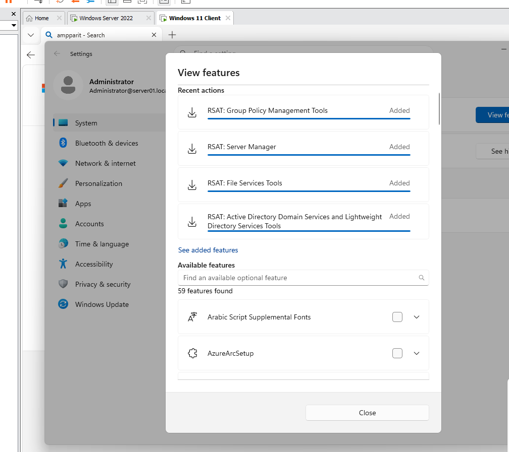
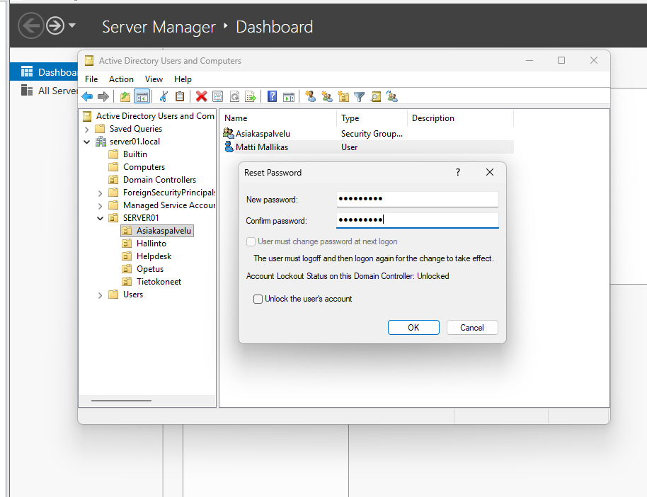
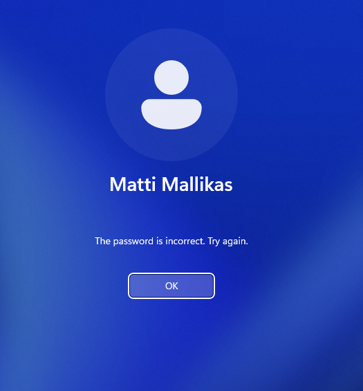
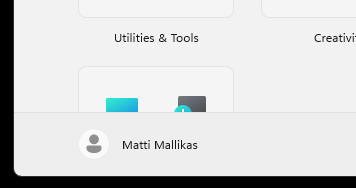

# Remote Server Administration Tools on a Windows 11 workstation

Installing Remote Server Administration Tools (RSAT) on a Windows 11 workstation that is joined to the `server01.local` domain, so that the domain can be managed from the workstation without logging in to the server. The tools are tested by resetting the password of a domain user.

## Installed tools

The following RSAT tools are installed (Windows 11 installs them as optional features):

- Active Directory Domain Services (AD DS) tools and Active Directory Lightweight Directory Services (AD LDS) tools
- File Services tools
- Group Policy Management tools
- Server Manager

### Installation

1. Sign in to the workstation with a domain administrator account.
2. Open **Settings** > **System** > **Optional features**.
3. Click **View features** and search for `RSAT`.
4. Select the four features above and click **Add**.
5. Wait until all features are shown as **Added** in the recent actions.

*Optional features on the Windows 11 client (signed in as `Administrator@server01.local`): RSAT: Group Policy Management Tools, Server Manager, File Services Tools and Active Directory Domain Services and Lightweight Directory Services Tools are all Added.*

After the installation the tools are found in the Start menu under **Windows Tools**: *Active Directory Users and Computers*, *Group Policy Management*, *Server Manager* and others.

## Testing: reset the password of a user

The test user is `Matti Mallikas` in the organizational unit structure under `server01.local`.

1. On the workstation, open **Active Directory Users and Computers**.
2. Right-click the user and select **Reset Password...**.
3. Enter the new password twice and click **OK**.

*Active Directory Users and Computers on the workstation: the password of the user Matti Mallikas is reset in the Reset Password dialog. The account is not locked.*

Check the result by signing in as the user:

- The old password no longer works:

  

  *The sign-in screen says that the password is incorrect when the old password is used.*

- The new password works:

  

  *The user Matti Mallikas is signed in with the new password.*

## Lessons learned

- With RSAT the domain can be administered from a normal workstation, so there is no need to use the server console or a remote desktop session for everyday tasks such as password resets and Group Policy editing.
- RSAT tools are installed as optional features of Windows 11 and the tools run with the rights of the signed-in account. A domain administrator account is needed to reset passwords.
- When a password is reset, the old password stops working immediately, but a signed-in user must sign out and sign in again for the change to take effect.
