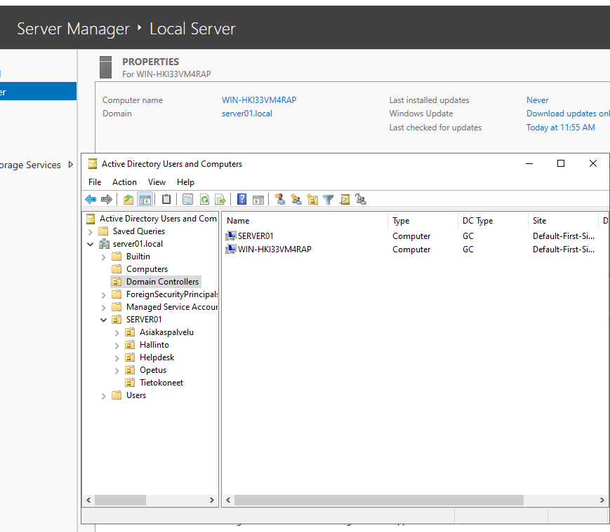
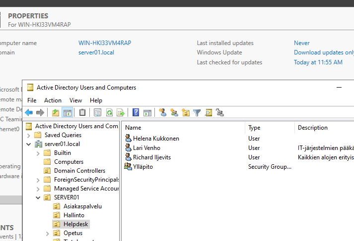
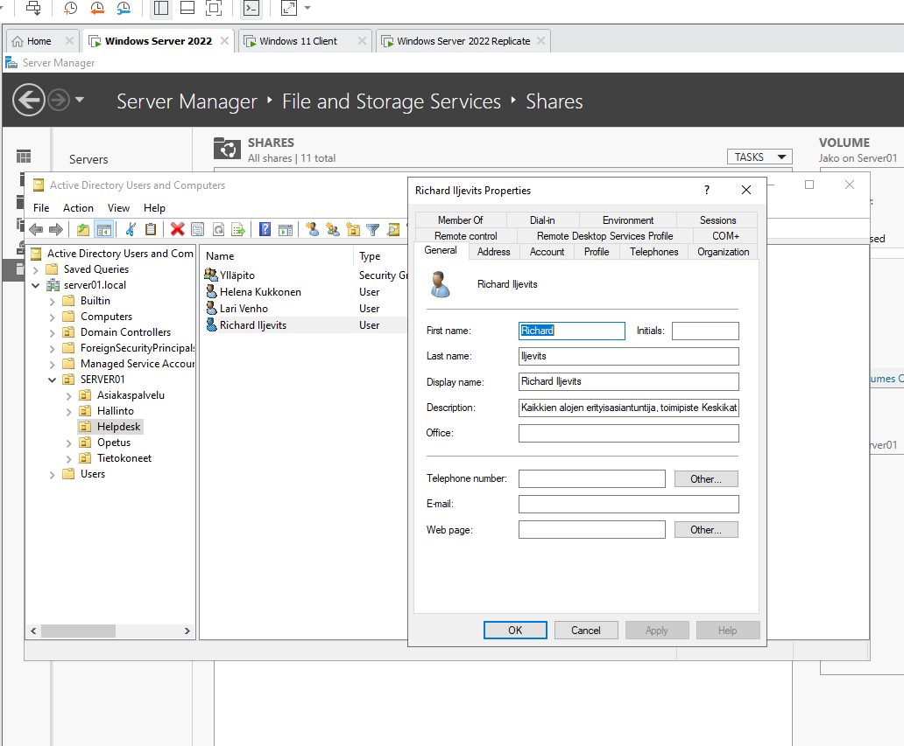

# Second domain controller and replication

Adding a second Windows Server 2022 domain controller to the existing `server01.local` domain and testing Active Directory replication by creating a user on the second server and checking that it appears on the original domain controller.

## Steps

1. Install a new Windows Server 2022 virtual machine.
2. Give the server a static IP address in the same network as the first domain controller and set the first domain controller (`172.16.10.10`) as its DNS server, so that the server can find the domain.
3. Join the server to the `server01.local` domain.
4. Install the **Active Directory Domain Services** role in Server Manager.
5. Promote the server to a domain controller: select **Add a domain controller to an existing domain**, enter the domain `server01.local`, keep **DNS server** and **Global Catalog** selected and set the Directory Services Restore Mode (DSRM) password.
6. Restart the server. The server is now a second domain controller of the domain.

The Domain Controllers organizational unit shows both domain controllers, `SERVER01` and `WIN-HKI33VM4RAP`. Both are global catalog servers (GC) in the site `Default-First-Site-Name`.

*Active Directory Users and Computers on the second server: the Domain Controllers OU contains SERVER01 and WIN-HKI33VM4RAP, both GC.*

## Testing replication

A new user is created on the **second** domain controller in the `Helpdesk` organizational unit:

| Property | Value |
|---|---|
| Name | Richard Iljevits |
| User logon name | `richardi` |
| Title | vuorovaravaurioratkaisupäällikkö |
| Description | Kaikkien alojen erityisasiantuntija, toimipiste Keskikatu |
| Groups | Domain Users, Domain Admins, Enterprise Admins |

*The user Richard Iljevits is created in the Helpdesk OU on the second domain controller (WIN-HKI33VM4RAP).*

The new user appears immediately on the original domain controller `SERVER01`, which means that the replication between the domain controllers works.

*Active Directory Users and Computers on SERVER01: Richard Iljevits is in the Helpdesk OU and the Properties window shows the description.*

## Lessons learned

- A second domain controller gives redundancy: if one server is down, the other can still authenticate the users. The changes are copied between the servers with Active Directory replication, so a change made on either server is visible on both.
- The new server must use the first domain controller as its DNS server before it can join the domain.
- The user in this test is a member of powerful groups (Domain Admins and Enterprise Admins). This is acceptable in a lab, but in a real environment these groups should only contain the accounts that really need them.
