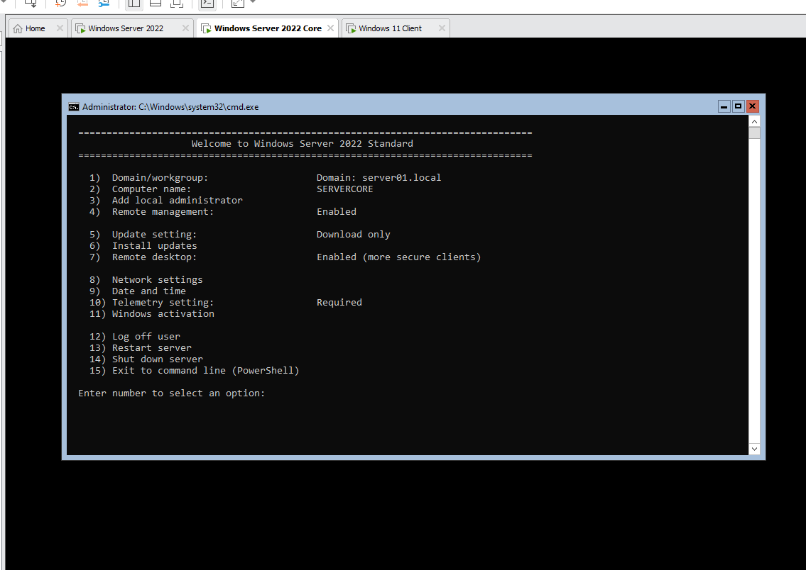
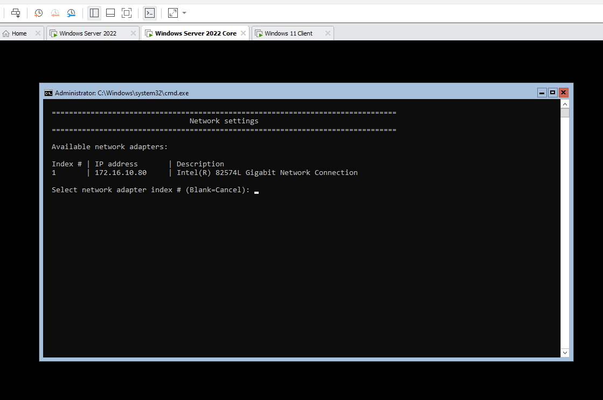
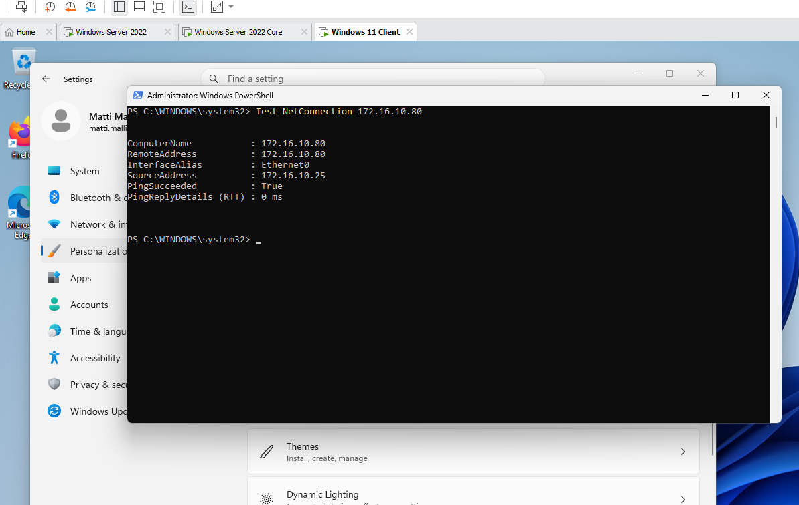

# Windows Server 2022 Core and domain join

Installing a Windows Server 2022 Standard server with the Server Core installation option (no graphical desktop), configuring it with the `sconfig` tool, joining it to the `server01.local` domain and testing the connection from a Windows 11 client.

## Steps

1. Create a new virtual machine and install **Windows Server 2022 Standard** with the Server Core option (without Desktop Experience).
2. Set the password of the local administrator when the installation asks for it. After signing in, the server shows a command prompt and starts the configuration tool `sconfig` (in a PowerShell window, `sconfig` starts it again).
3. In `sconfig`, change the computer name with option **2** (`SERVERCORE`).
4. Set a static IP address with option **8** (Network settings): select the network adapter and give it the address `172.16.10.80`. The DNS server of the server must be the domain controller, so that the server can find the domain.
5. Join the server to the domain with option **1** (Domain/workgroup): select **D** for domain, give the domain `server01.local` and a domain account that is allowed to join computers, and restart the server.
6. Turn on **Remote management** (option **4**) and **Remote desktop** (option **7**) so that the server can be managed from other computers.



*The `sconfig` menu of Windows Server 2022 Standard: the domain is `server01.local`, the computer name is `SERVERCORE`, remote management is enabled and remote desktop is enabled (more secure clients).*



*Network settings in `sconfig`: the network adapter (Intel(R) 82574L Gigabit Network Connection) has the IP address `172.16.10.80`.*

## Testing the connection from the client

On the Windows 11 client the connection to the server is tested in PowerShell:

```powershell
Test-NetConnection 172.16.10.80
```



*The test from the client (`172.16.10.25`) to `172.16.10.80` succeeds: `PingSucceeded : True`, round-trip time 0 ms.*

## Lessons learned

- Server Core has no graphical desktop, so it uses fewer resources, needs fewer updates and has a smaller attack surface than a server with the desktop.
- `sconfig` gives the basic settings of the server (name, network, domain, updates, remote management) from a menu. Other tasks are done with PowerShell or remotely with tools such as Server Manager and the Remote Server Administration Tools (RSAT) on a client.
- Remote management has to be enabled in order to manage the server from another computer.
- The server must use the domain controller as its DNS server, otherwise it cannot find and join the domain.
